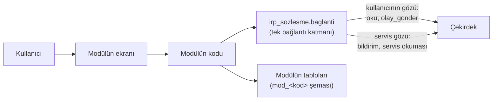

# 01 · Bağlantı: modül çekirdekle nasıl konuşur

## 1. Bir bakışta



- **İki göz:**
  - **Kullanıcının gözü:** Okuma ve olay kullanıcının oturumuyla yapılır. Çekirdek o kişinin yetkisini ve görme kurallarını uygular. Modül kullanıcının yetkisini genişletemez.
  - **Servis gözü:** Modülün kendi kimliği (`SRV-<kod>`). Yalnızca bildirim bırakmak ve kişisel olmayan veriyi okumak içindir. Servis gözüyle olay yazılmaz.
- **Sürücü:** Bağlantı katmanının altında bir sürücü çalışır. Modülün kodu sürücüyü bilmez.
  - Geliştirirken **simülatör**: çekirdeğin Python modeli, modülün yanında.
  - Bağlanınca **HTTP**: çekirdeğin ortak modül geçidi; gerçek buluta normal kullanıcı oturumuyla gider.

  Seçim ortam değişkenlerindedir (bölüm 2.1). Bunu biz ayarlarız.

## 2. Python

```python
from irp_sozlesme.baglanti import Cekirdek, CekirdekHatasi

cekirdek = Cekirdek.ac('kunye.json')
```

### 2.1 Açmak

| Çağrı | Ne yapar |
|---|---|
| `Cekirdek.ac(kunye_yolu, sayac=None)` | Künyeyi okur, sürücüyü ortam değişkenlerinden seçer: `IRP_CEKIRDEK=simulator` (varsayılan) ya da `http`. `http` için `IRP_TABAN`, `IRP_ANON`, `IRP_SERVIS`. Bunların değerlerini biz veririz |
| `cekirdek.oturum(erisim_anahtari)` | **Üründe kullanıcının gözü budur.** Kullanıcı çekirdeğin girişiyle girer; modülün ekranı onun erişim anahtarını (JWT) modülün arka yüzüne iletir; arka yüz bununla oturum açar. Modül şifre görmez, saklamaz |
| `cekirdek.giris(kisi, sifre)` | Geliştirme ve deneme içindir. Simülatörde şifre denetlenmez |
| `cekirdek.servis()` | Servis gözü. Künyede `arka_yuz: true` olmalı |
| `cekirdek.simdi()` | Çekirdeğin saati (ISO 8601, `+03:00`). Modül kendi saatini olaya yazmaz |

### 2.2 Okumak (kullanıcının gözü)

```python
oturum = cekirdek.oturum(anahtar)
okuma = oturum.oku('NESNE', 'K006-2610280001-P')
okuma.deger      # okunan veri
okuma.guncel     # False ise çekirdek hâlâ hesaplıyor: ekranda "hesaplanıyor" yaz, eski veriyi güncel diye gösterme
```

- **Okuma adları ve parametreleri:**
  - `kaynak/02_modul_sozlesmesi.md` › 2
  - kim neyi görür: `kaynak/16_okumalar.md` › 4
- **Künyede beyan:** Modülün kullandığı okumalar künyenin `kapilar.okumalar` listesinde yazılır.
- **Hata:** Göremediği veride `CekirdekHatasi('YETKI', ...)`, tanımsız okumada `CekirdekHatasi('BICIM', 'TANIMSIZ_VERI')`.
- **`surum`:** Okunan her kayıt satırı `surum` taşır. Yönetim kararı verirken o sürümü geri gönderirsin (2.3).

### 2.3 Olay göndermek (kullanıcının gözü)

```python
parca = oturum.oku('NESNE', kimlik).deger
cevap = oturum.olay_gonder(
    'NESNE.ASAMA_GECIRDIM',
    {'hedef': kimlik, 'yeni_asama': 'SIPARISTE', 'gerekce': 'sipariş verildi'},
    neyin_ustunde=[oturum.hedef('NESNE', parca)])     # okunan sürümle
if cevap.basarili: ...
elif cevap.bayat: ...       # kayıt bu arada değişti: yeniden oku, kullanıcıya göster, yeniden sor
else: cevap.kod, cevap['neden']
```

**Olayın künyesini bağlantı katmanı kurar; sen yalnızca eylem ve girdileri verirsin:**
- `kim`: oturumdaki kişi
- olay kimliği: kişi + gün + sıra + modülün harfi (`K006-2610280001-P`)
- `cihaz`: `MODUL-<kod>`
- `oldugu_an`: çekirdeğin saatiyle, hep artan
- uygulama sürümü: `<kod>-<sürüm>`

**Şartlar:**
- Künyede `olay_yolu: ARKA_YUZ` ve `cihaz_harfi` olmalı.
- Eylem `kapilar.olaylar` listesinde olmalı. Değilse `CekirdekHatasi('KUNYE', ...)`.

**Girdiler:**
- Her eylemin girdi şeması `simulator/olay_semasi.json`'da.
- Sık kullanılanlar `kaynak/02_modul_sozlesmesi.md` › 3'te.

**Cevap** (`Cevap`, bir sözlük):

| `sonuc` / `kod` | Anlamı | Modül ne yapar |
|---|---|---|
| `BASARILI` | Kabul edildi. `tekrar: true` ise bu olay zaten vardı (ağ kesilip yeniden gönderilmiş) | Devam |
| `REDDEDILDI` / `BICIM` | Girdi eksik ya da yanlış | Modülün hatası; düzelt |
| `REDDEDILDI` / `YETKI` | Kullanıcının bu işe yetkisi yok | Kullanıcıya "yetkiniz yok" de; etrafından dolaşma |
| `REDDEDILDI` / `DURUM` | İş bu durumda yapılamaz (ör. son aşamadaki nesne) | Kullanıcıya nedeni göster |
| `REDDEDILDI` / `BAYAT` | Karar verilen kayıt arada değişti. `neden: SIRA` ise aynı ana dayanan bir karar var | Yeniden oku, kullanıcıya göster, yeniden sor. Kendiliğinden yeniden gönderme |
| `CAKISMA` | Aynı olay kimliği başka içerikle var | Katman sırayı ilerletip yeniden dener; sana gelirse sayaç bozuktur |

**Tekrar güvenlidir:**
- Ağ hatasında katman aynı zarfı yeniden gönderir.
- Çekirdek aynı kimlik ve aynı içeriği bir kez sayar.
- Yeniden göndermek için yeni olay kurma; aynı `olay_gonder` çağrısının sonucunu bekle.

**Olay kimliğinin sırası:**
- `Cekirdek.ac(..., sayac=...)` ile verilir.
- Geliştirirken `BellekSayac` ya da `DosyaSayac` kullanılır.
- Üründe modülün kendi tablosu kullanılır (`04_veritabani.md` › 3): `sonraki(kisi, gun)` yöntemi olan bir nesne, tek işlemle artar.

**Toplu işler** (ör. 400 parça):
- Toplu iş, çok sayıda olay demektir; her biri ayrı `olay_gonder`.
- Her satırın sonucu (olay kimliği ya da ret) modülün tablosuna yazılır.
- Yarıda kesilirse yalnızca sonucu olmayan satırlar yeniden gönderilir.
- Aynı kodla ikinci kez açılmak istenen parça `REDDEDILDI` alır (kod tekildir); modül bunu "zaten açık" diye okur.

### 2.4 Bildirim (servis gözü)

```python
servis = cekirdek.servis()
servis.bildirim_birak('SIPARIS_GECIKTI',                       # künyedeki kural
                      {'tur': 'NESNE', 'kimlik': parca, 'modul_kaydi': 'sipariş S-102'},
                      [{'tur': 'NESNE_SORUMLUSU', 'kimlik': parca}, {'tur': 'BIRIM_YONETICILERI', 'kimlik': 'PLANLAMA'}],
                      'Siparişin termini geçti', 'UYARI')
servis.bildirim_kaldir('SIPARIS_GECIKTI', {'tur': 'NESNE', 'kimlik': parca})
```

- **Kayıt:** `PROJE`, `IS`, `GOREV` ya da `NESNE`.
- **Alıcı türleri:** `KISI`, `BIRIM_YONETICILERI`, `ROL`, `PROJEDE_YETKILILER`, `NESNE_SORUMLUSU`.
- **Önem:** `BILGI` ya da `UYARI`.
- **Süzme:** Çekirdek alıcıları kişilere çevirir. Kaydın projesini göremeyen, ayrılmış ya da istihdam dışı kişi süzülür. Cevap kimin neden süzüldüğünü söyler (`suzulenler`).
- **Tekillik:**
  - Aynı kural, kayıt ve alıcıyla yeniden bırakmak metni günceller; kişinin "gördüm"ü korunur.
  - Kaldırılan bildirim yeniden bırakılınca geri gelir.
  - Bu yüzden modülün kuralı istediği sıklıkta baştan çalışabilir.
- **Bildirim olay değildir.** Kişi bildirimi çekirdeğin bildirim kutusunda görür; açınca "gördüm"ü çekirdeğin uygulaması yazar.

### 2.5 Servis okuması (servis gözü)

```python
servis.oku('TOP_KIMDE', None, nesne=parca).deger['asama']
```

- **İzinli okumalar:** Yalnızca künyenin `kapilar.servis_okumalari` listesindekiler. O liste de çekirdeğin izin verdikleriyle sınırlıdır: kişisel veri ve para yok (`arac/cekirdek_katalogu.json` › `servis_okumalari`).
- **Ne için:** Kural içindir. Kullanıcıya gösterilecek her şey kullanıcının gözüyle yeniden okunur.
- **Bildirim metni:** Yalnızca kendi kaydının bilgisini taşır; başka projeden söz etmez.
- **Üründe:** Ortak kurulumun verdiği dar veritabanı rolüyle çalışır. Modüle genel `service_role` anahtarı veya çekirdek veritabanı şifresi verilmez. `IRP_SERVIS` yalnız o modülün geçidinde geçerli, bellekte tutulan servis kimliğidir; başka modülü veya kullanıcıyı taklit edemez. Kişisel/para okumaları ve kullanıcı gözüyle `oku` bu kimliğe kapalıdır.

### 2.6 Hatalar

`CekirdekHatasi(tur, neden)`:

| `tur` | Anlamı |
|---|---|
| `YETKI` | Oturum yok ya da görme yetkisi yok |
| `BICIM` | Tanımsız okuma, eksik parametre |
| `DURUM` | Kayıt bu durumda değil |
| `KUNYE` | Künyede beyan edilmemiş bir şey istendi. Modülün hatasıdır |
| `BAGLANTI` | Ağ. Katman 2, 4 sn arayla yeniden denedi, olmadı |
| `URUN` | Beklenmeyen hata. Bize bildir |
| `SAGLAYICI_YOK` | Gerekli bilgiyi sağlayan modül devrede değil; bilinmeyen bilgi sıfır sayılmaz |
| `BILGI_YOK` | Sağlayıcıda istenen bilgi yok |

## 3. Python dışında bir dil

Modül başka bir dildeyse aynı kapıları aynı biçimle çağıran **tek bir katman** yazılır. Biçim gerçek bulutla aynıdır (Supabase). Yerelde `simulator/sunucu.py` aynısını sunar:

```
python3 irp_sozlesme/simulator/sunucu.py --kunye kunye.json --port 8787
```

**Uç noktalar:**

| İstek | Gövde | Anahtar |
|---|---|---|
| `POST /auth/v1/token?grant_type=password` | `{"email": "k006@calisan.irp", "password": "…"}` → `{"access_token": …}` | — |
| `POST /rest/v1/rpc/simdi` | `{}` → `"2026-10-28T09:00:00+03:00"` | — |
| `POST /rest/v1/rpc/oku` | `{"veri": "NESNE", "hedef": "…", "g": {…}}` → `{"deger", "hesap", "hesap_ani"}` | kullanıcının |
| `POST /rest/v1/rpc/olay_ekle` | `{"olay": {…}, "hassas_ek": null}` → `{"sonuc", "kod", "neden", "tekrar", "alindi", "hesap"}` | kullanıcının |
| `POST /rest/v1/rpc/modul_bildirimi_birak` | `{"g": {"modul", "kural", "kayit", "alicilar", "metin", "onem", "an"}}` | servis |
| `POST /rest/v1/rpc/modul_bildirimi_kaldir` | `{"g": {"modul", "kural", "kayit", "an"}}` | servis |
| `POST /rest/v1/rpc/servis_oku` | `{"veri", "hedef", "g"}` | servis |

**Başlıklar:**
- `apikey: <IRP_ANON>`
- `Authorization: Bearer <anahtar>`
- `Content-Type: application/json`

**Hata:**
- HTTP 400 gövdesi `{"message": "IRP|<TUR>|<neden>"}` olur; `<TUR>` 2.6'daki türlerdendir.
- 401: anahtar yok ya da yanlış.

**Olay zarfı** (`olay`). Python katmanının kurduğunun aynısı:

| Alan | Değer |
|---|---|
| `olay_kimligi` | `<kişi>-<yyaagg><sıra 4 hane>-<modülün harfi>`, ör. `K006-2610280001-P`. Sıra kişi ve gün başına, tek işlemle artar |
| `kim` | Oturumdaki kişi (erişim anahtarındaki e-postanın `@`'tan önceki kısmı, büyük harf) |
| `adina` | Başkasının adına yapılan işte o kişi; yoksa `null` |
| `cihaz` | `MODUL-<kod>` |
| `eylem_kodu`, `eylem_versiyonu` | Eylem ve sürümü (`arac/cekirdek_katalogu.json` › `eylemler`) |
| `girdiler` | Eylemin girdileri (`simulator/olay_semasi.json`) |
| `neyin_ustunde` | `[{"tur", "kimlik", "surum"}]`: kararın dayandığı kayıtlar, okunan sürümle |
| `giris_sekli` | `LISTE`, `ELLE` ya da `QR`. `AKTARIM` yasak |
| `oldugu_an`, `bildigi_son_hal_ani` | Çekirdeğin saatiyle (`simdi`), hep artan; aynı ana iki olay yazılmaz |
| `saat_dilimi` | `+03:00` |
| `uygulama_surumu` | `<kod>-<künyedeki sürüm>` |
| `yol` | `DISARIDA` |
| `kanit` | Dosya kanıtları; yoksa `[]` |
| `duzelttigi_olay`, `pc_ulasma_ani` | `null` |

**Sözleşme senaryosu:**
- Sahte bulut her isteği kaydeder.
- `POST /sahte/senaryo {"ad": "KAL01"}` kayıtlı adımları senaryo dosyası olarak verir.
- Sınamada saati `POST /sahte/saat {"an": "…"}` kurar.
- Bu ikisi yalnızca sahte buluttadır.

## 4. Gerçek buluta geçiş

1. Modül teslim edilir (`06_teslim.md`).
2. Biz künyeyi ve göçleri çekirdeğe kurarız. Modüle şunları veririz:
   - taban adres
   - anon anahtarı
   - yalnız modüle ait dar servis kimliği
   - cihaz harfi
3. Modülün ortamına `IRP_CEKIRDEK=http`, `IRP_TABAN`, `IRP_ANON`, `IRP_SERVIS` yazılır.
4. Biz modülün senaryolarını ürüne oynatırız. Geçerse bağlıdır.

`IRP_TABAN`, örneğin ortak sunucunun `/irp/cekirdek/M11B` yoludur; modül Supabase ana adresini seçmez. Giriş/oturum yenilemesini ortak web yapar. Modül arka yüzüne gelen normal kullanıcı anahtarı çekirdekte doğrulanır; kullanıcı e-postasının JWT içinden çözülmesi imza denetimi değildir.

## 5. Sağlayıcı Modülü Okumak

`oturum.oku('M11B.TASARIM_KAPISI', proje)` aynı bağlantı katmanından geçer. Tüketici künyesi bu adı `kapilar.okumalar` ve `bagimliliklar[].okumalar` içinde; sağlayıcı künyesi `saglananlar` içinde bildirir. Geçit sabit çalışma kaydından sağlayıcıyı bulur; istekten adres almaz ve modül tablolarına SQL ile girmez.

Sağlayıcı arka yüzü `GET /api/saglanan/<TAM_AD>?proje=...` sunar. Parametre adları künyedeki `parametreler` listesidir; `hedef` proje parametresine eşlenir. Normal kullanıcı oturumu taşınır; sağlayıcı kendi özel verisinin iznini ve çekirdek proje erişimini kontrol eder. Servis gözü bu yolu kullanamaz. Başarılı cevap `deger/hesap` zarfına konur; ret, eksik bilgi ve kapalı sağlayıcı yukarıdaki ayrı sonuçlardır. İlk çalışan sağlayıcı M11B'dir; diğer modüllerin gerçek tüketim akışı ayrıca kabul edilir.

## 6. Paket Ve Simülatör Kapsamı

`arac/cekirdek_katalogu.json` her okuma için tasarım katmanını, gerçek SQL uygulamasını ve model kapsamını ayrı gösterir. `katman: S` tek başına üründe yok anlamına gelmez. `simulator: URUN_SQL_GEREKLI` olan sonuç/maliyet okumaları eski modelde taklit edilmez; gerçek SQL deneme ortamında sınanır. PROJELER ve isteğe bağlı PLAN.surumler / GANTT.adlar paket uyarlamasında bulunur. `PLAN` varsayılan cevabı değişmez; `surumler=True` bütün çekirdek onaylarını numara, an, onaylayan, gerekçe ve etap görüntüsüyle verir. Modül kendi sürüm sayacını esas alamaz.

Birden çok künye ile sahte bulut `--kunye m3/kunye.json --kunye kal/kunye.json` şeklinde açılır. Her modülün tabanı `/modul/<KOD>`, servis kimliği ayrıdır; firma ve saat ortaktır. Yalnız yerel testte `/sahte/yetkili`, süreçte üretilen `yetkili_anahtari()` ile normal yetkili test olayı gönderebilir. Canlı geçit bu ucu sunmaz. Bu ortamın imzasız test anahtarları canlı güvenlik kabulü sayılmaz.
