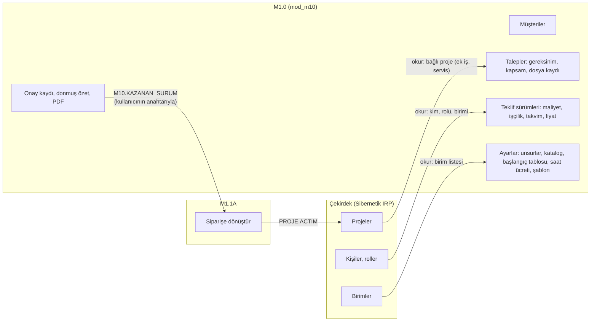
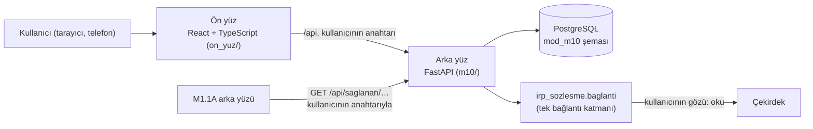
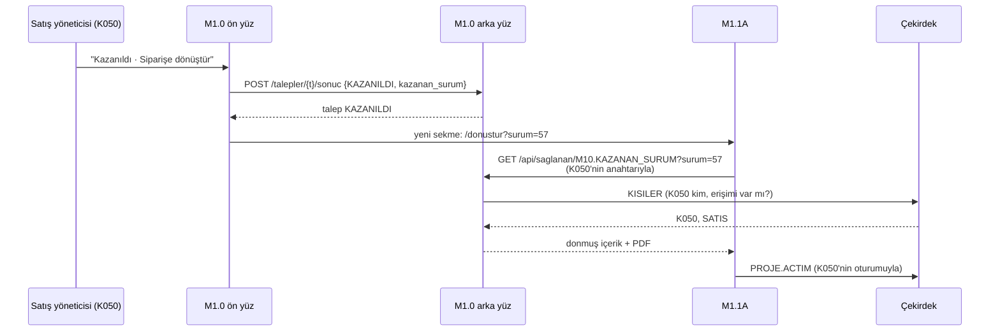

# M1.0 · Teklif hazırlama — uygulamanın açıklaması

*Modül kodu (geçici): `M10` · Sürüm 0.1.0 · Paket `irp_sozlesme` 1.0 · çekirdek 10.2 · 30 Ekim 2026*

Bu belge M1.0'ın ne olduğunu, nasıl kurulduğunu, Sibernetik IRP çekirdeğiyle ilişkisini ve gerçek bir teklifte
nasıl kullanıldığını anlatır. Diğer belgeler:
- tarif: `SPEC.md`
- teslim notu: `TESLIM.md`
- kurulum ve duman testi: `gelistirme/BENIOKU.md`

---

## İçindekiler

1. [Kısa cevap: çekirdekten ne alıyoruz, çekirdeğe ne veriyoruz](#1-kısa-cevap-çekirdekten-ne-alıyoruz-çekirdeğe-ne-veriyoruz)
2. [Uygulama ne işe yarar](#2-uygulama-ne-işe-yarar)
3. [Kim kullanır](#3-kim-kullanır)
4. [Mimari](#4-mimari)
5. [Çekirdekle ilişki, ayrıntılı](#5-çekirdekle-ilişki-ayrıntılı)
6. [Modülün kendi verisi](#6-modülün-kendi-verisi)
7. [Modülün kendi kuralları](#7-modülün-kendi-kuralları)
8. [Kullanım senaryosu: bir teklif, ilk temastan siparişe](#8-kullanım-senaryosu-bir-teklif-ilk-temastan-siparişe)
9. [Kısa kullanım senaryoları (rol rol)](#9-kısa-kullanım-senaryoları-rol-rol)
10. [Ekranlar](#10-ekranlar)
11. [API](#11-api)
12. [Sınama ve sözleşme senaryoları](#12-sınama-ve-sözleşme-senaryoları)
13. [Çekirdekte eksik olanlar (istekler)](#13-çekirdekte-eksik-olanlar-istekler)
14. [Gerçek buluta geçiş](#14-gerçek-buluta-geçiş)
15. [Çalıştırmak](#15-çalıştırmak)
16. [Sözlük](#16-sözlük)

---

## 1. Kısa cevap: çekirdekten ne alıyoruz, çekirdeğe ne veriyoruz

Çekirdek, firmanın ortak motorudur: insanı, işi, zamanı ve parayı izler. Kim neyi ne zaman yaptı, top kimde, proje
nerede?

M1.0 onun üstüne kurulan bir modüldür, ama öbür modüllerden bir yönüyle ayrılır: **teklif çekirdeğe hiç girmez.**
- **Neden:** Teklif bir projeye bağlı değildir; proje ancak sipariş gelince M1.1A'da açılır. Projesiz bir kaydı
  çekirdekte mavi yaka dahil herkes görür (K-30). Teklifin maliyeti ve kârı gizlidir.
- **Sonuç:** Bütün teklif modülün kendi şemasında durur. M1.0 çekirdekten yalnızca **okur**: kim olduğunu, hangi
  birimlerin olduğunu, bağlanacak projeyi.

### 1.1 Çekirdekten aldıklarımız (okumalar)

Hepsi **kullanıcının gözüyle** okunur: çekirdek o kişinin yetkisini ve görme kurallarını uygular.

| Okuma | Çekirdekten ne geliyor | Modül ne için kullanıyor |
|---|---|---|
| `KISILER` | Kişiler: kimlik, ad, birim, yaka, roller, aktif mi | İsteği yapan kişiyi tanımak (rolü `SATIS` ya da `YETKILI` mi, birimi yönetim birimi mi). Ekranda kişi adları (hazırlayan, onaylayan). İstek başına bir kez okunur |
| `BIRIMLER` | Birimler: kimlik, ad, üst birim, başı, yöneticileri | İşçilik satırlarının, başlangıç tablosunun, saat ücretlerinin, takvim şablonunun ve yönetim birimlerinin birim kodu bu listeden seçilir ve doğrulanır ("ortak katalog zorunlu") |
| `PROJE` | Kod, ad, müşteri, sorumlu, tarihler | Ek iş ve servis talebinin bağlı projesi. Kullanıcı projeyi görüyorsa kodu ve adı gösterilir, kodu saklanır; göremiyorsa talep açılmaz |

**Servis gözü kullanılmaz.** Künyede `servis_okumalari` boştur. Modülün arka yüzü vardır (`arka_yuz: true`), ama
bildirim bırakacak bir kaydı yoktur (1.3).

### 1.2 Çekirdeğe verdiklerimiz (olaylar)

**Yok.** Künyede `olay_yolu: YOK`, `kapilar.olaylar: []`; M1.0'ın cihaz harfi yoktur.
- Talep, sürüm, onay, gönderim, müşterinin cevabı: hepsi modülün kendi kaydıdır.
- Siparişe dönüşünce projeyi M1.1A açar (`PROJE.ACTIM`, kullanıcının oturumuyla). M1.0 yalnızca ona kazanan
  sürümün içeriğini sağlar (1.5).

**Kurulumda çekirdeğe yazılanlar.** Bunlar modülün değil, firmanın yetkilisinin yazdığı olaylardır. Künyeden
üretilir (`kunye_denetle.py --kurulum kunye.json`):

| Olay | Ne |
|---|---|
| `MODUL.TANIMLADIM` | Modülün kaydı: `M10`, "Teklif hazırlama", `SRV-M10` |
| `KOD.TANIMLADIM` | Yeni rol: `SATIS` (Satış yöneticisi) |
| `YETKI.TANIMLADIM` | `PROJE.ACTIM` yetkisinin `SATIS`'e önerisi, firma kapsamında |

`SATIS` rolünün sahibi M1.0'dır. Siparişe dönüştürürken projeyi satış yöneticisi açtığı için yetkiyi de M1.0
önerir; olayı M1.1A yazar. Künye denetiminin tek uyarısı (V17) budur ve beklenendir.

### 1.3 Çekirdeğin bildirim kapısı

**Kullanılmaz.** Bildirim yalnızca `PROJE`, `IS`, `GOREV`, `NESNE` kaydına bırakılabilir. Teklif bunların hiçbiri
değildir. Bu yüzden şu iki haber çekirdeğin bildirim kutusuna düşemez:
- onay bekleyen teklifin CEO'ya haberi
- cevap tarihi yaklaşan talebin satış yöneticisine hatırlatması

İstek M10-01 açıktır. Faz 1'de ikisi de modülün ekranında **iş listesi** olarak durur:
- "Onayınızı bekleyen N teklif" şeridi
- talepler listesinde ▲ işareti

Ayrı bir bildirim kutusu, çan ya da sayaç rozeti yoktur.

### 1.4 Çekirdeğin bizim yerimize uyguladığı kurallar

Modül bunları **kendisi yazmaz**:

- **Görünürlük.** Kim hangi projeyi görür (`UYELER`)? Satış yöneticisi çoğu projeyi göremez. Bağlı projeyi
  okuyamazsa modül "Bu projeyi göremiyorsunuz; bağlamak için projede erişiminiz olmalı." der. Etrafından dolaşmaz:
  projeyi başka gözle okumaz, listeyi kendisi tutmaz.
- **Kişi, rol, birim.** Kişinin kim olduğu, rolü ve birimi çekirdektedir. Modül çalışanın yalnızca kodunu tutar;
  adı ekranda `KISILER`'den okunur.
- **İstihdam.** İşten ayrılmış kişi giriş yapamaz; `KISILER`'de bulunmayan kişi 403 alır.
- **Saat.** Modülün kayıtlarındaki her an (talebin açılışı, onay anı, gönderim anı) çekirdeğin saatinden
  (`cekirdek.simdi()`, `+03:00`) gelir. Talep numarasının yılı da oradan.

**Modülün okumadığı şeyler:**
- **Maaş ve saat maliyeti.** Teklifin saat ücreti modülün kendi varsayımıdır (karar 104); çekirdeğin `MAAS`,
  `SAAT_MALIYETI` okumalarına dokunulmaz.
- **Başka modülün verisi.** M1.0 köktür: M1.1A'dan, M3'ten ya da M8'den okumaz. Okursa bağımlılık döngüsü olur (R08).

### 1.5 Başka modüllere verdiklerimiz (sağlanan okumalar)

| Okuma | Kim kullanır | Ne |
|---|---|---|
| `M10.KAZANAN_SURUM {surum}` | M1.1A (siparişe dönüştürme) | Kazanan ve gönderilmiş sürümün donmuş içeriği (5.5) |
| `M10.KATALOG_TEMIN_SURELERI` | M2, M3, M4 (sonra) | Katalog kalemlerinin tipik temin süresi ve kritik işareti; fiyat yok |

Çekirdek modüller arası okumayı henüz yönlendirmiyor (istek M10-02). Faz 1'de ikisi M1.0'ın kendi arka yüzünde
`GET /api/saglanan/{ad}` olarak durur.

### 1.6 Bir bakışta



---

## 2. Uygulama ne işe yarar

Sibernetik siparişe göre makine tasarlayıp üretir. Her iş bir **teklifle** başlar. Bugün teklif dağınık hazırlanır:
- eski bir benzer iş zor bulunur
- maliyetin hangi kaleminin nereden geldiği unutulur
- uzun teslimli bir robot teslim süresini sessizce kaydırır
- onaylanmamış bir teklif müşteriye gidebilir

M1.0 müşterinin ilk temasından onaylı teklifin müşteriye gönderilmesine kadar olan işi taşır. Teklifi **satış
yöneticisi** hazırlar, **CEO** onaylar. Kullanıcının öncelikleri sırayla:

1. **Benzer işi bulmak:** Eski bir talebin sürümünü arayıp kopyalamak.
2. **Doğru maliyet tahmini:** Her kalemin yanında kaynağı ve temin süresi; işçiliğin yanında öneri.
3. **Gerçekçi teslim süresi:** Uzun teslimli kalemi hesaba katan "en erken teslim".

Teklif takibi ve onay ikinci plandadır.

Başarı şöyle görünür:

- Satış yöneticisi talebi açar, eski bir teklifi kopyalayarak V1'i **birkaç dakikada** kurar.
- **Her maliyet kaleminin yanında** kaynağı (tedarikçi teklifi, geçmiş proje, tahmin) ve temin süresi görünür.
  İşçilik satırının yanında başlangıç tablosunun ve geçmiş projelerin önerisi durur.
- Takvim, uzun teslimli kalemi hesaba katarak **en erken teslimi** söyler; teklife bundan kısa süre yazılamaz.
- Kâr oranı ve fiyat **birbirinden hesaplanır**; ekranda kârın iki anlamı da görünür.
- **Onaylanmamış teklif müşteriye gönderilemez**; hiçbir rol bu kapıdan geçemez.
- CEO **telefonundan** özeti görüp onaylar ya da gerekçeyle geri gönderir.
- **Gönderilmiş sürüm değişmez.** Düzeltme yeni sürümdür.
- Kazanılan sürüm **tek tıkla** M1.1A'nın "siparişe dönüştür" penceresine geçer.

### 2.1 Faz 1'de olmayanlar

- **Yapay zekâ:** şartname okuma, benzer teklif bulma, metin taslağı (gizlilik izni bekleniyor).
- **Öğrenme katmanı:** Kapanan projenin gerçek saatleri ve maliyeti öneriyi kendiliğinden beslemez (M10-03, M10-04).
- **M3'ten ortalama temin süresi:** Alanı vardır, değeri her zaman "bilgi yok"tur.
- **Atölye doluluğunun takvime katılması.**
- **Eski tekliflerin taşınması.**
- **Çekirdeğin bildirim kutusuna haber** (M10-01).
- **PDF'i e-postayla göndermek:** Kullanıcı PDF'i indirir, kendisi gönderir, "gönderildi" der.
- **Kapsam, maliyet ve fiyatın ayrı ayrı onaylanması.**
- **İşçilik saatlerinin departman liderlerine dağıtılması.**
- **Kazanılan talebin hangi projeye dönüştüğünü göstermek:** M1.0 M1.1A'dan okuyamaz; döngü olur.

Gerekçeleri `SPEC.md` › 2.2'de.

---

## 3. Kim kullanır

**M1.0'a kimler erişir:**
- `SATIS` ya da `YETKILI` rolündekiler
- birimi `yonetim_birimleri` ayarında olanlar (varsayılan `["YONETIM"]`)

Erişimi olmayanın her isteği 403 alır; ekranda "Erişiminiz yok" yazar. Tek istisna `M10.KATALOG_TEMIN_SURELERI`'dir:
onu oturumu olan herkes okur.

Örnek firmanın (`irp_sozlesme/simulator/ornek_firma.md`) ve A ekibinin ortak sınama zemininin (SPEC Ek D.10)
kişileriyle:

| Kişi | Rol | M1.0'da ne yapar |
|---|---|---|
| **K050** Satış Yöneticisi | `YONETICI` + `SATIS`, birim SATIS | Müşteri ve talep açar; sürümü hazırlar, onaya gönderir; "gönderildi" der; müşterinin cevabını yazar; ayarları ve geçmiş proje formunu doldurur. Onaylayamaz |
| **K001** Genel Müdür (CEO) | `YETKILI`, birim YONETIM | Her şeyi yapar. Ayrıca **onaycıdır**: onaylar, kendisi düzeltir, gerekçeyle geri gönderir (telefondan da). Kaybedilen ya da kapatılan talebi geri açar. Yönetim birimlerini değiştirir. Kendi hazırladığı teklifi de onaylayabilir; kayıtta "Hazırlayan ve onaylayan aynı kişi" yazar |
| **Yönetim birimindeki** bir yönetici | birimi YONETIM | Talepleri, sürümleri, maliyeti ve kârı görür; ayarları yapar. Teklif hazırlamaz, onaylamaz |
| **K004** Planlama Müdürü | `YONETICI`, PLANLAMA | Erişimi yok. `yonetim_birimleri`'ne PLANLAMA eklenirse yönetim gibi görür |
| **K041** Tasarım Mühendisi | `BEYAZ_YAKA`, MEK_TASARIM | Erişimi yok. `M10.KATALOG_TEMIN_SURELERI`'ni okuyabilir |
| **K017** Kaynakçı | `CALISAN`, atölye (mavi yaka) | M1.0'ı kullanmaz. Mavi yakanın tek yolu çekirdeğin telefon uygulamasıdır; M1.0 ona düğme eklemez |

**Örnek firmada `SATIS` rolünü taşıyan kimse yoktur.** Testler ve yerel başlatıcı K050'yi D.10 zeminiyle kurar.
Yalnız sahte bulutta satış yöneticisi gibi denemek için K001 ile girilir.

**Onaycı:** Kimin onaylayacağı açık bir sorudur (S-8b). Faz 1'de `YETKILI` onaylar; cevap gelince ayar olur.

---

## 4. Mimari

### 4.1 Katmanlar



- **Ön yüz** çekirdeği hiçbir zaman doğrudan çağırmaz; yalnızca modülün arka yüzünü (`/api`) çağırır. Ekranların
  yolu (S1: uygulama içi mi, ayrı uygulama mı) kesinleşince yalnızca ön yüz değişir.
- **Arka yüz** çekirdeğe yalnızca paketteki bağlantı katmanından gider; bu yol tek bir dosyadadır (`m10/baglanti.py`).
  Kodda çekirdeğe başka istek, çekirdeğin şemasına SQL yoktur.
- **Veritabanı:** Modülün verisi kendi şemasındadır (`mod_m10`). Çekirdeğin kayıtları yalnızca kimlikleriyle,
  değer olarak tutulur: kişi kodu, birim kodu, proje kimliği. Çekirdeğe yabancı anahtar yoktur.
- **Hesap arka yüzdedir.** Maliyet, kur, kâr ve takvim saf fonksiyonlardır (`m10/alan/`). Ön yüz bunları tekrar
  etmez; formu kaydettikten sonra hesabı arka yüzden alır.

### 4.2 İki göz

| Göz | Kimlik | M1.0'da |
|---|---|---|
| **Kullanıcının gözü** | Kullanıcının erişim anahtarı (JWT) | Her okuma: `KISILER`, `BIRIMLER`, `PROJE`. Sağlanan okumalarda da çağıranın anahtarı kullanılır |
| **Servis gözü** | `SRV-M10` | Kullanılmaz: bildirim yok, servis okuması yok |

### 4.3 Sürücü: simülatör ya da gerçek bulut

Bağlantı katmanının altında bir sürücü çalışır; modülün kodu hangisi olduğunu bilmez.

| Sürücü | Ne zaman | Seçim |
|---|---|---|
| Simülatör | Testler ve yerel başlatıcı (çekirdeğin Python modeli, aynı süreçte) | `IRP_CEKIRDEK` verilmez |
| HTTP | Sahte bulut (yerel) ve gerçek bulut (Supabase) | `IRP_CEKIRDEK=http`, `IRP_TABAN`, `IRP_ANON`, `IRP_SERVIS` |

Gerçek buluta geçince **modülün kodunda tek satır değişmez**; yalnızca bu ortam değişkenleri verilir.

### 4.4 Oturum

- **Üründe:** Kullanıcı çekirdeğin girişiyle girer, ekran onun erişim anahtarını arka yüze iletir, arka yüz
  `cekirdek.oturum(anahtar)` ile çalışır. Modül şifre görmez, saklamaz.
- **Geliştirmede:** `/api/gelistirme/giris` örnek firmanın bir kişisi için anahtar verir (yalnızca
  `M10_GELISTIRME=1`). Ön yüz anahtarı `sessionStorage`'da `m10_anahtar` olarak tutar; M1.1B ile aynı kalıp.

### 4.5 Olay kimliği

M1.0 olay yazmadığı için olay sayacı tablosu ve cihaz harfi yoktur. Modülün kendi sıraları
(`sayaclar` + `sayac_ilerlet()`) talep numarası içindir: yıl başına, **tek işlemle** artar. Böylece iki kişi aynı
anda talep açsa da aynı numara iki kez verilmez.

### 4.6 Klasör düzeni

```
m1.0/                       modülün kökü
  irp_sozlesme/             paket (çekirdeğe bağlanmanın tek yolu; değiştirilmez)
  kunye.json                modülün kimlik kartı (SPEC Ek A)
  veritabani/               göçler (yalnızca mod_m10): 001_m10.sql, 002_varsayilanlar.sql, 003_iscilik_sira.sql
  m10/                      arka yüz
    ayarlar.py              KOD = 'M10', SEMA = 'mod_m10', ortam değişkenleri
    baglanti.py             Cekirdek.ac; uygulamada tek örnek
    vt.py                   bağlantı havuzu, işlem yardımcısı (search_path, Europe/Istanbul)
    hatalar.py              modülün hataları (YETKI, DURUM, KAPI, DEGISTI, DOGRULAMA…)
    depo/                   tablolara SQL (elle, parametreli; ORM yok)
    alan/                   iş kuralları: hesap, takvim, oneri, durum, dogrulama, arama, kopyalama, yetki, saglanan
    pdf/                    teklif PDF'i (fpdf2) ve yazitipi/ (Barlow, SIL OFL)
    api/                    FastAPI yönlendiricileri, istek şemaları, hata eşleme
    komutlar.py             python -m m10.komutlar gelistirme-vt-sifirla
  testler/                  pytest (çekirdeğe karşı olanlar simülatörle); sabitler/M10.KAZANAN_SURUM.json
  senaryolar/               sözleşme senaryoları (*.girdi.json, *.beklenen.json)
  istekler/                 çekirdeğe istekler (M10-01 … M10-06)
  on_yuz/                   React uygulaması
  gelistirme/               docker-compose, sema_ac.sql, ornek_veriler.sql, yerel_sunucu.py, BENIOKU.md
  TESLIM.md, SPEC.md, ACIKLAMA.md, CLAUDE.md
```

### 4.7 Künye

`kunye.json` modülün çekirdekteki kimlik kartıdır. Modülün çekirdekte kullandığı **her şey** burada beyan edilir;
künyede olmayanı bağlantı katmanı da yapmaz.

M1.0'ın künyesinde:

| Alan | İçerik |
|---|---|
| Okumalar | 3 (`KISILER`, `BIRIMLER`, `PROJE`) |
| Servis okuması, olay, bildirim kuralı | Yok |
| Rol | 1 (`SATIS`) |
| Yetki önerisi | 1 (`PROJE.ACTIM` → `SATIS`) |
| Sağlanan okuma | 2 |
| Kişisel veri | 1 beyan (müşteri iletişim kişileri) |
| Para | `true` |
| İstekler | 6 |

Nesne türü ve kod listesi tanımlamaz; derin bağlantısı yoktur (teklifin çekirdekte bağlamı yok).

Denetim sonucu: 0 hata, 1 uyarı (V17, beklenen).

---

## 5. Çekirdekle ilişki, ayrıntılı

### 5.1 Ne nerede durur

| Kavram | Nerede | Nasıl |
|---|---|---|
| Kişi, rolü, birimi | Çekirdek | `KISILER`; istek başına bir kez. Modül yalnızca kişi kodunu tutar (hazırlayan, onaylayan, gönderen…) |
| Departman listesi | Çekirdek | `BIRIMLER`. İşçilik, başlangıç tablosu, saat ücreti ve takvim şablonu birim kodunu değer olarak tutar |
| Bağlı proje (ek iş, servis) | Çekirdek | Kullanıcının gözüyle `PROJE`; yalnızca kimliği tutulur |
| Müşteri, talep, sürüm, kalem, işçilik, takvim, fiyat, PDF | **Modül** | `mod_m10` (bölüm 6) |
| Maliyet unsuru ve bütçe kalemi | **Modül** | `maliyet_unsurlari.butce_kalemi`; bütçe kalemleri M1.1A ile ortak (`MALZEME`, `ISCILIK`, `FASON`, `GENEL_GIDER`) |
| Etap listesi | **Modül** (kopya) | `takvim_sablonu`: M1.1B'nin etap şablonuyla aynı on kod, ad, sıra, paralel grup ve oran. Ortak listenin çekirdekte durması istek M10-03 |
| Teklifin saat ücreti | **Modül** | `saat_ucretleri`: birim başına varsayım. Çekirdeğin maaşı ya da saat maliyeti değildir |
| Proje açılışı | M1.1A | M1.0 projeyi açmaz; yalnızca `PROJE.ACTIM` yetkisini `SATIS`'e önerir |
| Kazanan sürümün donmuş kopyası | M1.1A | M1.0 `M10.KAZANAN_SURUM`'u sağlar; M1.1A dondurur |
| Saat | Çekirdek | Modülün kayıtlarındaki anlar `cekirdek.simdi()`'den gelir (`+03:00`) |

**İlke:** Modül yalnızca **kendi bilgisini** tutar. Kişi, birim ya da proje bilgisini ikinci kez tutmaz; bunların
kimliğini değer olarak saklar ve gerektiğinde okur.

### 5.2 Okumaların ayrıntısı ve görme kuralları

| Okuma | Kim görür (çekirdeğin kuralı) | Modülde nerede |
|---|---|---|
| `KISILER` | İstihdamda olan herkes | Her istekte (kimlik ve erişim); `/kisiler` seçim listesi; geçmişte ve sürümde kişi adları |
| `BIRIMLER` | İstihdamda olan herkes | `/birimler`; işçilik ve ayarlarda birim seçimi ve doğrulaması |
| `PROJE` | Proje ekibi (`UYELER`): sorumlu, projede etabı olan birimin yöneticisi ve üstleri, iş verilenler, yetkili | Yeni talep ve talep güncellemesi (bağlı proje değişince), `/projeler/{kod}`, talep kartında bağlı projenin adı |

**Satış yöneticisi ve projeler.** Örnek firmada K050, 2614'ü göremez (`YETKI: Gorunurluk`). Modül:
1. talebi açmaz, 403 döner
2. projeyi başka gözle okumaz
3. proje listesini kendisi tutmaz

Yetkili K050'ye projede erişim verirse (`PROJE.ERISIM_VERDIM`) okuma geçer, talep açılır. Bu akış `M1002`
senaryosudur.

Talep kartı, göremediği bağlı projenin yalnızca kodunu gösterir, adını göstermez.

### 5.3 Yetki: iki katman

1. **Çekirdeğin yetkisi:** Okumalarda görünürlük (5.2). M1.0 olay yazmadığı için olay yetkisi yoktur.
2. **Modülün kuralı:** M1.0'ın bütün işleri kendi tablolarına yazılır; yetki modülün kuralıdır. Kişinin rolü ve
   birimi `KISILER`'den okunur.

| İş | Kim |
|---|---|
| Talepleri, sürümleri, maliyeti ve kârı görmek | M1.0'a erişimi olan herkes |
| Müşteri, talep, `TASLAK` sürüm: açmak ve düzenlemek | `SATIS`, `YETKILI` |
| Onaya göndermek | `SATIS`, `YETKILI` |
| Onaylamak, kendim düzeltmek, gerekçeyle geri göndermek | `YETKILI` (onaycı) |
| `ONAY_BEKLIYOR` sürümü düzenlemek ("kendim düzelt") | Yalnızca onaycı; satış yöneticisi onay beklerken düzenleyemez |
| Düzenlemeye açmak (`ONAYLANDI` → `TASLAK`) | Sürümü hazırlayan ya da `YETKILI` |
| Gönderildi demek | `SATIS`, `YETKILI` |
| Müşterinin cevabını yazmak; talebi kapatmak | `SATIS`, `YETKILI` |
| `KAYBEDILDI` ya da `KAPATILDI` talebi geri açmak | `YETKILI` |
| Ayarlar ve geçmiş proje formu | `SATIS`, `YETKILI`, yönetim birimleri |
| Yönetim birimlerini değiştirmek | Yalnızca `YETKILI` |

**Sıra:** Önce yetki (403), sonra durum (409). Onaylanmamış sürümün gönderimi kapı olduğu için ayrı kodla döner
(409 `KAPI`).

### 5.4 Çekirdeğin ve modülün cevapları, ekrandaki karşılıkları

Hata gövdesi M1.1B ile aynıdır: `{"kod", "mesaj", ...}`.

| Durum | HTTP | Kod | Ekranda |
|---|---|---|---|
| Okumada çekirdeğin `YETKI`'si | 403 | `YETKI` | "Bu bilgiyi görme yetkiniz yok." Bağlı projede: "Bu projeyi göremiyorsunuz; bağlamak için projede erişiminiz olmalı." |
| M1.0'a erişim yok; modülün rol kuralı | 403 | `YETKI` | "Bu işi satış yöneticisi ya da yetkili yapar." vb. |
| Oturum yok ya da anahtar okunamadı | 401 | `OTURUM` | Ön yüz girişe döner |
| Doğrulama | 422 | `DOGRULAMA` | `hatalar: [{alan, sira, mesaj}]`; onaya göndermede `uyarilar` da |
| Durum geçişi geçersiz | 409 | `DURUM` | "Bu sürüm bu durumda değiştirilemez." |
| Onaysız gönderim | 409 | `KAPI` | "Onaylanmamış teklif müşteriye gönderilemez." |
| Aynı anda düzenleme | 409 | `DEGISTI` | "Kayıt siz bakarken değişti." Gövdede `guncel` hal; ekran onu yükler |
| Aynı adlı müşteri | 409 | `AYNI_AD` | "Bu adla bir müşteri var." ve "Yine de kaydet" |
| Bulunamadı | 404 | `BULUNAMADI` | — |
| Çekirdeğin `BICIM` ya da `KUNYE`'si | 400 / 500 | `BEKLENMEYEN` | "Beklenmeyen bir hata oldu." Modülün hatasıdır; ayrıntı günlüğe yazılır |
| Çekirdeğin `BAGLANTI`'sı | 503 | `BAGLANTI` | "Çekirdeğe ulaşılamıyor, biraz sonra yeniden deneyin." |
| Çekirdeğin `URUN`'u | 502 | `URUN` | "Çekirdekte beklenmeyen hata." |

### 5.5 Sağlanan okumalar ve M1.1A

Kazanılan teklifin projeye dönüşmesi:



**`M10.KAZANAN_SURUM {surum}` kuralları:**
- **Görme:** Çağıran kullanıcı M1.0'a erişebilen biri olmalı: `SATIS`, `YETKILI` ya da yönetim birimi. Değilse
  403 `YETKI`.
- **Kapı:** Sürüm `GONDERILDI`, talep `KAZANILDI` ve talebin kazananı bu sürüm olmalı. Değilse 409 `KAPI`, `neden`:
  `GONDERILMEDI` ya da `KAZANILMADI`.
- **Tutarlar donmuştur:** `toplamlar` (maliyet, bütçe kalemine göre kırılım, marj) ve her kalemin bütçe kalemi onay
  anında dondurulan özetten gelir; yeniden hesaplanmaz. Bir unsurun bütçe kalemi sonradan değişse de gönderilen
  sürüm onaydaki kalemle kalır. Cevap her çağrıda aynıdır.
- **İçerik:**
  - müşteri (strateji notu hariç, iletişim kişileriyle)
  - para birimi ve kurlar, fiyat, kâr oranı, fiyat girişi
  - kalemler (unsur, bütçe kalemi, katalog kodu, adet, birim fiyat, tutar ve teklif para birimindeki tutar,
    kaynak etiketi, temin süresi, kritik)
  - işçilik (birim, saat, saat ücreti, tutarlar)
  - takvim, takvim teslimi, en erken teslim, teslim süresi
  - gereksinimler, kapsam, dosya kayıtları
  - hazırlayan, onaylayan, onay ve gönderim anları
  - müşteriye giden PDF (ad, SHA-256 parmak izi, base64 içerik)
- **Dışarıda kalanlar:** Müşterinin strateji notu ve işlem geçmişi.
- **Ortak örnek:** Biçimi SPEC Ek D.5'teki ortak örnektir; M1.1A'nın testleri de aynı örneği kullanır. M1.0'ın
  sözleşme testi bu örneği uçtan uca kurar ve cevabı örnekle karşılaştırır.

**`M10.KATALOG_TEMIN_SURELERI`:**
- Parametre yok. Oturumu olan herkes okur.
- Cevap: aktif katalog kalemleri: kod, ad, unsur, bütçe kalemi, tipik temin süresi, `ortalama_temin_hafta: null`,
  kritik.
- Fiyat yoktur.

**Tanımsız okuma:** 404 `TANIMSIZ_VERI`.

### 5.6 Teklif neden çekirdeğe açılmıyor

Teklifi çekirdeğe projesiz bir nesne olarak açmak SPEC'te açıkça yasaktır (2.3):
- Projesiz nesneyi firmada mavi yaka dahil herkes görür (K-30).
- Teklifin maliyeti ve kârı yalnızca satış yöneticisinin, CEO'nun ve yönetimin görmesi gereken bilgidir.

Bu yüzden teklifin çekirdekte bir izi yoktur. Bunun bedeli:
- Teklife bildirim bırakılamaz (M10-01).
- Çekirdeğin ekranlarından teklife derin bağlantı verilemez.
- Teklif çekirdeğin plan ve maliyet raporlarında görünmez; proje M1.1A'da açılana kadar.

---

## 6. Modülün kendi verisi

Şema `mod_m10`. Göçler:
- `veritabani/001_m10.sql`: tablolar
- `002_varsayilanlar.sql`: para birimleri, maliyet unsurları, etap şablonu, ayarlar
- `003_iscilik_sira.sql`: işçilik satırlarının girildiği sıra

İlk ikisi SPEC Ek B'den aynen alındı.

| Tablo | Ne tutar |
|---|---|
| `ayarlar` | Anahtar–değer ayarlar: `yonetim_birimleri`, `talep_no_deseni` (`T-{YYYY}-{SIRA4}`), varsayılan para birimi ve geçerlilik, `cevap_uyari_gun`, firma bilgileri, varsayılan metinler, `son_kurlar` |
| `sayaclar` + `sayac_ilerlet()` | Talep numarasının yıllık sırası; tek işlemle artar |
| `para_birimleri` | TRY ₺, EUR €, USD $; aktiflik |
| `maliyet_unsurlari` | 10 unsur (Robot, PLC ve HMI, Pnömatik, Mekanik malzeme, Elektrik malzemesi, Isıl işlem, Fason imalat, Nakliye, Genel gider payı, Diğer). Her biri tek bir bütçe kalemine bağlı; sık/ara sıra; aktif; sıra |
| `katalog_kalemleri` | Tekrar kullanılan kalem: kod, ad, unsur, ölçü birimi, fiyat, para birimi, fiyatın tarihi ve kaynağı, tipik temin süresi, kritik |
| `makine_turleri`, `baslangic_tablosu` | Makine türü ve tipik toplam süresi; makine türü × birim → tipik saat ve süre |
| `saat_ucretleri` | Birim başına teklif saat ücreti ve para birimi (varsayım) |
| `takvim_sablonu` | On etap (M1.1B ile ortak) ve firmanın birim eşlemesi, aktiflik |
| `gecmis_projeler`, `gecmis_proje_saatleri` | Kapanmış projelerin birim bazında gerçek saatleri, elle |
| `musteriler`, `musteri_kisileri` | Müşteri (ad, kısa ad, adres, ülke, vergi, strateji notu) ve iletişim kişileri |
| `talepler` | Numara, müşteri, kaynak, bağlı proje, tür, makine türü, konu, tarihler, durum, kazanan sürüm, kayıp nedeni, kapatma gerekçesi, sonuç anı, arama metni, eşzamanlılık sayacı |
| `talep_dosyalari` | Dosyanın kaydı: tür, ad, konum (şirket sunucusunda), SHA-256 parmak izi. Silinmez |
| `gereksinimler`, `kapsam_satirlari` | Sıralı gereksinimler (belirsiz, soru, cevap); kapsam dahil ve hariç |
| `teklif_surumleri` | Sürüm: no, durum, kaynak sürüm, para birimi, kâr, fiyat, fiyat girişi, süreler, metinler, hazırlayan, onaylayan, gönderim, onaylı PDF ve parmak izi, donmuş özet, eşzamanlılık sayacı |
| `surum_kurlari` | Sürümün kurları: 1 birim kaç TL, kur tarihi |
| `maliyet_kalemleri`, `iscilik_satirlari`, `takvim_satirlari` | Sürümün maliyet, işçilik ve takvim satırları; dördüncü bölüm olan fiyat sürümün kendisinde |
| `onay_kayitlari` | Onaya gönderme, onay, düzeltme isteği (gerekçe), onaycı düzeltmesi, düzenlemeye açma ("bilgi havuzu") |
| `islem_gecmisi` | Talebe ve sürüme yapılan her değişiklik: kim, ne, ne zaman, `{alan, eski, yeni}`; onaycı düzeltmeleri işaretli |

**Değişmezler:**

| Değişmez | Kim korur |
|---|---|
| Bir talepte en çok bir gönderilmemiş sürüm olur | Kısmi tekil dizin |
| Gönderilmiş sürüm satırı değişmez | Veritabanının tetikleyicisi |
| Çocuk satırlar yalnızca sürüm `TASLAK` ya da `ONAY_BEKLIYOR` iken değişir | Modülün kuralı; değilse 409 |
| `ONAYLANDI` ve `GONDERILDI` sürümde onaylayan, onay anı, PDF ve donmuş özet doludur | Kısıt |
| `KAZANILDI` talepte kazanan sürüm, `KAYBEDILDI`'de neden, `KAPATILDI`'da gerekçe zorunludur | Kısıt |
| Kalemin birim fiyatı ile para birimi birlikte boş ya da birlikte dolu olur | Kısıt |

Sürüm, dosya kaydı ve müşteri silinmez; müşteri ve iletişim kişisi pasifleştirilir.

**Kişisel veri ve para:**
- **Kişisel veri:** Yalnızca müşteri firmanın iletişim kişileri (ad, unvan, telefon, e-posta). Künyede KVKK
  m.5/2-c gerekçesiyle beyanlıdır. Çalışanların yalnızca kodları tutulur.
- **Para:** Modül para tutar: maliyet, kur, fiyat, saat ücreti varsayımı. Çekirdekten para okumaz.

---

## 7. Modülün kendi kuralları

Bunlar çekirdeğin değil modülün kurallarıdır. Saf fonksiyonlar olarak yazıldı (`m10/alan/`) ve birim testleriyle
sınanır. Sayılar SPEC Ek D.5'in ortak örneğidir: Autoliv, 710 Projesi Burç Çakma Ekipmanı, V2.

### 7.1 Maliyet ve kur

- **Kalemin tutarı:** adet × birim fiyat, kalemin kendi para biriminde.
- **Teklif para birimine çeviri:** tutar × kur(kalemin birimi) ÷ kur(teklifin birimi). Kur "1 birim kaç TL"dir;
  TL'nin kuru 1'dir. Kurlar sürüm başına elle girilir; dış servis yok.
- **Yuvarlama:** İki ondalığa **yarım yukarı**, her satırda ayrı. Toplam, yuvarlanmış satırların toplamıdır.
- **Kırılım:** Kalemler unsurlarının bütçe kalemine gider; işçilik her zaman `ISCILIK`'tir.
- **Bilinmeyen tutar sıfır sayılmaz.** Fiyatı olmayan kalem, ücreti tanımlı olmayan işçilik ya da kuru girilmemiş
  para birimindeki satır **VERİ EKSİK**'tir. O kırılım ve maliyet de VERİ EKSİK olur; sürüm onaya gidemez.

Örnek (EUR teklif, 1 € = 35,20 TL):

| Satır | Hesap | Teklifte |
|---|---|---|
| Robot, 6 eksen, 20 kg | 1 × 28.000,00 € | 28.000,00 € (MALZEME) |
| PLC ve HMI seti | 1 × 4.500,00 € | 4.500,00 € (MALZEME) |
| Fikstür ısıl işlem | 35.200,00 TL ÷ 35,20 | 1.000,00 € (FASON) |
| Mekanik tasarım | 120 sa × 1.760 TL = 211.200 TL | 6.000,00 € (ISCILIK) |
| İmalat | 100 sa × 1.408 TL = 140.800 TL | 4.000,00 € (ISCILIK) |
| **Maliyet** | | **43.500,00 €** |

### 7.2 Fiyat ve kâr

- **Biri girilir, öbürü hesaplanır:**
  - Kâr oranı girilirse: fiyat = maliyet × (1 + kâr ÷ 100).
  - Fiyat girilirse: kâr = (fiyat ÷ maliyet − 1) × 100. Maliyet 0 ya da eksikse kâr hesaplanamaz.
- **Maliyet değişince** girilmiş olan sabit kalır, öbürü yeniden hesaplanır.
- **Kârın iki anlamı yan yana:** Kâr maliyetin üstüne mi, fiyatın yüzdesi mi? Bu açık bir sorudur (S-5a). Faz 1'de
  hesap maliyetin üstüne yapılır, ekranda ikisi de görünür:
  - 56.000 € girildi: "Kâr oranı (maliyetin üstüne): %28,74 · Fiyatın yüzdesi olarak (marj): %22,32".
  - %20 girildi: fiyat 52.200,00 €. "Kâr %20 fiyatın yüzdesi olsaydı fiyat 54.375,00 € olurdu."

### 7.3 Takvim ve en erken teslim

- **Şablondan doldurma:** Toplam süre N hafta (varsayılanı makine türünün tipik toplam süresi). Şablonun aktif her
  satırı için:
  - başlangıç = yarım yukarı(bas_orani × N)
  - bitiş = yarım yukarı(bit_orani × N)
  - süre = en az 1, bitiş − başlangıç

  Örnek: N = 26'da İmalat'ın başlangıcı 0,25 × 26 = 6,5 → 7.
- **Takvim teslimi:** Kesin kabul dışındaki satırların en geç bitişi (başlangıç + süre).
- **Kayma:**
  - Satın alma satırı varsa: en(0, satın almanın başlangıcı + en uzun temin − satın almanın bitişi).
  - Satın alma satırı yoksa: en(0, en uzun temin − takvim teslimi).
- **En erken teslim** = takvim teslimi + kayma.
- **Teklifin teslim süresi:** Varsayılanı en erken teslimdir. Kullanıcı daha uzun yazabilir; daha kısası onaya
  gönderilemez.
- **Örnek:** Takvim teslimi 25. hafta. Robotun temini 10 hafta: satın alma 4. haftada başlar, robot 14. haftada gelir,
  satın alma 12. haftada biter.
  - Kayma 2 hafta; en erken teslim 27. hafta; teklifte 28 hafta.
  - Ekranda: "En uzun temin süreli kalem (Robot, 6 eksen, 20 kg, 10 hafta) satın almanın bitişini 2 hafta geçiyor;
    en erken teslim 2 hafta kayar."
- **İpucu:** Her takvim satırının yanında, şablonun birim eşlemesine göre başlangıç tablosunun tipik süresi durur
  ("Tablo: 5 hf").

### 7.4 İşçilik önerisi

- **Tablo:** Başlangıç tablosundaki tipik saat (makine türü × birim).
- **Geçmiş:** Aynı makine türündeki geçmiş projelerde o birimin gerçek saatlerinin ortalaması ve proje sayısı, bir
  haneye yarım yukarı.
- **Ekranda:** "Tablo 120 sa · Geçmiş 140 sa (3 proje)"; biri yoksa yazılmaz.
- **"Önerileri doldur":** Makine türünün tablosundaki her birim için satır yoksa açar. Saat boşsa tablo değeriyle,
  tablo yoksa geçmiş ortalamasıyla doldurur. Dolu saate dokunmaz.
- **Saat ücreti** satır eklenirken ayardan gelir ve **satırda donar**. Ayar sonradan değişse de o satır eski ücretle
  kalır. Kopyalanan sürümde ücret o anki ayardan yeniden okunur.

### 7.5 Durumlar

**Sürüm:**

| Durum | Eylem | Kim | Sonuç |
|---|---|---|---|
| `TASLAK` | Onaya gönder | `SATIS`, `YETKILI` | Doğrulama geçerse `ONAY_BEKLIYOR` |
| `ONAY_BEKLIYOR` | Onayla | `YETKILI` | Onaylı PDF ve donmuş özet yazılır → `ONAYLANDI` |
| `ONAY_BEKLIYOR` | Kendim düzelt | `YETKILI` | Onaycı formu düzenler; ilk kayıtta `ONAYCI_DUZELTTI`; geçmişte "onaycı düzeltmesi" |
| `ONAY_BEKLIYOR` | Gerekçeyle geri gönder | `YETKILI` | → `TASLAK`; aynı sürüm düzeltilir |
| `ONAYLANDI` | Düzenlemeye aç (gerekçe) | Hazırlayan, `YETKILI` | → `TASLAK`; PDF, özet, onaylayan silinir |
| `ONAYLANDI` | Gönderildi | `SATIS`, `YETKILI` | → `GONDERILDI`; sürüm donar |

Başka her geçiş 409 `DURUM`'dur. Onaylanmamış sürümü "gönderildi" yapmak 409 `KAPI`'dır: **geçiş yolu yok.**

**Talep** (müşterinin cevabı sürüme değil talebe yazılır):

| Durumdan | Eylem | Sonuç |
|---|---|---|
| `ACIK`, `BEKLEMEDE` | Bir sürüm gönderildi | `TEKLIF_VERILDI` |
| `ACIK`, `BEKLEMEDE` | Teklif vermiyoruz (gerekçe) | `KAPATILDI` |
| `TEKLIF_VERILDI`, `BEKLEMEDE` | Kazanıldı (gönderilmiş bir sürümle) | `KAZANILDI` |
| `TEKLIF_VERILDI`, `BEKLEMEDE` | Kaybedildi (fiyat / teknik çözüm / teslim süresi) | `KAYBEDILDI` |
| `TEKLIF_VERILDI` | Beklemede | `BEKLEMEDE` |
| `BEKLEMEDE` | Cevap bekleniyor | `TEKLIF_VERILDI` |
| `KAYBEDILDI`, `KAPATILDI` | Geri aç (`YETKILI`, gerekçe) | Gönderilmiş sürüm varsa `TEKLIF_VERILDI`, yoksa `ACIK` |

- **`KAZANILDI` geri alınmaz:** M1.1A siparişe dönüştürmüş olabilir ve M1.0 bunu bilemez.
- **Revize:** Müşteri revize isterse durum değişmez; yeni sürüm açılır, geçmişe "Müşteri revize istedi" yazılır.
- **Yeni sürüm:** Yalnızca `ACIK`, `TEKLIF_VERILDI` ya da `BEKLEMEDE` talepte ve gönderilmemiş sürüm yokken açılır.

### 7.6 "Onaya gönder"in doğrulaması

Hatalar (422, her biri `{alan, sira, mesaj}`):
- En az bir maliyet kalemi ya da işçilik satırı var.
- Her kalemde birim fiyat ve para birimi var; her işçilik satırında saat ücreti var.
- Kullanılan her yabancı para biriminin kuru var.
- Fiyat ve kâr hesaplanmış, fiyat > 0.
- Takvimde en az bir satır var.
- Teslim süresi ≥ en erken teslim.
- Geçerlilik günü var.

Uyarılar (durdurmaz): kapsam boş; belirsiz ve cevapsız gereksinim var.

Ekran doğrulamanın sonucunu kaydettikçe gösterir; kullanıcı onaya göndermeden ne eksik olduğunu bilir.

### 7.7 Donmuş özet

Onay anında sürüme yazılır:
- toplamlar: maliyet, bütçe kalemine göre kırılım, marj
- takvim teslimi ve en erken teslim
- kalemlerin unsur adı ve bütçe kalemi
- müşteri (strateji notu hariç, iletişim kişileriyle)
- gereksinimler, kapsam, talebin dosya kayıtları

Talep düzeyindeki bu bilgiler sonradan değişse de gönderilen sürüm **onay anındaki haliyle** kalır.
`M10.KAZANAN_SURUM` buradan kurulur.

### 7.8 Talep numarası, arama, kopyalama

- **Talep numarası:** `T-{YYYY}-{SIRA4}`, ör. `T-2026-0012`. Yıl çekirdeğin saatinden, sıra yıl başına tek işlemle.
  Numara değişmez.
- **Arama:** `normal(metin)`.
  1. Türkçe küçük harf (`İ`→`i`, `I`→`ı`)
  2. ASCII'ye katlama (ç→c, ğ→g, ı→i, ö→o, ş→s, ü→u)
  3. noktalama boşluğa, boşluklar teke

  Talebin arama metni şunlardan kurulur: talep no, müşteri adı ve kısa adı, konu, açıklama, makine türünün adı,
  gereksinimler, kapsam, en son sürümün kalem açıklamaları. Sorgunun her kelimesi geçmelidir (VE): "çakma autoliv",
  "Autoliv — Burç Çakma"yı bulur; "IŞIK" "isik" olur.
- **Kopyalama:**
  - **Bu talebin sürümünden:** kalemler, işçilik, takvim, metinler, para birimi, kurlar, kâr ve fiyat girişi gelir.
  - **Eski bir talebin sürümünden ("benzer işi bulmak"):** kalemler, işçilik, takvim ve metinler gelir. Bu talebin
    gereksinim ve kapsamı boşsa eskininkiler de gelir.
  - **Gelmeyenler:** Müşteri talebe aittir, kopyalanmaz. Öbür talebin dosya kaydı da gelmez.
  - Geçmişe kaynağı yazılır ("T-2026-0003/V1'den").
- **"Diğer…" unsuru:** Kod addan üretilir ("Hidrolik ünite" → `HIDROLIK_UNITE`; çakışırsa `_2`). Yeni unsur
  kataloğa eklenir, sonraki teklifte hazır gelir.

### 7.9 Cevap tarihi işareti ve sayaç şeridi

- **▲ "Cevap tarihi yaklaşıyor / geçti":** Durumu `ACIK` ya da `BEKLEMEDE` olan, gönderilmiş sürümü olmayan ve cevap
  tarihine `cevap_uyari_gun` (varsayılan 3) ya da daha az gün kalmış ya da tarihi geçmiş talepte görünür.
- **Sayaç şeridi** (seçili yıl, sonuç anının yılı):
  - kazanılan, kaybedilen
  - kazanma oranı = kazanılan ÷ (kazanılan + kaybedilen)
  - kayıp nedenleri
  - açık talep sayısı

### 7.10 Aynı anda düzenleme

Talep ve sürüm bir sayaç (`surum`) taşır. İstek okunan sayacı geri gönderir:
- Uyuşmazsa 409 `DEGISTI` döner ve güncel hal gövdededir; ekran "Kayıt siz bakarken değişti" deyip güncel hali yükler.
- Kaydedince sayaç bir artar.

Sürüm formu **tek bütün** olarak kaydedilir: genel alanlar, kalemler, işçilik, takvim, kurlar. Bütün bunlar tek
işlemde yazılır. Değişen her alan ve satır geçmişe `{alan, eski, yeni}` olarak yazılır (ör.
`kalemler[2].birim_fiyat: 4500.00 → 4800.00`).

---

## 8. Kullanım senaryosu: bir teklif, ilk temastan siparişe

**Talep:** Autoliv, 710 projesi için bir burç çakma ekipmanı istiyor; şartname e-postayla geldi. Satış yöneticisi
K050, onaycı K001 (CEO).

Her adımda üç şeye bakıyoruz:
- kullanıcı ne yapar
- çekirdekten ne okunur
- modülde ne kalır

**Çekirdeğe hiçbir adımda olay gitmez.**

### Gün 1 · 20 Ekim — Talep gelir

**1. Müşteri.** K050 "Müşteriler"de "Yeni müşteri" ile Autoliv'i kaydeder: adres Bursa, iletişim kişisi Ayşe Demir
(Satın alma). CEO'nun yönlendirmesi strateji notuna yazılır: "İyi fiyat ver". Aynı adla ikinci kez kaydetmek
isteseydi "Bu adla bir müşteri var" uyarısı gelirdi.
- Çekirdekten: `KISILER` (K050 kim, `SATIS` mı?).
- Modülde: `musteriler`, `musteri_kisileri` (kişisel veri, künyede beyanlı).

**2. Talep.** "Yeni talep": müşteri Autoliv, kaynak yeni iş, tür kurumsal şartname, makine türü Robotik hücre, konu
"710 Projesi Burç Çakma Ekipmanı", cevap tarihi 20 Kasım. Talep **T-2026-0012** olur.
- Modülde: talep. Gereksinim "Çevrim süresi 45 sn altında". Kapsam:
  - dahil: mekanik ve otomasyon tasarımı, robot ve fikstür, FAT
  - hariç: saha elektrik altyapısı
- Şartnamenin dosya kaydı: konum `\\sunucu\satis\T-2026-0012\sartname.pdf`. Dosya yüklenmez; seçilirse tarayıcı
  SHA-256 izini hesaplar.
- Talep kartında "Strateji notu: İyi fiyat ver" görünür. Bu not hiçbir yere gitmez: PDF'e de, M1.1A'ya da.

### Gün 1 · Teklif V1

**3. Benzer iş.** K050 "Yeni sürüm" › "Eski bir talebin sürümünden"i seçer ve "robotik hücre" arar. Geçen yılın
benzer hücresini seçer: kalemler, işçilik, takvim ve metinler gelir; Autoliv'in bilgileri değişmez. Bu senaryoda V1'i
boş başlatıp katalogdan dolduruyor.

**4. Maliyet.** "Katalogdan çek"e "robot" yazar: ROB-6E-20 seçilir; fiyat, temin ve kaynak notu dolar. PLC'yi
elle, ısıl işlemi TL ile girer.

| Kalem | Fiyat | Kaynak | Temin |
|---|---|---|---|
| ROB-6E-20 | 28.000 € | "Katalog: Tedarikçi teklifi, 15.10.2026" | 10 hafta, kritik |
| PLC ve HMI seti | 4.500 € | geçmiş proje | 6 hafta |
| Fikstür ısıl işlem | 35.200 TL | tahmin | 2 hafta |

- Kur 35,20; ısıl işlem teklifte 1.000,00 €.

**5. İşçilik.** "Önerileri doldur" başlangıç tablosundan satırları açar: "Mekanik tasarım · Tablo 120 sa". K050
planlama satırını siler. Ücretler ayardan gelir: 1.760 TL ve 1.408 TL; satırda donar.

**6. Takvim.** "Şablondan doldur"da 26 hafta (makine türünün tipik süresi) verilir; on etap dolar.
- Gantt'ta takvim teslimi 25. hafta, en erken teslim 27. hafta çizgisi görünür.
- Satın alma çubuğunun ucunda kırmızı ▲ ve açıklama: "En uzun temin süreli kalem (Robot…, 10 hafta) satın almanın
  bitişini 2 hafta geçiyor; en erken teslim 2 hafta kayar."
- Teslim süresine 26 yazmayı dener: kaydeder ama "Onaya gönder" reddeder. 30 yazar.

**7. Fiyat.** "Fiyatı gireceğim", 60.000 €. Özet şeridi: maliyet 43.500 €, kâr %37,93, marj %27,50.

**8. Taslak PDF.** "PDF oluştur (taslak)": her sayfada çapraz "TASLAK — ONAYLANMADI" yazar.
- PDF'te olanlar: firma, teklif no, müşteri, konu, teknik çözüm, kapsam, "Siparişten itibaren 30 hafta",
  "60.000,00 €", koşullar.
- PDF'te olmayanlar: maliyet, kalem fiyatları ve kâr.

**9. Onaya gönder.** Doğrulama geçer; sürüm `ONAY_BEKLIYOR` olur. Satış yöneticisi artık formu düzenleyemez.
- Modülde: `onay_kayitlari: ONAYA_GONDERILDI`; geçmiş.

### Gün 2 · 21 Ekim — CEO onaylar

**10. Onaycının haberi.** K001 M1.0'ın herhangi bir sayfasını açınca üstte sarı şerit görür: "▲ Onayınızı bekleyen 1
teklif". Tıklayınca liste açılır: T-2026-0012/V1, Autoliv, 60.000 €. Bu bir iş listesidir; çekirdeğin bildirim
kutusuna düşmesi istek M10-01'dedir.

**11. Telefondan onay.** K001 toplantıdadır; telefondan `/onay/…`'ı açar:
- Görünenler: müşteri, konu, maliyet, fiyat, kâr ve marj, teslim süresi ve en erken teslim, kayma uyarısı, taslak PDF.
- "Onayla"ya basar. "Kendim düzelt" telefonda yoktur: "Düzeltmek için bilgisayardan açın."
- Modülde:
  - onaylı PDF üretilir ve sürüme yazılır (SHA-256 parmak iziyle)
  - donmuş özet yazılır
  - onaylayan K001, onay anı
  - `ONAYLANDI`

**12. Gönderim.** K050 onaylı PDF'i indirir, Ayşe Hanım'a e-postayla kendisi gönderir (modül e-posta göndermez) ve
"Gönderildi"ye basar: şekil e-posta.
- Sürüm `GONDERILDI` olur ve donar; talep `TEKLIF_VERILDI`.
- Bu sürüme artık hiçbir yazma kabul edilmez: modül 409 döner, veritabanının tetikleyicisi de reddeder.

### Hafta 2 — Müşteri revize ister (V2)

**13. Yeni sürüm.** Ayşe Hanım fiyatı yüksek bulur, teslim süresinin kısalmasını ister. K050 "Yeni sürüm" › "Bu
talebin bir sürümünden" › V1, "Müşteri revize istedi" işaretli.
- Modülde: V2 açılır. Kalemler, takvim, kurlar ve fiyat girişi gelir; saat ücretleri o anki ayardan yeniden okunur.
  Geçmişe "Müşteri revize istedi" yazılır. Talebin durumu değişmez.
- K050 teslim süresini 28, fiyatı 56.000 € yapar: kâr %28,74, marj %22,32. Onaya gönderir.

**14. Onaycı düzeltir ya da geri gönderir.**
- **Düzeltirse:** K001 bilgisayardan açıp "Kendim düzelt"e basar, bir kalemin açıklamasını düzeltir, "Kaydet ve
  onayla" der. Modülde `ONAYCI_DUZELTTI`; değişiklik geçmişte "onaycı düzeltmesi" işaretli. Talep kartının geçmişinde
  "Yalnızca onaycı düzeltmeleri" süzgeciyle listelenir. Bu "bilgi havuzu"dur; yapay zekâ sonraki fazda bundan öğrenir.
- **Geri gönderirse:** K001 gerekçe yazar, örneğin "PLC fiyatını tedarikçiden teyit et". Sürüm `TASLAK`'a döner,
  aynı sürüm düzeltilir.

Onaydan sonra K050 V2'yi gönderir.

### Hafta 4 — Kazanıldı, siparişe dönüştür

**15. Kazanıldı.** Autoliv sipariş verir. K050 V2'nin sayfasında "Kazanıldı · Siparişe dönüştür"e basar.
- Talep `TEKLIF_VERILDI` olduğu için onay sorulur; talep V2 ile `KAZANILDI` olur. Sonuç anı ve sonucu yazan doldurulur.
- Yeni sekmede `${VITE_M11A_ADRES}/donustur?surum=<V2'nin kimliği>` açılır.

**16. M1.1A devralır.** M1.1A, K050'nin anahtarıyla `M10.KAZANAN_SURUM`'u çağırır.
- M1.0 K050'yi `KISILER`'den tanır, kapıyı denetler: gönderilmiş, kazanılmış, kazanan bu sürüm.
- Donmuş içeriği ve müşteri PDF'ini verir.
- M1.1A maliyeti başlangıç bütçesi, takvimi başlangıç planı olarak dondurur ve projeyi açar (`PROJE.ACTIM`, K050'nin
  oturumuyla; yetkiyi M1.0'ın künyesi önermişti).
- **Bundan sonrası M1.1A'nın ve M1.1B'nin işidir.** `KAZANILDI` geri alınmaz.

### Başka bir yol: kaybedilen ya da hiç teklif verilmeyen talep

- **Kaybedildi:** Bir başka talep fiyat yüzünden kaybedilirse K050 "Kaybedildi"yi neden "Fiyat" ve açıklamayla
  yazar. Sayaç şeridinde kayıp nedenlerine eklenir. Müşteri sonra dönerse K001 gerekçeyle geri açar;
  gönderilmiş sürüm olduğu için talep `TEKLIF_VERILDI`'ye döner.
- **Teklif vermiyoruz:** Kapasite yoksa K050 talebi gerekçeyle kapatır.

### Başka bir yol: ek iş talebi ve görünmeyen proje

Autoliv, 2614 projesine ikinci bir fikstür ister. K050 kaynağı "Ek iş", bağlı projeyi 2614 yazıp "Projeyi doğrula"ya
basar:
1. **İlk deneme:** Çekirdek `YETKI` der; K050 bu projenin ekibinde değildir. Modül "Bu projeyi göremiyorsunuz;
   bağlamak için projede erişiminiz olmalı." der; talep açılmaz.
2. **Erişim:** Yetkili çekirdeğin ekranından K050'ye projede erişim verir.
3. **İkinci deneme:** K050 yeniden dener; proje okunur, kod ve ad görünür, talep açılır.

Proje listesinin olmaması ve satış yöneticisinin projeleri görememesi istek M10-06'dadır.

### Özet: senaryo boyunca çekirdekle konuşma

| Adım | Okuma (kullanıcının gözü) | Olay | Bildirim |
|---|---|---|---|
| Her istek | `KISILER` | — | — |
| 5, ayarlar | `BIRIMLER` | — | — |
| Ek iş talebi | `PROJE` (önce `YETKI`, sonra kabul) | — | — |
| 16 | M1.1A'nın çağrısında `KISILER` | — (projeyi M1.1A açar) | — |

Müşteri, talep, sürüm, onay, PDF, gönderim ve müşterinin cevabı **hiçbiri** çekirdeğe gitmez; bunlar modülün kendi
bilgisidir.

---

## 9. Kısa kullanım senaryoları (rol rol)

**Satış yöneticisi (K050):**
- Talebi açar, eski bir benzer teklifi bulup kopyalar.
- Maliyeti katalogdan ve tedarikçi tekliflerinden kurar; işçiliği önerilerle doldurur.
- Takvimi şablondan çıkarır; en erken teslimi aşmayan bir süre yazar; fiyatı belirler.
- Taslak PDF'e bakıp onaya gönderir.
- Onaylanınca PDF'i müşteriye kendisi gönderir, "gönderildi" der.
- Müşterinin cevabını yazar; kazanılınca siparişe dönüştürür.
- Talepler listesinde ▲ işaretli talepleri önce ele alır.

**CEO / onaycı (K001):**
- Üst şeritten onay bekleyenleri görür; telefondan onaylar ya da gerekçeyle geri gönderir.
- Bilgisayardan kendisi düzeltebilir.
- Kaybedilen talebi geri açar; yönetim birimlerini ayarlar.
- Kendi hazırladığı teklifi onaylarsa kayıtta "Hazırlayan ve onaylayan aynı kişi" yazar.

**Yönetim:**
- Talepleri, maliyeti ve kârı görür; sayaç şeridiyle kazanma oranını ve kayıp nedenlerini izler.
- İlk gün başlangıç tablosunu ve geçmiş proje formunu doldurur.

**M1.1A (başka modül):**
- Kazanan sürümü `M10.KAZANAN_SURUM` ile, siparişi dönüştüren kullanıcının anahtarıyla alır.

**M2, M3, M4 (sonra):**
- Katalog kalemlerinin tipik temin süresini `M10.KATALOG_TEMIN_SURELERI` ile okur; fiyat görmez.

**Mavi yaka (K017):**
- M1.0'ı kullanmaz.

---

## 10. Ekranlar

| Ekran | Ne gösterir | Kim görür |
|---|---|---|
| Talepler listesi (`/`) | Sayaç şeridi; arama ve süzgeçler (müşteri, makine türü, durum, yıl); tablo: talep no, müşteri, konu, makine türü, kaynak ve tür, durum, cevap tarihi ve ▲, son sürüm, fiyat. Açık olanlar önce, cevap tarihi yakın olan önce. "Yeni talep" | M1.0'a erişimi olan |
| Talep kartı (`/talep/:t`) | Antet; strateji notu; sürümler ve "Yeni sürüm" (boş, bu talepten, eski talepten; revize); durum ve müşterinin cevabı, teklif vermiyoruz, geri aç; talep bilgileri, gereksinimler, kapsam; dosya kayıtları; geçmiş ("onaycı düzeltmeleri" süzgeci) | M1.0'a erişimi olan; düzenleme `SATIS`, `YETKILI` |
| Teklif sürümü (`/surum/:s`) | Sabit özet şeridi: maliyet, fiyat, kâr ve marj, en erken teslim, durum. Alt alta dört bölüm (ayrıntı aşağıda); doğrulama; PDF; onaya gönder; gönderildi; düzenlemeye aç; "Kazanıldı · Siparişe dönüştür" | M1.0'a erişimi olan; düzenleme 5.3'e göre |
| Telefondan onay (`/onay/:s`) | Dar ekran: özet, taslak PDF, "Onayla", "Gerekçeyle geri gönder"; "Düzeltmek için bilgisayardan açın" | `YETKILI` |
| Müşteriler (`/musteriler`, `/musteri/:m`) | Liste ve arama; kart: firma, adres, vergi, strateji notu, iletişim kişileri, aktiflik; müşterinin talepleri | M1.0'a erişimi olan; düzenleme `SATIS`, `YETKILI` |
| Ayarlar ve geçmiş veri (`/ayarlar`) | İki sekme (ayrıntı aşağıda) | `SATIS`, `YETKILI`, yönetim birimleri |
| Geliştirme girişi (`/giris`) | Örnek firmanın kişileri | Yalnızca geliştirmede |

**Teklif sürümünün bölümleri:**
- **Genel ve kurlar:** para birimi, geçerlilik, kurlar, teknik çözüm.
- **Maliyet:** katalogdan çek; unsur seçimi (sık kullanılanlar / ötekiler / "Diğer…"); kaynak etiketi, notu,
  dosyası; temin (katalog ipucu, "Ortalama: — (M3 bağlanınca)"); kritik; kataloğa da kaydet; kırılım.
- **İşçilik:** birim, saat, öneri, donmuş ücret, "Önerileri doldur".
- **Takvim:** satırlar, şablondan doldur, ipucu, Gantt.
- **Fiyat:** kâr ya da fiyat girişi; iki anlam; koşullar ve notlar.
- **Onaycıya:** Sayfanın üstünde onayla / kendim düzelt / geri gönder.

**Ayarlar ve geçmiş veri:**
- **Ayarlar sekmesi:**
  - maliyet unsurları (bütçe kalemi değişince uyarı)
  - kalem kataloğu
  - makine türleri, başlangıç tablosu (makine türü × birim)
  - saat ücretleri
  - takvim şablonu (yalnızca birim ve aktiflik)
  - firma bilgileri ve varsayılanlar, para birimleri
  - yönetim birimleri (yalnız `YETKILI`)
- **Geçmiş proje formu sekmesi.**

**Onaycıya her sayfada** sarı "Onayınızı bekleyen N teklif" şeridi durur; tıklanınca liste açılır. Derin bağlantı
yoktur: teklifin çekirdekte bağlamı yok.

**Görünüş:** M1.1B ile ortaktır (SPEC Ek D.12):
- teknik resim kâğıdı rengi zemin, lacivert mürekkep, Barlow ve Barlow Condensed
- Gantt düz SVG; UI kütüphanesi yok
- tarihler gg.aa.yyyy; tutarlar `56.000,00 €` (binlik nokta, ondalık virgül, simge sonda)
- renk her zaman yazı ve simgeyle birlikte: ▲ uyarı, ● tamam, ○ VERİ EKSİK

---

## 11. API

- Taban `/api`, JSON. Her istekte `Authorization: Bearer <kullanıcının erişim anahtarı>`.
- Tutarlar ondalık **metin**dir (`"56000.00"`), float değildir. Saat bir haneli (`"120.0"`), kur altı haneli
  (`"35.200000"`) metindir.
- Çekirdekten okunan bir bilgi güncel değilse cevaba `"hesaplaniyor": true` eklenir.

| Yöntem | Yol | Ne |
|---|---|---|
| GET | `/ben` | Kişi: kimlik, ad, birim, roller, erişim, düzenleyici mi, onaycı mı, onay bekleyen sayısı |
| GET | `/kisiler`, `/birimler` | Seçim listeleri (`KISILER`, `BIRIMLER`) |
| GET, POST | `/musteriler` | Liste (`?q=&aktif=`) ve yeni (aynı ad 409 `AYNI_AD`; `yine_de`) |
| GET, PUT | `/musteriler/{m}` | Kart ve güncelleme (kişiler dahil; listede olmayan kişi pasifleşir) |
| GET | `/talepler` | Liste: `?q=&musteri=&makine_turu=&durum=&yil=` |
| GET | `/talepler/sayac?yil=` | Sayaç şeridi |
| POST | `/talepler` | Yeni talep |
| GET, PUT | `/talepler/{t}` | Talep kartı; güncelleme (`surum` ile) |
| POST | `/talepler/{t}/dosyalar` | Dosya kaydı ekle |
| POST | `/talepler/{t}/kapat` | Teklif vermiyoruz `{gerekce}` |
| POST | `/talepler/{t}/sonuc` | `{sonuc: KAZANILDI \| KAYBEDILDI \| BEKLEMEDE \| BEKLENIYOR, kazanan_surum?, kayip_nedeni?, aciklama?}` |
| POST | `/talepler/{t}/geri-ac` | `YETKILI`, `{gerekce}` |
| GET | `/talepler/{t}/gecmis` | İşlem geçmişi; `?onayci=true` yalnızca onaycı düzeltmeleri |
| POST | `/talepler/{t}/surumler` | Yeni sürüm `{kaynak: BOS \| SURUM, kaynak_surum?, revize?}` |
| GET, PUT | `/surumler/{s}` | Sürüm formu ve hesaplar; kaydet (`surum` ile) |
| GET | `/surumler/{s}/oneriler` | İşçilik önerileri ve "Önerileri doldur"un sonucu |
| POST | `/surumler/{s}/takvim/sablondan` | `{toplam_hafta}` → önerilen satırlar ve hesap (kaydetmez) |
| GET | `/surumler/{s}/pdf` | Taslakta üretilir (saklanmaz); onaylı ve gönderilmişte saklanan döner |
| POST | `/surumler/{s}/onaya-gonder` | Doğrulama; `ONAY_BEKLIYOR` |
| POST | `/surumler/{s}/onayla` | `YETKILI`; onaylı PDF ve donmuş özet |
| POST | `/surumler/{s}/geri-gonder` | `YETKILI`, `{gerekce}` |
| POST | `/surumler/{s}/duzenlemeye-ac` | Hazırlayan ya da `YETKILI`, `{gerekce}` |
| POST | `/surumler/{s}/gonderildi` | `{gonderim_sekli, not}`; kapı |
| GET | `/onay-bekleyenler` | Onaycının iş listesi |
| GET | `/projeler/{kod}` | Bağlı proje doğrulaması: kullanıcının gözüyle `PROJE` → kod, ad |
| GET | `/katalog?q=` | Kalem kataloğu araması (teklif formu için; yalnızca aktifler) |
| POST | `/unsurlar` | "Diğer…" ile yeni unsur |
| GET, PUT | `/ayarlar/{bölüm}` | `unsurlar`, `katalog`, `makine-turleri`, `baslangic-tablosu`, `saat-ucretleri`, `takvim-sablonu`, `genel` |
| GET, POST, PUT | `/gecmis-projeler`, `/gecmis-projeler/{k}` | Geçmiş proje formu |
| GET | `/saglanan/{ad}` | Sağlanan okumalar (5.5) |
| POST | `/gelistirme/giris` | Yalnızca `M10_GELISTIRME=1`: `{kisi}` → `{anahtar}` |

Arka yüz çalışırken uçların ayrıntılı belgesi: `http://localhost:8010/api/belgeler`.

---

## 12. Sınama ve sözleşme senaryoları

**Sözleşme senaryosu** nedir:
- Modülün çekirdeğe gönderdiği adımların kaydıdır; M1.0'da bunlar yalnızca kullanıcının gözüyle yapılan okumalar ve
  sınama zemininin olaylarıdır.
- Testler simülatöre karşı koşar ve kaydı `senaryolar/` altına yazar.
- `senaryo_dogrula.py` aynı kaydı simülatörde baştan oynatıp beklenen cevapları üretir.
- Çekirdek ekibi aynı dosyaları **gerçek çekirdeğe** oynatıp karşılaştırır: **modülün bağlanmasının kanıtı budur.**

| Senaryo | Ne gösterir | Beklenen retler |
|---|---|---|
| `M1001_teklif_dongusu` | Ek D.5'in tamamı: K050 müşteri ve talep açar; V1 gönderilir; revize; V2 Ek D.5'teki gibi kurulur (işçilik birimleri `BIRIMLER`'den); onaya gönderilir; K050'nin onay denemesi modülde 403; K001 onaylar; K050 gönderir ve talebi V2 ile kazanır. Cevap SPEC'teki örneğe eşit (kimlik, an, PDF dışında); K041'in anahtarıyla 403; kazanılmamış ve taslak sürümde 409 `KAPI` | Yok |
| `M1002_bagli_proje` | K050'nin ek iş talebi: `PROJE` okuması `YETKI` alır, modül 403 döner, talep açılmaz; yetkili K050'ye projede erişim verir; yeniden deneme geçer | 1 okuma hatası (`YETKI`) |

Her senaryo A ekibinin ortak sınama zeminiyle (SPEC Ek D.10) başlar. Zemin şunları kurar: SATIS ve MUHASEBE
birimleri, K050 satış yöneticisi, K060. Zemin M1.1A'nın testlerinde birebir aynıdır.

**Diğer sınamalar:**

| Ne | Kapsam |
|---|---|
| pytest, 203 test | Saf fonksiyonlar Ek D.5'in sayılarıyla (hesap, kur, yuvarlama, takvim, öneri, durum tabloları, doğrulama, arama, kod üretme) |
| | Göçler ve kısıtlar (tek açık sürüm, gönderilenin değişmezliği, `KAZANILDI`'da kazanan, fiyat ve para birimi birlikte) |
| | API ve SPEC › 6'nın yetki tablosu |
| | Hata eşleme, 409 `DEGISTI`, gönderilmiş sürümün çocuk satırlarına yazma, kopyalamada müşterinin gelmemesi |
| | PDF: içerik; maliyet ve kârın girmemesi; "TASLAK"; parmak izi |
| vitest, 11 test | Tutar ve tarih biçimleri, takvim çizimi, sürüm formunun arka yüzün gövdesine çevrilmesi |

**Denetimler:** paket sağlam; künye 0 hata ve 1 uyarı (V17, beklenen); göç denetimi temiz.

---

## 13. Çekirdekte eksik olanlar (istekler)

Çekirdek bir şeyi vermiyorsa modül taklit etmez, başka yoldan almaz; istek yazar ve o özellik bekler ya da sınırlı
çalışır. Dosyalar `istekler/` altında. Kanıtlar simülatörde yeniden denendi.

| Kod | Önem | Eksik | Beklerken modülde |
|---|---|---|---|
| M10-01 | ONEMLI | Projesiz modül kaydına bildirim yok: onay bekleyen teklif ve cevap tarihi hatırlatması çekirdeğin bildirim kutusuna düşemiyor | Onaycıya "Onayınızı bekleyen N teklif" şeridi; listede ▲ işareti |
| M10-02 | ONEMLI | Modüller arası okumaların yönlendirmesi yok (`oku('M10.KAZANAN_SURUM')` → `TANIMSIZ_VERI`) | `GET /api/saglanan/{ad}`, kullanıcının anahtarıyla |
| M10-03 | ONEMLI | Ortak katalog (maliyet unsuru ve bütçe kalemi, etap şablonu) çekirdekte değil. M3'ün gerçek temin süreleri ve M1.1A'nın kapanış farkı M1.0'a dönemiyor (döngü, R08) | Etap kodları M1.1B ile elle aynı; ortalama temin "bilgi yok"; öğrenme yok |
| M10-04 | DUSUK | Kapanan projenin birim bazında gerçek saatleri okunamıyor (`PROJE_ISCILIGI` → `TANIMSIZ_VERI`) | Geçmiş proje formu elle |
| M10-05 | ONEMLI | Dosya depolama kapısı yok | Yalnızca dosya kaydı: konum ve parmak izi |
| M10-06 | ONEMLI | Ek iş ve servis talebinde bağlı proje seçilemiyor: `PROJELER` yok, satış yöneticisi projeyi göremiyor (`UYELER`) | Kod elle yazılır; göremiyorsa bağlanamaz |

---

## 14. Gerçek buluta geçiş

1. Modül klasörü bütün olarak teslim edilir (`irp_sozlesme/sozlesme/06_teslim.md`).
2. Çekirdek ekibi kesin modül kodunu verir (şimdilik `M10`; "M1.0" künyede geçersizdir, nokta yüzünden). M1.0 olay
   yazmadığı için cihaz harfi almaz. Kod değişirse şunlar güncellenir:
   - künye
   - göçlerdeki şema adı
   - `m10/ayarlar.py`'deki iki sabit (`KOD`, `SEMA`)

   Python kodunun geri kalanında şema adı geçmez; tablolar `search_path` ile anılır.
3. Künye ve göçler çekirdeğe kurulur: `mod_m10` şeması açılır, yetkili kurulum olaylarını yazar (`MODUL.TANIMLADIM`,
   `SATIS` rolü, `PROJE.ACTIM` önerisi), göçler sırayla koşar. Ardından:
   - Yetkili `SATIS` rolünü satış yöneticisine verir.
   - Firma ayarlar ekranında unsurları, kataloğu, makine türlerini, başlangıç tablosunu, saat ücretlerini ve takvim
     şablonunun birimlerini doldurur ("ilk gün doldurulur").
4. Modülün ortamına şunlar verilir:
   - `IRP_CEKIRDEK=http`, `IRP_TABAN`, `IRP_ANON`, `IRP_SERVIS`
   - `M10_VERITABANI`
   - ön yüze `VITE_M11A_ADRES`
5. Sözleşme senaryoları ürüne oynatılır; geçerse modül bağlıdır.

**Bilinen sınırlar:**
- **`M10.KAZANAN_SURUM`:** Çekirdek yönlendirmeyi verene kadar M1.1A bu okumayı M1.0'ın arka yüzünden alır (M10-02).
  Yönlendirme gelince yalnızca M1.1A'nın sağlayıcı sınıfı değişir.
- **Ekranların yolu (S1):** Kesinleşince yalnızca ön yüz bağlanır.

---

## 15. Çalıştırmak

Ayrıntı `gelistirme/BENIOKU.md`'de. Kısaca, proje klasöründen:

```
uv venv --python 3.15 && uv pip install -e ".[dev]"
docker compose -f gelistirme/docker-compose.yml up -d          # PostgreSQL 16, localhost:54330
.venv/bin/python -m m10.komutlar gelistirme-vt-sifirla          # şema + göçler + örnek veriler
.venv/bin/python gelistirme/yerel_sunucu.py                     # arka yüz :8010, simülatör + A ekibi zemini (K050)
cd on_yuz && npm install && VITE_M11A_ADRES=http://localhost:5181 npm run dev -- --port 5180
```

Tarayıcıda `http://localhost:5180/giris`: K050 (satış yöneticisi) ya da K001 (CEO, onaycı) ile girin.

**Başka yollar:**
- **Sahte bulut:** `irp_sozlesme/simulator/sunucu.py`. Orada `SATIS` rolünü taşıyan kimse yoktur; K001 ile girilir.
- **Üç modül birlikte:** M1.1A'nın ortak sahte bulutu (SPEC Ek D.11).

**Testler:**
- `.venv/bin/pytest`
- `cd on_yuz && npm test`
- `.venv/bin/python irp_sozlesme/arac/senaryo_dogrula.py senaryolar/*.girdi.json`

---

## 16. Sözlük

| Terim | Anlamı |
|---|---|
| **Çekirdek** | Sibernetik IRP'nin ortak motoru (Supabase, PostgreSQL); kişi, iş, zaman, para |
| **Modül** | Çekirdeğin üstüne kurulan iş alanı; M1.0 bunlardan biri |
| **Talep** | Müşterinin bir iş için başvurusu; altında teklif sürümleri vardır. Müşterinin cevabı talebe yazılır |
| **Sürüm (V1, V2…)** | Talebin bir teklifi: maliyet, işçilik, takvim, fiyat. Gönderilince donar; düzeltme yeni sürümdür |
| **Maliyet unsuru** | Maliyetin bir türü (robot, PLC, ısıl işlem…); her biri tek bir bütçe kalemine bağlı |
| **Bütçe kalemi** | `MALZEME`, `ISCILIK`, `FASON`, `GENEL_GIDER`; M1.1A bütçeyi bu dört kalemde tutar |
| **Kaynak etiketi** | Kalemin fiyatının nereden geldiği: tedarikçi teklifi, geçmiş proje, tahmin |
| **Temin süresi** | Kalemin siparişten gelişine kadar geçen hafta; en uzunu teslimi kaydırabilir |
| **Başlangıç tablosu** | Makine türü × birim için tipik saat ve süre; işçilik önerisinin "tablo" ayağı |
| **Geçmiş proje formu** | Kapanmış projelerin birim bazında gerçek saatleri, elle; önerinin "geçmiş" ayağı |
| **Takvim teslimi** | Kesin kabul dışındaki etapların en geç bitişi (hafta) |
| **Kayma** | En uzun temin süreli kalemin satın almanın bitişini geçtiği hafta sayısı |
| **En erken teslim** | Takvim teslimi + kayma; teklife bundan kısa süre yazılamaz |
| **Kâr oranı / marj** | Kâr maliyetin üstüne (%28,74) / kâr fiyatın yüzdesi olarak (%22,32) |
| **VERİ EKSİK** | Fiyatı, ücreti ya da kuru bilinmeyen tutar; sıfır sayılmaz |
| **Onaycı** | Teklifi onaylayan; Faz 1'de `YETKILI` (CEO) |
| **Kendim düzelt** | Onaycının onay bekleyen sürümü kendisinin düzeltmesi; "onaycı düzeltmesi" olarak işaretlenir |
| **Bilgi havuzu** | Onaycı düzeltmeleri ve geri gönderme gerekçeleri; sonraki fazda yapay zekânın öğreneceği kayıt |
| **Kapı** | Onaylanmamış teklifin "gönderildi" yapılamaması; geçiş yolu yoktur (409 `KAPI`) |
| **Donmuş özet** | Onay anında sürüme yazılan toplamlar, müşteri, gereksinim, kapsam ve dosyalar |
| **Strateji notu** | CEO'nun müşteri için yönlendirmesi; yalnızca M1.0 ekranlarında, hiçbir yere gitmez |
| **Sağlanan okuma** | Modülün başka modüllere sunduğu okuma (`M10.KAZANAN_SURUM`, `M10.KATALOG_TEMIN_SURELERI`) |
| **Kullanıcının gözü / servis gözü** | Okumanın kimin yetkisiyle yapıldığı; M1.0 yalnızca kullanıcının gözünü kullanır |
| **Künye** | `kunye.json`; modülün çekirdekte kullandığı her şeyin beyanı |
| **Sözleşme senaryosu** | Modülün çekirdeğe gönderdiği adımların kaydı; bağlanmanın kanıtı |
| **İstek** | Çekirdekte eksik olan bir şey için çekirdek ekibine yazılan dosya |
| **Sahte bulut** | Çekirdeğin Supabase biçimindeki yerel kopyası (`simulator/sunucu.py`) |
