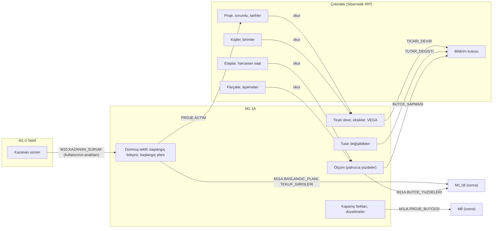
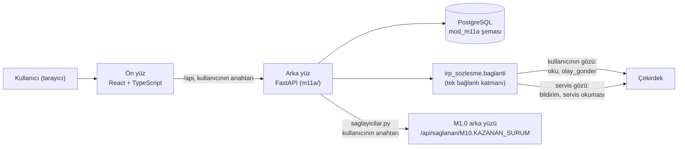

# M1.1A · Sipariş alma ve muhasebeye devir — uygulamanın açıklaması

*Modül kodu (geçici): `M11A` · Sürüm 0.1.0 · Paket `irp_sozlesme` 1.0 · çekirdek 10.2 · 30 Ekim 2026*

Bu belge M1.1A'nın ne olduğunu, nasıl kurulduğunu, Sibernetik IRP çekirdeğiyle ilişkisini ve gerçek bir projede
nasıl kullanıldığını anlatır. Tarifin kendisi `SPEC.md`'de, teslim notu `TESLIM.md`'de, kurulum ve duman testi
`gelistirme/BENIOKU.md`'dedir.

---

## İçindekiler

1. [Kısa cevap: çekirdekten ne alıyoruz, çekirdeğe ne veriyoruz](#1-kısa-cevap-çekirdekten-ne-alıyoruz-çekirdeğe-ne-veriyoruz)
2. [Uygulama ne işe yarar](#2-uygulama-ne-işe-yarar)
3. [Kim kullanır](#3-kim-kullanır)
4. [Mimari](#4-mimari)
5. [Çekirdekle ilişki, ayrıntılı](#5-çekirdekle-ilişki-ayrıntılı)
6. [Modülün kendi verisi](#6-modülün-kendi-verisi)
7. [Modülün kendi kuralları](#7-modülün-kendi-kuralları)
8. [Kullanım senaryosu: bir siparişin yolculuğu, baştan sona](#8-kullanım-senaryosu-bir-siparişin-yolculuğu-baştan-sona)
9. [Kısa kullanım senaryoları (rol rol)](#9-kısa-kullanım-senaryoları-rol-rol)
10. [Ekranlar](#10-ekranlar)
11. [API](#11-api)
12. [Sınama ve sözleşme senaryoları](#12-sınama-ve-sözleşme-senaryoları)
13. [Çekirdekte eksik olanlar (istekler)](#13-çekirdekte-eksik-olanlar-istekler)
14. [Gerçek buluta geçiş](#14-gerçek-buluta-geçiş)
15. [Çalıştırmak](#15-çalıştırmak)
16. [Sözlük](#16-sözlük)

---

## 1. Kısa cevap: çekirdekten ne alıyoruz, çekirdeğe ne veriyoruz

Çekirdek, firmanın ortak motorudur: insanı, işi, zamanı ve parayı izler. M1.1A onun üstüne kurulan bir modüldür.
Çekirdeğin verisini **kopyalamaz**, kuralını **tekrar etmez**; okur, kullanıcının yaptığı işi olay olarak gönderir,
kendi kuralının sonucunu bildirim olarak bırakır. M1.1A'nın çekirdekle konuşması azdır: **tek bir olay**
(`PROJE.ACTIM`) yazar; gerisi okuma ve bildirimdir. Para modülün kendi tablosundadır, çekirdekten para okunmaz.

### 1.1 Çekirdekten aldıklarımız (okumalar)

Hepsi **kullanıcının gözüyle** okunur: çekirdek, o kişinin yetkisini ve görme kurallarını uygular.

| Okuma | Çekirdekten ne geliyor | Modül ne için kullanıyor |
|---|---|---|
| `PROJE` | Kod, ad, müşteri, sorumlu, aktif mi, başlangıç/teslim/kesin kabul tarihleri, ana proje, sürüm | Kullanıcı projeyi görüyor mu (her proje işinden önce); kartın tarihleri; ek işte ana projenin sürümü; "Yeniden dene"de açılışın doğrulanması; kapanışın varsayılan kesin kabul tarihi |
| `KISILER` | Kişiler: ad, birim, roller, aktif mi | Oturumdaki kişinin rolü (istek başına bir kez); sorumlu seçimi ve doğrulaması |
| `BIRIMLER` | Birimler | Ayarlarda yedek saat ücretinin birimi |
| `PROJE_DURUM` | Projenin ve her etabının harcanan saati (`harcanan_emek`) | Bütçe ölçümü: tahmini gerçekleşen işçilik. Tutar alanları kullanılmaz |
| `ETAPLAR` | Projenin etapları ve birimleri | Etabın saatinin hangi birim ücretiyle çarpılacağı |
| `NESNELER` | Projenin nesneleri ve aşamaları | İlerleme: montaja hazır ve montajdaki `PARCA` ÷ bütün `PARCA` |
| `M10.KAZANAN_SURUM` | (M1.0'dan; çekirdekten değil) Kazanan teklif sürümü: müşteri, fiyat, kalemler, işçilik, takvim, PDF | Siparişe dönüştürme. Çekirdek modüller arası okumayı henüz yönlendirmediği için M1.0'ın arka yüzünden, kullanıcının anahtarıyla gelir (M11A-02) |

Ayrıca **servis gözüyle** bir okuma (yalnızca kural işi için, ekrana gitmez): `PROJE` (proje hâlâ aktif mi).

### 1.2 Çekirdeğe verdiklerimiz (olaylar)

Olay, **insanın yaptığı iştir**; kullanıcının oturumuyla gönderilir. Modül kendi adına olay yazmaz.

| Olay | Ne zaman | Önemli girdiler |
|---|---|---|
| `PROJE.ACTIM` | Satış yöneticisi "Siparişe dönüştür"e basınca | kimlik = kod, ad (teklifin konusu), müşteri, sorumlu, başlangıç (sipariş tarihi), teslim, kesin kabul; ek iş ve serviste ana proje (ana projenin **okunan sürümüyle**) |

Başka olay yoktur. Ticari devir, eksikler, VEGA kodları, tutar değişikliği, ölçüm ve kapanış modülün kendi
bilgisidir; çekirdeğe olay olarak gitmez. M1.1A çekirdekteki projeyi açtıktan sonra değiştirmez (kod değişmez;
`PROJE.DEGISTIRDIM` yazmaz).

### 1.3 Çekirdeğin bildirim kapısı

| Kural | Ne zaman | Kime | Önem |
|---|---|---|---|
| `TICARI_DEVIR` | "Muhasebeye devret"te bırakılır; süzülen alıcı kaldıkça kural işi yeniden bırakır; devir tamamlanınca kaldırılır | `ROL MUHASEBE` | Bilgi |
| `TUTAR_DEGISTI` | Her tutar değişikliğinde bırakılır ya da metni güncellenir; bütçe kapanınca ya da proje kapanınca kaldırılır | `ROL MUHASEBE` | Bilgi |
| `BUTCE_SAPMASI` | Ölçüm kırmızıysa bırakılır ya da güncellenir; renk düzelince kaldırılır | Projenin satış yöneticisi (`KISI`) ve `ROL YETKILI` | Uyarı |

Bildirim olay değildir; modülün kuralının sonucudur. Kişi onu **çekirdeğin bildirim kutusunda** görür. Modülün ayrı
bir bildirim kutusu yoktur. Bildirim metinlerinde **tutar yoktur**; yalnızca projenin kodu, adı ve yüzdeler yazar.

### 1.4 Çekirdeğin bizim yerimize uyguladığı kurallar

Modül bunları **kendisi yazmaz**, çekirdeğe sorar ya da çekirdeğin cevabına uyar:

- **Görünürlük.** Kim hangi projeyi görür. Modül her proje işinden önce `PROJE`'yi kullanıcının gözüyle okur;
  `YETKI` gelirse "Bu projeyi göremiyorsunuz" der ve o projeye ait hiçbir kaydını göstermez. Muhasebe projeyi
  göremiyorsa modül ona projeyi açmaz (M11A-01).
- **Proje açma yetkisi.** `PROJE.ACTIM`'ı kimin yazabileceği çekirdeğin yetki tablosundadır (`SATIS` M1.0'ın yetki
  önerisiyle, `YETKILI` her zaman). Modül de kendi kuralını uygular, ama çekirdeğin reddi son sözdür.
- **Kodun tekilliği.** Kod çekirdekte kullanılıyorsa çekirdek reddeder; modül kodu kendi tablosunda da arar ama
  çekirdekteki projeleri saymaya kalkmaz.
- **Ana projenin tek basamak olması.** Ek işin ana projesi kendi başına bir ek işse çekirdek reddeder.
- **Çalışılan saat.** Etabın ve projenin harcanan saati çekirdeğin hesabıdır (`PROJE_DURUM`). Modül saati kendisi
  hesaplamaz, maaşı ya da saat maliyetini taklit etmez.
- **Parçanın aşaması.** Çekirdektedir (`NESNELER`); modül aşamayı saklamaz, yalnızca ilerleme yüzdesini saklar.
- **Bildirimin süzülmesi.** Projeyi göremeyen, ayrılmış ya da istihdam dışı alıcı çekirdekte süzülür; cevap kimin
  neden süzüldüğünü söyler, modül bunu devir kaydına yazar ve ekranda gösterir.

### 1.5 Bir bakışta



---

## 2. Uygulama ne işe yarar

Sibernetik siparişe göre makine tasarlayıp üretir. Teklif (M1.0) kazanılınca iki iş aynı anda başlar: **muhasebeye
devir** (M1.1A) ve **proje ekibine devir** (M1.1B). Bugün bu geçiş dağınıktır: proje kodu elle verilir, teklifin
maliyet kırılımı ve takvimi bir yerde donmaz, ticari koşullar muhasebeye e-postayla gider, eksik bilgi unutulur,
bütçenin nereye gittiği ancak proje bitince anlaşılır.

M1.1A beş iş yapar:

1. Kazanan teklifi **tek tıkla siparişe dönüştürür**.
2. Proje kodunu verir, projeyi çekirdekte açar.
3. Teklifin maliyetini **başlangıç bütçesi**, takvimini **başlangıç planı** olarak dondurur.
4. Ticari koşulları **muhasebeye devreder**; eksik bilgiyi izler.
5. **Bütçe izlemesini** açar: dolum ile ilerleme yan yana. Bütçe kesin kabule kadar yaşar.

Başarı şöyle görünür:

- Satış yöneticisi kazanılan teklifin üstünde "Siparişe dönüştür" der, PO'yu kaydeder; proje açılır: `2611001`.
- M1.1B aynı projeyi hemen devralır: proje çekirdekte tarihleri ve sorumlusuyla vardır.
- PO gelmediyse proje yine açılır; "PO bekleniyor" işareti kalır.
- Eksik ticari bilgi devri durdurmaz. Muhasebe eksik listesini görür, tamamlar, VEGA kart kodlarını yazar, devri bitirir.
- **Sözleşme tutarı ve başlangıç bütçesi hiç değişmez.** Kapsam değişince güncel tutar ve güncel bütçe gerekçe ve
  belgeyle değişir.
- Dolum ilerlemeyi eşikten fazla geçerse satış yöneticisine ve yetkiliye uyarı gider.
- Kesin kabulde bütçe kilitlenir; fark kalem bazında kalır.

### 2.1 Faz 1'de olmayanlar

Malzeme ve fason gerçekleşeni (M3'ün tutarları gelince, M11A-05), genel gider gerçekleşeni (formül belirlenmedi,
S-8), VEGA ile otomatik eşleşme, kalan maliyet tahmini (M8), tarih uyarılarının bildirim olması (Faz 1'de gelen
kutusunda sütun), kesin kabulün M7'den gelmesi (Faz 1'de muhasebe elle kapatır), kapanış farkının M1.0'ın öğrenme
katmanına gitmesi (M11A-06), teklifsiz projeye bütçe açmak. Gerekçeleri `SPEC.md` › 2.2'de.

---

## 3. Kim kullanır

Örnek firmanın kişileri ve A ekibi zemininin (`SPEC.md` › Ek D.10) eklediği iki kişiyle:

| Kişi | Rol | M1.1A'da ne yapar |
|---|---|---|
| **K050** Satış Yöneticisi | `YONETICI`, `SATIS` (M1.0'ın rolü), SATIS birimi | Siparişe dönüştürür, PO ve sözleşmeyi kaydeder, ticari formu doldurur, muhasebeye devreder, tutar değişikliği yapar; `BUTCE_SAPMASI`'nı alır |
| **K060** Muhasebe Uzmanı | `BEYAZ_YAKA`, `MUHASEBE` (M1.1A'nın rolü), MUHASEBE birimi | Gelen kutusunu izler, devri alır, eksikleri ister ve kapatır, VEGA kodlarını yazar, devri tamamlar, bütçeyi kapatır, kapanış sonrası düzeltme yazar. **Projeyi görmesi için yetkilinin erişim vermesi gerekir** (M11A-01) |
| **K001** Genel Müdür | `YETKILI` | Her şeyi yapabilir ve görür; ayarları yapar; çekirdeğin ekranından proje erişimi verir; `BUTCE_SAPMASI`'nı alır |
| **K012** Tasarım Müdürü | `YONETICI`, MEK_TASARIM | Etabı olan projede şeridi ve yüzdeleri görür; tutarları, ticari formu ve bütçe panelini **görmez** ("ekip liderleri yalnızca yüzdeleri görür") |
| **K004** Planlama Müdürü | `YONETICI` | `SATIS` rolü olmadığı için dönüştüremez; modül 403 der, doğrudan denerse çekirdek de `YETKI` der |
| **K017** Kaynakçı | `CALISAN`, atölye (mavi yaka) | Projeyi görmez. Mavi yakanın tek yolu çekirdeğin telefon uygulamasıdır; M1.1A ona düğme eklemez |

M1.1A'nın tek yeni rolü `MUHASEBE`'dir (künyede tanımlı). `SATIS` M1.0'ın rolüdür; M1.1A bu yüzden M1.0'a
bağımlıdır (isteğe bağlı bağımlılık).

---

## 4. Mimari

### 4.1 Katmanlar



- **Ön yüz** çekirdeği hiçbir zaman doğrudan çağırmaz; yalnızca modülün arka yüzünü (`/api`) çağırır. Ekranların
  yolu (S1) kesinleşince yalnızca ön yüz değişir.
- **Arka yüz** çekirdeğe yalnızca paketteki bağlantı katmanından gider (`m11a/baglanti.py`). Kodda çekirdeğe başka
  istek, başka SQL yoktur. M1.0'a giden tek kapı `m11a/saglayicilar.py`'dir; çekirdek modüller arası okumayı
  yönlendirince yalnızca o dosya değişir.
- **Veritabanı:** modülün verisi kendi şemasındadır (`mod_m11a`). Çekirdeğin ve M1.0'ın kayıtları yalnızca
  kimlikleriyle, değer olarak tutulur (yabancı anahtar yok; başka modülün şeması okunmaz).
- **Saf fonksiyonlar** (`alan/kod.py`, `tarih.py`, `butce.py`, `olcum.py`, `eksik.py`) veritabanına ve çekirdeğe
  dokunmaz; birim testleriyle sınanır.

### 4.2 İki göz

| Göz | Kimlik | Ne için | Örnek |
|---|---|---|---|
| **Kullanıcının gözü** | Kullanıcının erişim anahtarı (JWT) | Ekrana gidecek her okuma, ölçüm ve tek olay | K050'nin `PROJE.ACTIM`'ı; K050'nin bütçe ölçümü |
| **Servis gözü** | `SRV-M11A` | Bildirim bırakmak/kaldırmak; kural işinde "proje aktif mi?" | `TICARI_DEVIR`; proje kapanınca bildirimlerin kaldırılması |

Servis gözüyle okunan hiçbir şey ekrana gitmez; servis gözüyle olay yazılmaz; servis gözüyle **para ya da saat
okunmaz**. Bütçe ölçümü arka planda yapılmaz: biri projeyi, bütçeler listesini ya da `M11A.BUTCE_YUZDELERI`'ni
açtığında, onun gözüyle yapılır.

### 4.3 Sürücü: simülatör ya da gerçek bulut

Bağlantı katmanının altında bir sürücü çalışır; modülün kodu hangisi olduğunu bilmez.

| Sürücü | Ne zaman | Seçim |
|---|---|---|
| Simülatör | Testler (çekirdeğin Python modeli, aynı süreçte) | `IRP_CEKIRDEK` verilmez |
| HTTP | Sahte bulut (yerel geliştirme, ortak ortam) ve gerçek bulut (Supabase) | `IRP_CEKIRDEK=http`, `IRP_TABAN`, `IRP_ANON`, `IRP_SERVIS` |

Gerçek buluta geçince **modülün kodunda tek satır değişmez**; yalnızca bu dört ortam değişkeni verilir.

### 4.4 Oturum

Üründe kullanıcı çekirdeğin girişiyle girer; ekran onun erişim anahtarını arka yüze iletir; arka yüz
`cekirdek.oturum(anahtar)` ile çalışır. Modül şifre görmez, saklamaz. Aynı anahtar M1.0'a da olduğu gibi iletilir.
Geliştirmede `/api/gelistirme/giris` bir kişi için anahtar verir (yalnızca `M11A_GELISTIRME=1`).

### 4.5 Olay kimliği

Her olayın kimliği `<kişi>-<yyaagg><sıra>-<modülün harfi>` biçimindedir, ör. `K050-2611020001-Q`. Sıra kişi ve gün
başına modülün kendi tablosunda (`olay_sayaci`) **tek işlemle** artar (`TabloSayac`, kendi kısa işleminde). Harf
modüle ayrıldığı için M1.1B'nin (`R`) aynı kişi ve günde verdiği sırayla çakışmaz.

### 4.6 Klasör düzeni

```
m1.1a/                      modülün kökü
  irp_sozlesme/             paket (çekirdeğe bağlanmanın tek yolu; değiştirilmez)
  kunye.json                modülün kimlik kartı
  veritabani/               göçler (yalnızca mod_m11a): 001_m11a.sql, 002_varsayilanlar.sql
  m11a/                     arka yüz
    ayarlar.py              ortam değişkenleri
    baglanti.py             Cekirdek.ac, TabloSayac
    vt.py                   PostgreSQL bağlantısı (anlar +03:00), göçleri koşmak (geliştirme)
    saglayicilar.py         M1.0'a giden tek kapı: HTTP ve sahte sağlayıcı
    depo/                   modülün tablolarına SQL
    alan/                   iş kuralları: donusturme, kod, tarih, butce, olcum, eksik, devir, ticari, tutar,
                            serit (ölçüm, şerit, panel), kapanis, bildirim, kurallar, yetki, saglanan, ayar
    api/                    FastAPI uçları, istek bağlamı, hata eşleme
    komutlar.py             python -m m11a.komutlar <komut>
  testler/                  pytest; sabitler/M10.KAZANAN_SURUM.json (Ek D.5)
  senaryolar/               sözleşme senaryoları (*.girdi.json, *.beklenen.json)
  istekler/                 çekirdeğe istekler (M11A-01 … M11A-09)
  on_yuz/                   React uygulaması
  gelistirme/               docker-compose, yerel şema, örnek ayarlar, ortak_zemin.py, ortak_duman.py, BENIOKU.md
  TESLIM.md, SPEC.md, ACIKLAMA.md
```

### 4.7 Künye

`kunye.json` modülün çekirdekteki kimlik kartıdır. Modülün çekirdekte kullandığı **her şey** burada beyan edilir;
künyede olmayanı bağlantı katmanı da yapmaz. M1.1A'nın künyesinde: 7 okuma (biri M1.0'ın `M10.KAZANAN_SURUM`'u),
1 servis okuması, 1 olay, 3 bildirim kuralı, 1 rol (`MUHASEBE`), 4 sağlanan okuma, M1.0'a isteğe bağlı bağımlılık,
derin bağlantı `/proje/{kimlik}`, kişisel veri beyanı (donmuş teklifteki müşteri iletişim kişileri), `para: true`,
9 istek. Nesne türü ve kod listesi tanımlamaz. Denetim: 0 hata, 0 uyarı; M1.0 ve M1.1B ile birlikte kayıt
denetimi 0 hata.

---

## 5. Çekirdekle ilişki, ayrıntılı

### 5.1 Ne nerede durur

| Kavram | Nerede | Nasıl |
|---|---|---|
| Teklif, müşteri, fiyat, maliyet kırılımı, takvim | M1.0 | `M10.KAZANAN_SURUM`, yalnızca dönüştürmede, kullanıcının anahtarıyla |
| Teklifin donmuş kopyası, PDF, kurlar, sözleşme tutarı | **Modül** | `projeler` (tetikleyiciyle değişmez) |
| Proje, kodu, sorumlusu, tarihleri | Çekirdek | `PROJE.ACTIM` ile açılır; `PROJE` ile okunur. M1.1A açtıktan sonra değiştirmez |
| Sipariş: PO, sözleşme dosyası, yıllık sıra, VEGA kodları | **Modül** | `projeler`, `dosya_kayitlari` |
| Başlangıç ve güncel bütçe (dört kalem) | **Modül** | `butce_satirlari` (başlangıç tetikleyiciyle değişmez) |
| Başlangıç planı (tarihlenmiş teklif takvimi) | **Modül** | `baslangic_plani`. Etapları M1.1B yazar; M1.1A etap yazmaz |
| Ticari koşullar, ödeme, teminat, devir, eksikler | **Modül** | `ticari_kosullar`, `odeme_satirlari`, `teminatlar`, `devirler`, `eksik_bilgiler` |
| Projeye harcanan saat | Çekirdek | `PROJE_DURUM` › `etaplar[].harcanan_emek`. Tutar alanları kullanılmaz |
| Etabın birimi | Çekirdek | `ETAPLAR` |
| Parçanın aşaması | Çekirdek | `NESNELER`; yalnızca `tur == 'PARCA'` sayılır |
| Ölçüm sonucu | **Modül** | `butce_olcumleri`: yalnızca yüzdeler, kapsam, eşik, uyarı, bilinmeyen saat |
| Muhasebeye ve satışa haber | Çekirdeğin bildirim kapısı | `TICARI_DEVIR`, `TUTAR_DEGISTI`, `BUTCE_SAPMASI` |
| Saat | Çekirdek | Modülün kayıtlarındaki anlar ve "bugün" `cekirdek.simdi()`'den gelir (+03:00) |

**İlke:** Modül yalnızca **kendi bilgisini** tutar (donmuş teklif, para, ticari koşullar, devir, ölçümün yüzdeleri,
kapanış). Proje, kişi, birim, etap, saat ya da parça aşamasını ikinci kez tutmaz; bunlar için çekirdeğin kimliğini
değer olarak saklar ve gerektiğinde okur.

### 5.2 Okumaların ayrıntısı ve görme kuralları

| Okuma | Kim görür (çekirdeğin kuralı) | Modülde nerede |
|---|---|---|
| `PROJE` | Proje ekibi (`UYELER` ayarı): sorumlu, projede etabı olan birimin yöneticisi ve üstleri, etap sorumluları, erişim verilenler, yetkili | Her `{p}` ucu; gelen kutusunun ve bütçeler listesinin satır süzgeci |
| `PROJE_DURUM` | Projeyi gören; tutarlar yalnızca `YETKILI`'ye (öteki maskeli gelir) | Ölçüm; M1.1A tutarı hiç kullanmaz |
| `ETAPLAR`, `NESNELER` | Projeyi gören | Ölçüm |
| `KISILER`, `BIRIMLER` | İstihdamda olan herkes | Rol, seçim listeleri |

Görünürlüğün en önemli sonucu: **muhasebe yeni açılan projeyi göremez** ve projeyi açan satış yöneticisi sorumluyu
başkası yaparsa kendi açtığı projeyi göremez (M11A-01). Modül bunu düzeltmeye çalışmaz; süzüleni gösterir, yetkili
erişim verene kadar bekler.

### 5.3 Yönetim kararı ve bayatlık

M1.1A'nın tek yönetim kararı `PROJE.ACTIM`'dır ve yeni bir proje açtığı için dayandığı bir kayıt yoktur. Ek iş ve
serviste ise karar **ana projeye** dayanır: modül ana projeyi kullanıcının gözüyle okur ve okunan sürümü
`neyin_ustunde`'ye koyar. Ana proje arada değiştiyse çekirdek `BAYAT` der; modül satırları geri alır ve 409
`DEGISTI` ("Ana proje bu arada değişti; yeniden açın") döner. Kendiliğinden yeniden göndermez.

Modülün kendi formlarında eşzamanlılık modülün sürümüyle korunur: ticari formu iki kişi aynı anda kaydederse ikincisi
409 `DEGISTI` alır ve güncel hal ekrana yüklenir.

### 5.4 Yetki: iki katman

1. **Çekirdeğin yetkisi** `PROJE.ACTIM`'da: `SATIS` (M1.0'ın yetki önerisi) ve `YETKILI` kabul edilir; `SATIS`'i
   olmayan biri `YETKI` alır.
2. **Modülün kuralı** yalnızca modülün kendi işleri için (`m11a/alan/yetki.py`):

| İş | Modülün kuralı |
|---|---|
| Projeye ait herhangi bir şey | Önce `PROJE` okunur; `YETKI` → 403 "Bu projeyi göremiyorsunuz" |
| Siparişe dönüştürmek | `SATIS`, `YETKILI` (M1.0 da kendi kuralını uygular) |
| PO ve sözleşme, ticari form, dosya kaydı | `SATIS`, `MUHASEBE`, `YETKILI` |
| Muhasebeye devretmek | `SATIS`, `YETKILI` |
| Devri almak, eksikleri yönetmek, VEGA kodları, devri tamamlamak | `MUHASEBE`, `YETKILI` |
| Tutar değişikliği | `SATIS`, `YETKILI` |
| Bütçeyi kapatmak, kapanış sonrası düzeltme | `MUHASEBE`, `YETKILI` |
| **Tutarları görmek** (bütçe paneli, ticari koşullar, `M11A.PROJE_BUTCESI`) | `SATIS`, `MUHASEBE`, `YETKILI` |
| Şerit, yüzdeler, başlangıç planı, teklif girdileri, müşteri PDF'i | Projeyi gören herkes |
| Muhasebe gelen kutusu | `MUHASEBE`, `YETKILI` |
| Bütçeler listesi | `SATIS`, `MUHASEBE`, `YETKILI` |
| Ayarlar | `YETKILI` |

Rol kuralı tutmayan istek **çekirdeğe gitmeden** 403 alır. Tutarları görmeyenin cevabında tutar alanı boş değil,
**hiç yoktur** (ör. K012'nin `/butce` cevabında `panel` anahtarı bulunmaz).

### 5.5 Çekirdeğin cevapları ve ekrandaki karşılıkları

| Durum | HTTP | Kod | Ekranda |
|---|---|---|---|
| `PROJE` okumasında `YETKI` | 403 | `YETKI` | "Bu projeyi göremiyorsunuz." |
| Modülün rol kuralı | 403 | `YETKI` | "Bu işi muhasebe ya da yetkili yapar." vb. |
| `PROJE.ACTIM` → `YETKI` | 403 | `YETKI` | "Çekirdekte proje açma yetkiniz yok (PROJE.ACTIM)." |
| `PROJE.ACTIM` → `DURUM`, kod kullanılıyor | 409 | `KOD_KULLANILIYOR` | "2614 kodu çekirdekte kullanılıyor." + önerilen kod |
| `PROJE.ACTIM` → `DURUM`, ana projenin ana projesi var | 409 | `ANA_PROJE` | "2611002 bir ek işin projesi; ek iş ana projeye bağlanır (2611001)." |
| Sürüm gönderilmemiş ya da kazanılmamış | 409 | `KAPI` | "Yalnızca gönderilmiş ve kazanılmış teklif siparişe dönüştürülür." |
| Sürüm zaten dönüştürülmüş | 409 | `ZATEN_DONUSTU` | "Bu teklif 2611001 olarak açıldı." (çekirdeğe olay gitmez) |
| M1.0'a ulaşılamıyor | 503 | `SAGLAYICI_YOK` | "Teklif modülüne (M1.0) ulaşılamıyor; dönüştürme şu an yapılamaz." |
| M1.0 403 | 403 | `YETKI` | "Bu teklifi görme yetkiniz yok." |
| Bütçe kapalı | 409 | `BUTCE_KAPALI` | "Bütçe kapalı; tutar değişikliği yapılmaz." |
| Devri tamamlama koşulu | 409 | `DURUM` | "Açık eksik var." / "VEGA kodları boş." |
| Doğrulama | 422 | `DOGRULAMA` | Alan alan, satır numarasıyla |
| Aynı anda düzenleme | 409 | `DEGISTI` | Güncel hal yüklenir |
| `BAGLANTI` | 503 | `BAGLANTI` | "Çekirdeğe ulaşılamıyor…"; dönüştürmede "Yeniden dene" |
| `BICIM` / `KUNYE` / `URUN` | 400 / 500 / 502 | `BEKLENMEYEN` / `URUN` | Günlüğe ayrıntısıyla yazılır |

Çekirdek kod çakışmasını da ana proje hatasını da aynı nedenle (`DURUM: Bulut kapisi kapali`) reddeder. Modül
hangisi olduğunu, açılıştan önce okuduğu ana projenin kaydından anlar: ana projenin kendi ana projesi varsa
`ANA_PROJE`, yoksa `KOD_KULLANILIYOR`. Karar her zaman çekirdeğin reddinden sonra verilir; kural tekrar edilmez
(M11A-09).

### 5.6 Siparişe dönüştürme: niyet, olay, sonuç

Dönüştürme hem modülün tablosuna hem çekirdeğe yazar; ikisinin arasında ağ kopabilir. Bu yüzden üç adımdır:

```mermaid
sequenceDiagram
  participant S as Satış yöneticisi
  participant M as M1.1A arka yüz
  participant T as M1.0
  participant V as mod_m11a
  participant C as Çekirdek
  S->>M: Siparişe dönüştür
  M->>T: M10.KAZANAN_SURUM (yeniden; önizleme eski olabilir)
  T-->>M: Sürüm, kapı açık
  M->>C: (ek işte) PROJE ana proje, sürümüyle
  M->>V: Niyet: projeler ACILIYOR + donmuş kopya, bütçe, plan, dosyalar (tek işlem, commit)
  M->>C: PROJE.ACTIM (kullanıcının gözü)
  alt BASARILI
    M->>V: ACIK, açılış olayı
    M-->>S: Proje 2611001, sipariş adı, eksikler, M1.1B geçişi
  else REDDEDILDI (DURUM, YETKI, BAYAT)
    M->>V: Satır ve çocukları silinir, sayaçlar geri verilir (tek işlem)
    M-->>S: 409 / 403
  else BAGLANTI
    M-->>S: 503, satır ACILIYOR kalır, "Yeniden dene"
  end
```

- **"Yeniden dene"** kullanıcının gözüyle `PROJE`'yi okur. Proje varsa ve kodu, müşterisi uyuşuyorsa satır `ACIK`
  olur, açılış olayı boş kalır ("PROJE okumasıyla doğrulandı"). Proje yoksa `PROJE.ACTIM` yeniden gönderilir.
  Proje var ama açan göremiyorsa (sorumlu başkası) ve çekirdek kodu kullanılıyor derse kayıt **silinmez**; açılış
  yetkilinin erişimini bekler.
- `ACILIYOR` satır yalnızca açan kişiye, "Açılış tamamlanmadı" olarak görünür; hiçbir listeye ve okumaya girmez.
- **Çifte dönüştürme:** `teklif_surumu` tekildir; ikinci dönüştürme çekirdeğe olay göndermeden 409 alır.
- **PDF'in parmak izi** baytlardan yeniden hesaplanır; M1.0'ın verdiğiyle uyuşmazsa hiçbir şey yazılmaz (502).

### 5.7 Bildirim ve kural işi

**Bırakma örnekleri:**

| Kural | Kayıt | Metin |
|---|---|---|
| `TICARI_DEVIR` | `{tur: PROJE, kimlik: 2611001, modul_kaydi: "ticari devir"}` | `2611001 710 Projesi Burç Çakma Ekipmanı · Ticari devir: 4 eksik` |
| `TUTAR_DEGISTI` | `{…, modul_kaydi: "tutar değişikliği"}` | `2611001 710 Projesi Burç Çakma Ekipmanı · Güncel tutar ve bütçe değişti (değişiklik #2)` |
| `BUTCE_SAPMASI` | `{…, modul_kaydi: "bütçe"}` | `2611001 710 Projesi Burç Çakma Ekipmanı · İşçilik dolumu %32,0, ilerleme %0,0 (32,0 puan; eşik 15)` |

Aynı kural ve kayıtla yeniden bırakmak metni günceller; kişinin "gördüm"ü korunur. Açık duran bildirimler
`acik_bildirimler`'de tutulur, böylece kaldırılacakları bilinir. `TICARI_DEVIR` bırakılınca çekirdeğin cevabındaki
`alicilar` ve `suzulenler` devir satırına yazılır. Bildirim başarısız olursa iş geri alınmaz; kural işi telafi eder.

**Kural işi** (`python -m m11a.komutlar kurallari-calistir`, ayrıca arka yüzde `M11A_KURAL_ARALIGI_DK` dakikada bir;
varsayılan 15, `0` kapatır). Her `ACIK` proje için:

1. Proje aktif değilse (servis gözüyle `PROJE`) açık bildirimlerin hepsi kaldırılır.
2. Bütçe `KAPALI` ise `BUTCE_SAPMASI` ve `TUTAR_DEGISTI` kaldırılır.
3. Devir `TAMAM` ise `TICARI_DEVIR` kaldırılır.
4. Devir `TAMAM` değilse ve bildirim bırakılamamışsa ya da süzülen alıcı varsa `TICARI_DEVIR` yeniden bırakılır.
   **Erişimi sonradan verilen muhasebeci bildirimi böyle alır.**
5. Bildirimi bırakılamamış son tutar değişikliği için `TUTAR_DEGISTI` bırakılır.

`BUTCE_SAPMASI` kural işinde yeniden hesaplanmaz (ölçüm kullanıcının gözüyledir); kural işi onu yalnızca kaldırır.
Tekrar güvenlidir. Modül kapatılmadan önce `bildirimleri-kaldir` bütün açık bildirimleri kaldırır.

Üründe servis okuması MVP'den sonra gelir; o zamana kadar 1. adım atlanır (günlüğe yazılır), öteki adımlar
modülün kendi tablosuna baktığı için çalışır.

### 5.8 Sağlanan okumalar

M1.1A başka modüllere dört okuma sağlar (künyede `saglananlar`). Dördü de `proje` parametresi alır; her biri önce
`PROJE`'yi kullanıcının gözüyle okur (`YETKI` → 403). Projenin M1.1A kaydı yoksa 404 `BULUNAMADI`; kayıt
`ACILIYOR` ise 409 `KAPI`.

| Okuma | Cevap | Görme | Kim kullanır |
|---|---|---|---|
| `M11A.BASLANGIC_PLANI` | Sipariş, teslim, kesin kabul tarihi; on etap: kod, ad, sıra, paralel grup, hafta, başlangıç, bitiş | Projeyi gören | M1.1B'nin ön doldurması (sonra) |
| `M11A.TEKLIF_GIRDILERI` | Konu, gereksinimler, kapsam (dahil/hariç), talep dosyaları, müşteri PDF'inin kaydı ve yolu. Fiyat, maliyet, kâr yok | Projeyi gören | M1.1B klasör arşivi, M2 tasarım girdisi |
| `M11A.BUTCE_YUZDELERI` | Dolum, ilerleme, sapma, eşik, renk, kapsam, ölçüm anı, bütçe durumu, PO bekleniyor. Tutar yok | Projeyi gören | Ekip liderleri, M1.1B |
| `M11A.PROJE_BUTCESI` | Sözleşme ve güncel tutar, dört kalem (başlangıç, güncel, tahmini gerçekleşen, kaynak), değişiklikler, kapanış ve düzeltmeler | `SATIS`, `MUHASEBE`, `YETKILI`; para | M8 (sonra) |

Çekirdeğin modüller arası yönlendirmesi henüz yok (M11A-02); Faz 1'de `GET /api/saglanan/{ad}?proje=` olarak durur.
`BUTCE_YUZDELERI`'ni her çağırmak ölçümü o kişinin gözüyle yeniden yapar.

---

## 6. Modülün kendi verisi

Şema `mod_m11a`. Göçler: `veritabani/001_m11a.sql` (tablolar ve tetikleyiciler), `002_varsayilanlar.sql`
(varsayılan ayarlar).

| Tablo | Ne tutar |
|---|---|
| `olay_sayaci` + `olay_sirasi()` | Olay kimliğinin kişi ve gün başına sırası |
| `sayaclar` + `sayac_ilerlet()` | Proje kodunun (yıl ya da ay kapsamında) ve yıllık sipariş sırasının sayacı |
| `ayarlar`, `saat_ucretleri` | Kalıplar, sapma eşiği, yaklaşan tarih günü; teklifte işçiliği olmayan birimler için yedek saat ücreti |
| `projeler` | Projenin M1.1A kaydı: durum (`ACILIYOR`, `ACIK`), teklif sürümü (tekil), müşteri, ana proje, sorumlu, satış yöneticisi, tarihler, yıllık sıra, PO, sözleşme, VEGA kodları, para birimi, sözleşme ve güncel tutar, kurlar, donmuş teklif, PDF ve parmak izi, açılış olayı, bütçe durumu ve kapanış |
| `butce_satirlari` | Dört kalem: başlangıç (donmuş) ve güncel |
| `proje_saat_ucretleri` | Tekliften donmuş birim saat ücretleri (MEK_TASARIM 1.760 TL, IMALAT 1.408 TL) |
| `baslangic_plani` | Teklifin takvimi, sipariş tarihine göre tarihlenmiş |
| `dosya_kayitlari` | PO, sözleşme, teminat mektubu, tutar değişikliği belgesi, fatura: ad, konum, parmak izi. Dosyanın kendisi şirket sunucusunda |
| `ticari_kosullar`, `odeme_satirlari`, `teminatlar` | Ticari devir formu (formun sürümüyle) |
| `devirler`, `eksik_bilgiler` | Muhasebeye devir (durum, gören, tamamlayan, son alıcılar ve süzülenler); eksik listesi |
| `tutar_degisiklikleri` | Eski ve yeni güncel tutar, eski ve yeni bütçe, gerekçe, belge, bildirim bırakıldı mı |
| `butce_olcumleri` | Yalnızca yüzdeler, kapsam, eşik, uyarı, ücreti bilinmeyen saat. Tutar ve saat saklanmaz |
| `acik_bildirimler` | Çekirdekte açık duran bildirimlerimiz (kaldırmak için) |
| `kapanis_farklari`, `kapanis_sonrasi_duzeltmeler` | Kesin kabulde kalem bazında fark; kilitten sonra gelen fatura |

**Değişmezler (tetikleyiciyle):** sözleşme tutarı, para birimi, teklif sürümü, donmuş teklif, kurlar, PDF'in parmak
izi ve başlangıç bütçesi değişmez. Bir teklif sürümü bir kez dönüştürülür. Koşulu `TARIH` olan ödeme satırında
tarih zorunludur. Kapalı bütçede kapanış anı, kesin kabul ve kapatan zorunludur. Bütçe `KAPALI` iken tutar
değişikliği yapılmaz (modülün kuralı, 409).

**Kişisel veri ve para:** Donmuş teklifteki müşteri iletişim kişileri kişisel veridir ve beyanlıdır (muhasebenin
eksik bilgiyi müşteriden istemesi için). Modül para tutar (`para: true`); çekirdekten para okumaz.

---

## 7. Modülün kendi kuralları

Bunlar çekirdeğin değil modülün kurallarıdır; çoğu saf fonksiyon olarak yazıldı ve birim testleriyle sınanır.

### 7.1 Proje kodu ve sipariş adı

- **Kod kalıbı** `proje_kodu_deseni` (varsayılan `{YY}{AA}{SIRA3}`), sıra kapsamı `YIL` ya da `AY`. 02.11.2026'daki
  yılın ilk siparişi `2611001`. Önizleme sayacı ilerletmez; kod dönüştürmede verilir. Modülün tablosunda olan kod
  atlanır.
- **Elle kod:** teklifte kod verilmişse elle yazılır (`^[0-9A-Za-z-]{2,20}$`). Kod açıldıktan sonra değişmez.
- **Sipariş adı** saklanmaz, alanlarından kurulur: varsayılan
  `{YYYY}-{YILLIK_SIRA3}-{PROJE_KODU}___{MUSTERI}-{PROJE_ADI}_{PO}`, ör.
  `2026-001-2611001___Autoliv-710 Projesi Burç Çakma Ekipmanı_PO1246789`. PO yoksa `PO-BEKLENIYOR`.
- Açılış geri alınınca (çekirdek reddetti) sayaçlar, arada başkası ilerletmediyse geri verilir; sırada boşluk kalmaz.

### 7.2 Tarihler

- **Teslim** = sipariş tarihi + 7 × teslim süresi (hafta) − 1 gün.
- **Kayma** = teslim süresi − takvimin teslim haftası (en az 0).
- **Kesin kabul** = takvimde `KESIN_KABUL` varsa onun bitişi + kayma; yoksa boş.
- **Başlangıç planı:** her satır başlangıç = sipariş + 7 × başlangıç haftası, bitiş = sipariş + 7 × (başlangıç +
  süre) − 1. Kayma satırlara eklenmez; plan teklifteki gibidir, M1.1B B0'da düzenler.

Ek D.5'in örneğiyle, sipariş 02.11.2026: teslim 16.05.2027, kayma 3, kesin kabul 23.05.2027; mekanik tasarım
09.11.2026 – 13.12.2026.

### 7.3 Bütçe dönüşümü

Teklifin donmuş özetinden (`toplamlar.kalemler`) dört kalem: malzeme 32.500,00 €, işçilik 10.000,00 €, fason
1.000,00 €, genel gider 0,00 €. Sözleşme tutarı ve güncel tutar = teklifin fiyatı (56.000,00 €). Saat ücretleri
işçilik satırlarından. Kur kuralı: tutar × kaynağın TL kuru ÷ hedefin TL kuru, her satır ayrı yarım yukarı
yuvarlanır; kuru bilinmeyen tutar **sıfır sayılmaz**, bilinmeyen kalır.

### 7.4 Ölçüm: dolum, ilerleme, sapma

| Değer | Tanım |
|---|---|
| Etabın tahmini işçiliği | Etabın saati (`PROJE_DURUM`) × biriminin ücreti (önce projenin donmuş ücreti, yoksa yedek ücret), proje para birimine çevrilir |
| Ücreti bilinmeyen saat | Ücreti ya da kuru olmayan birimin saati + etapsız saat (projenin saati − etapların toplamı). Hesaba girmez, ekranda ayrı yazılır |
| Kapsam | Güncel işçilik bütçesi > 0 ise `["ISCILIK"]`, değilse boş. Malzeme ve fason M3 gelince, genel gider S-8 cevaplanınca girer |
| Dolum | 100 × kapsamdaki tahmini gerçekleşen ÷ kapsamdaki güncel bütçe, bir ondalık. Kapsam boşsa hesaplanamaz |
| İlerleme | 100 × (`MONTAJA_HAZIR` + `MONTAJDA` aşamasındaki `PARCA`) ÷ bütün `PARCA`, bir ondalık. Parça yoksa hesaplanamaz |
| Sapma | Dolum − ilerleme |

| Renk | Koşul | Ekranda |
|---|---|---|
| ○ Gri | Dolum ya da ilerleme hesaplanamıyor | "Hesaplanamaz" |
| ▲ Kırmızı | Sapma > eşik (varsayılan 15 puan) | "Dolum ilerlemenin 22,0 puan önünde" |
| ● Yeşil | Değilse (tam 15,0 yeşildir) | "Yolunda" |

%60 harcanmış bütçe, iş %80 bittiyse iyidir; %30 bittiyse kötüdür. Örnek (denendi): K041'in tasarım görevi
tamamlanınca `PROJE_DURUM` mekanik tasarım etabına 12,8 saat verdi: 12,8 × 1.760 TL = 22.528,00 TL = 640,00 € →
dolum 6,4; 4 parçadan 1'i montaja hazır → ilerleme 25,0 → sapma −18,6 → yeşil.

**Saklama:** yalnızca yüzdeler. Yeni satır, değerler son ölçümden farklıysa ya da son ölçüm bir saatten eskiyse
yazılır. Çekirdek hâlâ hesaplıyorsa (okuma güncel değil) ölçüm saklanmaz, uyarı bırakılmaz, ekranda "hesaplanıyor"
yazar. Aynı istekte proje iki kez ölçülmez.

### 7.5 Eksik bilgi ve devir durumu

| Alan kodu | Eksik sayılır |
|---|---|
| `PO` | PO no boş |
| `SOZLESME` | Sözleşme dosyası yok |
| `ODEME_TAKVIMI` | Ödeme satırı yok |
| `FATURALAMA` | Faturalama biçimi boş |
| `TESLIM_SEKLI` | Teslim şekli boş |
| `IHRACAT` | Yurt içi / ihracat seçilmedi |
| `TESVIK` | Teşvik seçilmedi, ya da `VAR` ve belge no boş |
| `TEMINAT` | Teminat gerekli mi seçilmedi, ya da `VAR` ve teminat satırı yok |

- Ekranda eksik alanlar her zaman işaretlidir. **Devirden önce satır açılmaz.** Devirde her eksik alan için `EKSIK`
  satırı açılır; sonra her kayıtta yeniden hesaplanır: dolan alanın satırı `ALINDI`, yeniden boşalanın satırı
  `EKSIK` olur.
- Satırın durumu: `EKSIK` → `ISTENDI` (kimden: müşteri, satış, diğer) → `ALINDI`. Otomatik satır `ALINDI`'ya yalnızca
  alan dolunca geçer; muhasebenin elle eklediği satırı muhasebe kapatır.
- **Devir durumu:** `DEVREDILDI` → "Devri aldım" → açık eksik varsa `EKSIK_VAR`, yoksa `MUHASEBE_GORDU` (her
  değişiklikte ikisi arasında yeniden hesaplanır) → "Devri tamamla" (açık eksik yok ve iki VEGA kodu dolu) → `TAMAM`.
  **`TAMAM` geri alınmaz;** sonradan çıkan eksik görünür ama durum değişmez.
- Ödeme satırlarının sözleşme para birimindeki toplamı güncel tutarla tutmazsa uyarı çıkar; durdurmaz.
- VEGA cari kodu: aynı M1.0 müşterisinin önceki projesinde varsa öneri olarak gelir.

### 7.6 Kapanış

"Bütçeyi kapat" kesin kabul tarihini ister (varsayılan çekirdeğin `PROJE.kesin_kabul_tarihi`'si). Son ölçüm
kullanıcının gözüyle yapılır; her kalem için bütçe = güncel, gerçekleşen = tahmini gerçekleşen ya da yok, fark =
bütçe − gerçekleşen ya da yok, kaynak (`SAAT_X_UCRET`, `BILGI_YOK_M3`, `FORMUL_YOK`) yazılır. Bütçe `KAPALI` olur;
`BUTCE_SAPMASI` ve `TUTAR_DEGISTI` kaldırılır. Sonra gelen fatura gerekçeli **kapanış sonrası düzeltme** satırıdır
(artı ya da eksi); farkı yeniden yazmaz, ayrı listelenir.

---

## 8. Kullanım senaryosu: bir siparişin yolculuğu, baştan sona

Teklif **T-2026-0012/V2** (M1.0): Autoliv'in **710 Projesi Burç Çakma Ekipmanı**, fiyat 56.000 €, teslim süresi 28
hafta. Müşteri teklifi kabul etti; M1.0'da talep "Kazanıldı" oldu. Her adımda: kullanıcı ne yapar, çekirdeğe ne
gider, modülde ne kalır.

### Gün 1 · 2 Kasım — Sipariş

**1. Siparişe dönüştürmek.** K050 M1.0'ın sürüm sayfasında "Kazanıldı · Siparişe dönüştür"e basar; M1.1A'nın
penceresi `/donustur?surum=57` açılır. Pencerede her şey önceden doludur: kod `2611001`, proje adı (teklifin
konusu), müşteri, sorumlu K050, sipariş tarihi bugün, teslim 16.05.2027, kesin kabul 23.05.2027 ("takvim kayması 3
hafta eklendi"), dört kalemli bütçe ve tarihlenmiş on etap. K050 PO numarasını (`PO1246789`) ve PO dosyasının
sunucudaki yerini yazar, "Siparişe dönüştür"e basar.
- M1.0'dan: `M10.KAZANAN_SURUM` (önizlemede bir, dönüştürmede bir kez daha; K050'nin anahtarıyla).
- Çekirdekten: `KISILER` (K050'nin rolü; sorumlu aktif mi).
- Modülde: `projeler` satırı (önce `ACILIYOR`), donmuş teklif ve PDF, dört bütçe satırı, iki saat ücreti, on plan
  satırı, PO'nun dosya kaydı, boş ticari form.
- Çekirdeğe giden olay: `PROJE.ACTIM {kimlik: 2611001, kod: 2611001, ad, musteri: Autoliv, sorumlu: K050,
  baslangic_tarihi: 2026-11-02, teslim_tarihi: 2027-05-16, kesin_kabul_tarihi: 2027-05-23}` → kabul. Satır `ACIK`
  olur, açılış olayı `K050-2611020001-Q`.
- Sonuç sayfası: sipariş adı, ticari devirde eksik görünenler, "Proje ekibine devir (M1.1B): M1.1B'de 'Devri
  başlat'a 2611001 yazın."

**2. Aynı teklif ikinci kez.** Başka bir sekmede pencere yeniden açılırsa "Bu teklif 2611001 olarak açıldı" der;
basılırsa çekirdeğe olay gitmeden 409.

**3. Ticari form.** K050 proje kartının "Ticari" sekmesinde faturalamayı "kademeli", teslim şeklini "DAP" seçer,
iki ödeme satırı girer: siparişte 16.800 €, 20.11.2026'da 39.200 €. Sözleşme, ihracat, teşvik ve teminat alanları
kırmızı "▲ eksik" işaretlidir.
- Çekirdekten: `PROJE` (K050 projeyi görüyor mu).
- Modülde: `ticari_kosullar` (sürüm 2), iki `odeme_satirlari`. Çekirdeğe olay yok.

**4. Muhasebeye devret.** K050 "Muhasebeye devret"e basar.
- Modülde: `devirler` (`DEVREDILDI`), dört `EKSIK` satırı (sözleşme, ihracat, teşvik, teminat).
- Bildirim: `TICARI_DEVIR` → "2611001 710 Projesi Burç Çakma Ekipmanı · Ticari devir: 4 eksik", alıcı `ROL
  MUHASEBE`. Çekirdek cevap verir: alıcı yok, **K060 süzüldü (`PROJEYI_GOREMEZ`)**.
- Ekranda: "Muhasebede bu projeyi gören kimse yok (K060: projeyi göremiyor). Yetkili, çekirdeğin Proje erişimi
  ekranından erişim vermeli." K060'ın gelen kutusu boştur.

**5. Erişim ve bildirim.** K001 çekirdeğin Proje erişimi ekranından K060'a erişim verir (`PROJE.ERISIM_VERDIM`;
bunu M1.1A değil çekirdeğin ekranı yazar). Kural işinin bir sonraki çalışmasında süzülen alıcı kaldığı için
`TICARI_DEVIR` yeniden bırakılır; bu kez K060 alıcıdır, bildirim çekirdeğin kutusuna düşer.

**6. M1.1B devralır.** Aynı gün K050 (ya da proje sorumlusu) M1.1B'de "Devri başlat"a `2611001` yazar. Proje
çekirdekte sorumlusu ve tarihleriyle hazırdır; M1.1B planı, klasörleri ve görevleri kendisi kurar.

### Gün 2 · 3 Kasım — Muhasebe

**7. Devri almak.** K060 gelen kutusunda 2611001'i görür: "Devredildi", 4 eksik, 30 gün içinde bir ödeme
(20.11.2026 · 39.200,00 €). "Devri aldım" der → `EKSIK_VAR`.

**8. Eksikleri kapatmak.** Teşvik belge numarası için satırı "İstendi (müşteriden)" yapar. Sözleşmenin dosya
kaydını girer; yurt içi seçer; teşvik "yok", teminat "yok" der. Her kayıtta eksikler yeniden hesaplanır: dört satır
`ALINDI`, devir `MUHASEBE_GORDU` olur.

**9. VEGA ve tamamlama.** K060 VEGA'da cari kartı ve proje kartını açar, kodları satırda yazar (`120.01.0042`,
`P-2611001`), "Devri tamamla"ya basar → `TAMAM`. `TICARI_DEVIR` kaldırılır.

### Gün 4 · 5 Kasım — İlk ölçüm

**10. Bütçe şeridi.** M1.1B mekanik tasarım etabını K012'ye açmış, K012 K041'e görev vermiştir; K041 görevi
15:00'te tamamlar. Proje ekibi fikstürün dört parçasını açmış, biri montaja hazırdır. K050 proje kartını açar.
- Çekirdekten (K050'nin gözüyle): `PROJE_DURUM` (mekanik tasarım etabı 12,8 saat), `ETAPLAR` (etabın birimi
  MEK_TASARIM), `NESNELER` (4 parça, 1'i montaja hazır).
- Modülde: 12,8 × 1.760 TL = 640,00 € → dolum **%6,4**; ilerleme **%25,0**; sapma −18,6 → ● **Yolunda**. Ölçüm
  satırına yalnızca yüzdeler yazılır.
- Şeridin altında: "Dolum: yalnızca işçilik (malzeme ve fason M3 bağlanınca)". Bütçe panelinde malzeme ve fasonun
  gerçekleşeni "bilgi yok (M3)", genel giderin "formül yok (S-8)"; bütün rakamlar "tahmini gerçekleşen".
- K012 aynı kartı açınca şeridi ve yüzdeleri görür; Ticari sekmesi ve bütçe paneli ona hiç gelmez.

### Hafta 3 — Kapsam değişir

**11. Tutar değişikliği.** Müşteri robotu kendisi vereceğini bildirir. K050 bütçe panelinde "Tutar değişikliği"ni
açar: güncel tutar 56.000 → 50.000 €, malzeme 32.500 → 26.500 €; gerekçe "Robotu müşteri verecek", ek protokolün
dosya kaydı.
- Modülde (tek işlem): `tutar_degisiklikleri` satırı (eski ve yeni tutar, eski ve yeni bütçe), güncel tutar ve
  güncel malzeme. **Sözleşme tutarı 56.000 € ve başlangıç bütçesi aynı kalır.**
- Bildirim: `TUTAR_DEGISTI` → "… · Güncel tutar ve bütçe değişti (değişiklik #1)", alıcı muhasebe. Tutar ve gerekçe
  metne yazılmaz. Sonraki değişiklikte aynı bildirimin metni güncellenir.

### Ay 3 — Sapma

**12. Uyarı.** Tasarım saatleri birikir; on parçadan dördü montaja hazırdır. K050 bütçeler listesini açınca
2611001'in dolumu **%62,0**, ilerlemesi **%40,0** çıkar: sapma 22,0 puan > eşik 15 → ▲ kırmızı, listenin başında.
- Bildirim: `BUTCE_SAPMASI` → "2611001 710 Projesi Burç Çakma Ekipmanı · İşçilik dolumu %62,0, ilerleme %40,0
  (22,0 puan; eşik 15)", alıcılar K050 ve yetkili (K001). Tutar yazılmaz.
- İlerleme yetişip renk yeşile dönünce bir sonraki ölçüm bildirimi kaldırır.

### Mayıs 2027 — Kesin kabul

**13. Kapanış.** Kesin kabul 23.05.2027'de yapılır. K060 bütçe panelinde "Bütçeyi kapat"a basar (tarih çekirdekteki
kesin kabulle dolu gelir).
- Çekirdekten: son ölçüm, K060'ın gözüyle.
- Modülde: `kapanis_farklari`. Örneğin işçilik: bütçe 10.000,00 €, tahmini gerçekleşen 8.960,00 € (179,2 saat),
  fark 1.040,00 €; malzeme 26.500,00 €, gerçekleşen yok (`BILGI_YOK_M3`). Bütçe `KAPALI`.
- Bildirim: `BUTCE_SAPMASI` ve `TUTAR_DEGISTI` kaldırılır.
- Artık tutar değişikliği 409 alır.

**14. Geç gelen fatura.** Haziranda bir tedarikçinin faturası gelir. K060 "Düzeltme ekle" ile malzemeye +1.200,00 €
yazar, faturanın dosya kaydıyla. Satır `M11A.PROJE_BUTCESI`'nde ayrı listelenir; kapanış farkı değişmez.

**15. Proje kapanır.** Proje çekirdekte kapatılınca kural işi, projenin aktif olmadığını servis gözüyle görür ve
modülün o projede açık kalan bütün bildirimlerini kaldırır.

### Özet: senaryo boyunca çekirdeğe gidenler

| Adım | Olay | Bildirim |
|---|---|---|
| 1 | `PROJE.ACTIM` | — |
| 4 | — | `TICARI_DEVIR` bırak (K060 süzülür) |
| 5 | (çekirdeğin ekranından `PROJE.ERISIM_VERDIM`; M1.1A yazmaz) | `TICARI_DEVIR` yeniden bırak (K060'a ulaşır) |
| 9 | — | `TICARI_DEVIR` kaldır |
| 11 | — | `TUTAR_DEGISTI` bırak |
| 12 | — | `BUTCE_SAPMASI` bırak |
| 13 | — | `BUTCE_SAPMASI`, `TUTAR_DEGISTI` kaldır |
| 15 | — | kalanlar kaldırılır |

M1.1A'nın çekirdeğe yazdığı **tek olay** projenin açılışıdır. Ticari devir, eksikler, VEGA, tutar değişikliği,
ölçüm ve kapanış modülün kendi bilgisidir.

---

## 9. Kısa kullanım senaryoları (rol rol)

**Satış yöneticisi (K050):** Kazanılan teklifi M1.0'dan tek tıkla siparişe dönüştürür, PO'yu ve sözleşmeyi kaydeder,
ticari formu bildiği kadar doldurur, muhasebeye devreder. Kapsam değişince gerekçe ve belgeyle tutar değişikliği
yapar. Bütçeler listesinde kırmızıları izler; `BUTCE_SAPMASI`'nı alır.

**Muhasebe (K060):** Gelen kutusunda devredilen projeleri, eksikleri ve yaklaşan ödeme ve teminat tarihlerini görür
(geçmiş tarih kırmızı ▲). Eksikleri müşteriden ya da satıştan ister, kapatır; VEGA kodlarını satırda yazar; devri
tamamlar. Kesin kabulde bütçeyi kapatır, sonra gelen faturayı düzeltme olarak ekler. Projeyi göremiyorsa yetkiliden
erişim ister.

**Yetkili / CEO (K001):** Bütün projeleri ve tutarları görür, bütün işleri yapabilir. Çekirdeğin ekranından proje
erişimi verir. Ayarlarda proje kodu ve sipariş adı kalıbını, sapma eşiğini, yedek saat ücretlerini belirler.
`BUTCE_SAPMASI`'nı alır.

**Ekip lideri / birim yöneticisi (K012):** Projede etabı varsa kartın üstündeki şeritte dolumu ve ilerlemeyi,
başlangıç planını, teklif girdilerini ve müşteri PDF'ini görür. Tutarları görmez.

**Mavi yaka (K017):** M1.1A'yı kullanmaz. Atölyenin işi çekirdeğin telefon uygulamasındadır.

**Başka bir modül:** M1.1B başlangıç planını `M11A.BASLANGIC_PLANI`'ndan ön doldurabilir (sonraki iş), yüzdeleri
`M11A.BUTCE_YUZDELERI`'nden gösterebilir; M2 tasarım girdisini `M11A.TEKLIF_GIRDILERI`'nden alır; M8 bütçeyi
`M11A.PROJE_BUTCESI`'nden okur.

---

## 10. Ekranlar

| Ekran | Ne gösterir | Kim görür |
|---|---|---|
| Siparişe dönüştür | Önizleme: kod, sipariş adı (PO yazınca değişir), proje adı, müşteri, sorumlu (başkası seçilirse uyarı), tarihler, PO ve sözleşme, bütçe kırılımı ve sözleşme tutarı, tarihlenmiş takvim; sonuç sayfası ve M1.1B geçişi; "Yeniden dene" | `SATIS`, `YETKILI` |
| Proje kartı | Üstte bütçe şeridi; sekmeler: Özet (sipariş, PO, VEGA, devir durumu), Ticari, Bütçe, Başlangıç planı, Teklif girdileri | Projeyi gören; Ticari ve bütçe paneli tutarları görene |
| Ticari sekmesi | Ödeme takvimi, faturalama, teslim şekli, ihracat, teşvik, teminat; eksik işaretleri; eksik listesi; devret / aldım / tamamla; VEGA kodları ve öneri; süzülen uyarısı | `SATIS`, `MUHASEBE`, `YETKILI` |
| Bütçe sekmesi | Dört kalemin başlangıç, güncel, tahmini gerçekleşen çubukları; sözleşme ve güncel tutar; değişiklikler; işçilik ayrıntısı; ilerleme ayrıntısı; tutar değişikliği formu; kapanış ve düzeltmeler | Panel `SATIS`, `MUHASEBE`, `YETKILI`; form `SATIS`, `YETKILI`; kapanış `MUHASEBE`, `YETKILI` |
| Muhasebe gelen kutusu | Devredilen ve görülen projeler, devir durumu, PO işareti, eksikler, VEGA, yaklaşan tarihler | `MUHASEBE`, `YETKILI` |
| Bütçeler listesi | Bütün görülen projelerin şeridi; kırmızılar ve sapması büyük olan önce | `SATIS`, `MUHASEBE`, `YETKILI` |
| Ayarlar | Kalıplar, sıra kapsamı, sapma eşiği, yaklaşan tarih günü, yedek saat ücretleri | `YETKILI` |
| Geliştirme girişi | Kişi seçimi | Yalnızca geliştirmede |

Derin bağlantı: çekirdeğin proje ekranında "Ticari bilgiler ve bütçe (M1.1A)" → `/proje/{kimlik}`.

Görünüş A ekibinin ortak dilidir (`SPEC.md` › Ek D.12; M1.1B esastır): teknik resim kâğıdı zemin, lacivert mürekkep,
Barlow. Tarih gg.aa.yyyy, tutar `56.000,00 €`, yüzde `%62,5`. Renk her zaman yazı ve simgeyle birlikte durur: ●
yolunda, ▲ eşik aşıldı, ○ hesaplanamıyor. Dosyanın kendisi yüklenmez; konumu ve kaydı tutulur (M11A-07). Müşteri
PDF'i anahtarla indirilip yeni sekmede açılır.

---

## 11. API

Taban `/api`, JSON. Her istekte `Authorization: Bearer <kullanıcının erişim anahtarı>`. `{p}` taşıyan her uç önce
`PROJE`'yi kullanıcının gözüyle okur. Okumalardan biri güncel değilse cevaba `"hesaplaniyor": true` eklenir. Hata
gövdesi `{"kod", "mesaj", ...}`.

| Yöntem | Yol | Ne |
|---|---|---|
| GET | `/ben` | Kişi, roller, M1.1A'daki izinleri |
| GET | `/donustur/onizleme?surum=` | Önizleme (sayaç ilerlemez) |
| POST | `/donustur` | Siparişe dönüştür |
| POST | `/donustur/{p}/yeniden-dene` | `ACILIYOR` projeyi tamamla |
| GET | `/projeler/{p}` | Proje kartı: özet, sipariş adı, PO işareti, devir durumu, bütçe şeridi (ölçümle), izinler |
| PUT | `/projeler/{p}/siparis` | PO no ve dosyası, sözleşme dosyası |
| GET, PUT | `/projeler/{p}/ticari` | Ticari devir formu, eksikler (`surum` ile) |
| POST | `/projeler/{p}/dosyalar` | Dosya kaydı (ör. teminat mektubu) |
| POST | `/projeler/{p}/devir` | Muhasebeye devret |
| POST | `/projeler/{p}/devir/aldim` | Devri aldım |
| POST | `/projeler/{p}/devir/tamamla` | Devri tamamla |
| POST | `/projeler/{p}/eksikler` | Elle eksik |
| PUT | `/projeler/{p}/eksikler/{e}` | Eksik satırının durumu |
| PUT | `/projeler/{p}/vega` | VEGA cari ve proje kodu |
| GET | `/projeler/{p}/butce` | Şerit; tutarları görene panel |
| POST | `/projeler/{p}/tutar-degisikligi` | Tutar değişikliği |
| POST | `/projeler/{p}/kapanis` | Bütçeyi kapat |
| POST | `/projeler/{p}/kapanis-sonrasi` | Kapanış sonrası düzeltme |
| GET | `/projeler/{p}/baslangic-plani` | Tarihlenmiş takvim |
| GET | `/projeler/{p}/teklif-girdileri` | Gereksinim, kapsam, dosyalar |
| GET | `/projeler/{p}/teklif-pdf` | Müşteri PDF'i (`application/pdf`) |
| GET | `/gelen-kutusu` | Muhasebe gelen kutusu |
| GET | `/butceler` | Bütçeler listesi |
| GET, PUT | `/ayarlar` | Ayarlar |
| GET | `/birimler`, `/kisiler` | Seçim listeleri |
| GET | `/saglanan/{ad}?proje=` | Sağlanan okumalar |
| POST | `/gelistirme/giris` | Yalnızca `M11A_GELISTIRME=1` |

Arka yüz çalışırken `http://localhost:8011/docs` uçların ayrıntılı belgesini verir.

---

## 12. Sınama ve sözleşme senaryoları

**Sözleşme senaryosu**, modülün çekirdeğe gönderdiği adımların kaydıdır: olaylar, kullanıcı gözüyle okumalar,
bildirimler. Testler simülatöre karşı koşar ve kaydı `senaryolar/` altına yazar; `senaryo_dogrula.py` aynı kaydı
simülatörde baştan oynatıp beklenen cevapları üretir. Çekirdek ekibi aynı dosyaları **gerçek çekirdeğe** oynatıp
karşılaştırır: **modülün bağlanmasının kanıtı budur.** Satış ve muhasebe örnek firmada olmadığı için her test A
ekibinin ortak zeminini (Ek D.10) kurar; M1.0'ın yerine `SahteM10Saglayici` Ek D.5'in örneğini verir.

| Senaryo | Ne gösterir | Beklenen retler |
|---|---|---|
| `M11A01_siparise_donustur` | K050 sürüm 57'yi dönüştürür: `2611001`, sorumlu K050, teslim 16.05.2027, kesin kabul 23.05.2027; başlangıç planı; ikinci dönüştürme çekirdeğe gitmeden 409 | — |
| `M11A02_kod_ve_yetki` | Elle kod `2614` → çekirdek `DURUM`, satırlar silinir; K004 modülde 403; K004'ün doğrudan `PROJE.ACTIM`'ı çekirdekte `YETKI` | `DURUM`, `YETKI` |
| `M11A03_muhasebeye_devir` | Devir, K060 süzülür ve gelen kutusu boş; erişim, kural işi yeniden bırakır; aldım, eksikler, VEGA, tamam; bildirim kaldırılır | 1 okuma hatası (`YETKI`) |
| `M11A04_butce_olcumu` | Etap, görev (12,8 saat), dört parça biri hazır; dolum 6,4, ilerleme 25,0, yeşil | — |
| `M11A05_bildirim_sapma` | İşçilik 2.000'e inince 32,0 / 0,0 kırmızı, `BUTCE_SAPMASI` K050 ve K001'e; geri alınınca kaldırılır; yeniden bırakılır; proje kapanınca kural işi hepsini kaldırır | — |
| `M11A06_gorunurluk` | K017 projeyi göremez; K012 şeridi ve yüzdeleri görür, panel, ticari form ve `M11A.PROJE_BUTCESI` ona 403 | 1 okuma hatası (`YETKI`) |
| `M11A07_tutar_ve_kapanis` | 56.000 → 50.000, malzeme 32.500 → 26.500; K060 kapatır, fark yazılır, bildirimler kalkar; sonra tutar değişikliği 409; +1.200 düzeltme | — |
| `M11A08_ek_is` | Ek iş sürüm 58 → `2611002` ana proje `2611001` ile; sürüm 59 (ana projesi ek iş) → çekirdek `DURUM`, modül 409 `ANA_PROJE` | `DURUM` |

Diğer sınamalar: 108 pytest (saf fonksiyonlar, göçler ve tetikleyiciler, M1.0 sağlayıcı istemcisi `httpx.MockTransport`
ile, API ve hata eşleme, rol tablosu, tutar görmeyenin cevabında tutar alanının hiç olmaması, `ACILIYOR` projenin
listelere girmemesi, ağ kopunca "Yeniden dene"), 7 vitest (tutar, yüzde, tarih biçimleyicileri; renk ve simge).
Denetimler: paket sağlam, künye 0 hata ve 0 uyarı, M1.0 ve M1.1B ile kayıt denetimi 0 hata. Ortak ortamda
uçtan uca duman testi (M1.0 → M1.1A → M1.1B) geçti.

---

## 13. Çekirdekte eksik olanlar (istekler)

Çekirdek bir şeyi vermiyorsa modül taklit etmez, başka yoldan almaz; istek yazar ve o özellik bekler ya da sınırlı
çalışır. Dosyalar `istekler/` altında.

| Kod | Önem | Eksik | Beklerken modülde |
|---|---|---|---|
| M11A-01 | KRITIK | Muhasebe ve projeyi açan satış yöneticisi projeyi göremiyor (`UYELER`); açan ekibe girmiyor, rol bazlı görünürlük yok | Yetkili erişim verir; modül süzüleni gösterir, bildirimi yeniden bırakır |
| M11A-02 | ONEMLI | Modüller arası okumaların yönlendirmesi yok | M1.0 `saglayicilar.py` üzerinden HTTP ile |
| M11A-03 | ONEMLI | Parça ilerlemesi çekirdekte yok | Modül `NESNELER`'den sayar |
| M11A-04 | ONEMLI | Proje ve birim bazında saat okuması simülatörde yok | `PROJE_DURUM` etap saatleri + `ETAPLAR`; etapsız saat "bilinmeyen" |
| M11A-05 | ONEMLI | **M3'e:** proje bazında satın alma ve fason tutarları | Malzeme ve fason "bilgi yok (M3)", kapsam dışında |
| M11A-06 | DUSUK | `PROJE.ACTIM`'da kaynak kayıt alanı yok; kapanış farkı öğrenmeye dönemiyor | Fark `M11A.PROJE_BUTCESI`'nde |
| M11A-07 | ONEMLI | Dosya depolama kapısı yok | Yalnızca dosya kaydı |
| M11A-08 | DUSUK | Sahte bulut tek künye kuruyor; yetkili olayı ucu yok | Ortak ortam yalnızca duman testi için |
| M11A-09 | DUSUK | `PROJE.ACTIM` retlerinin nedeni ayırt edilemiyor | Okunan ana projeden ayırt edilir (5.5) |

---

## 14. Gerçek buluta geçiş

1. Modül klasörü bütün olarak teslim edilir (`irp_sozlesme/sozlesme/06_teslim.md`).
2. Çekirdek ekibi kesin modül kodunu ve cihaz harfini verir (şimdilik `M11A`, `Q`). Değişirse künye, göçlerdeki
   şema adı ve `mod_m11a`'yı anan SQL ve kod güncellenir.
3. Künye ve göçler çekirdeğe kurulur; `mod_m11a` şeması ve rolleri açılır; yetkili kurulum olaylarını yazar
   (modülün kaydı, `MUHASEBE` rolü). Yetkili `MUHASEBE`'yi muhasebecilere verir.
4. Modülün ortamına `IRP_CEKIRDEK=http`, `IRP_TABAN`, `IRP_ANON`, `IRP_SERVIS`, `M11A_VERITABANI` ve
   `M11A_SAGLAYICI_M10` (M1.0'ın API tabanı) verilir.
5. Sözleşme senaryoları ürüne oynatılır; geçerse modül bağlıdır.

Bilinen sınırlar: servis okuması üründe MVP'den sonra gelir; o zamana kadar kural işinin "proje kapandı mı"
adımı atlanır, öteki adımlar çalışır. Muhasebenin projeyi görmesi yetkilinin elle erişim vermesine bağlıdır
(M11A-01). M1.0 çalışmıyorsa dönüştürme `SAGLAYICI_YOK` der, modülün geri kalanı çalışır.

---

## 15. Çalıştırmak

Ayrıntı `gelistirme/BENIOKU.md`'de. Kısaca, modülün klasöründen:

```
uv venv --python 3.15 && uv pip install -e ".[dev]"
docker compose -f gelistirme/docker-compose.yml up -d                  # PostgreSQL 16, localhost:54331
.venv/bin/python -m m11a.komutlar gelistirme-vt-sifirla
python gelistirme/ortak_zemin.py ../m1.0/kunye.json ../m1.1b/kunye.json gelistirme/a_ekibi_zemini.json
python -u irp_sozlesme/simulator/sunucu.py --kunye kunye.json --zemin gelistirme/a_ekibi_zemini.json --port 8790
IRP_CEKIRDEK=http IRP_TABAN=http://127.0.0.1:8790 IRP_ANON=sahte-anon IRP_SERVIS='<sahte bulutun yazdığı>' \
  M11A_GELISTIRME=1 M11A_SAGLAYICI_M10=http://localhost:8010/api \
  .venv/bin/uvicorn m11a.api.uygulama:app --port 8011                   # arka yüz
cd on_yuz && npm install && npm run dev -- --port 5181                 # ön yüz
```

Testler: `.venv/bin/pytest` ve `cd on_yuz && npm test`. Komutlar: `python -m m11a.komutlar kurallari-calistir`,
`bildirimleri-kaldir`, `gelistirme-vt-sifirla`. Üç modül birlikte çalışırken `python gelistirme/ortak_duman.py
../m1.0` uçtan uca akışı koşar.

---

## 16. Sözlük

| Terim | Anlamı |
|---|---|
| **Çekirdek** | Sibernetik IRP'nin ortak motoru (Supabase, PostgreSQL); kişi, iş, zaman, para |
| **Modül** | Çekirdeğin üstüne kurulan iş alanı; M1.1A bunlardan biri |
| **Kazanan sürüm** | M1.0'da gönderilmiş ve müşterinin kabul ettiği teklif sürümü; siparişe yalnızca o dönüşür |
| **Siparişe dönüştürmek** | Kazanan sürümden proje açmak: kod, çekirdekte proje, donmuş kopya, bütçe, plan |
| **Donmuş kopya** | Teklifin siparişteki hali; değişmez (tetikleyici korur) |
| **Sözleşme tutarı / güncel tutar** | Siparişteki fiyat (değişmez) / kapsam değişince gerekçeyle güncellenen tutar |
| **Başlangıç bütçesi / güncel bütçe** | Teklifin dört kalemli maliyeti (değişmez) / tutar değişikliğiyle güncellenen bütçe |
| **Başlangıç planı** | Teklifin takvimi, sipariş tarihine göre tarihlenmiş; M1.1B'nin B0'ına girdi |
| **Müşteri siparişi (PO)** | Müşterinin bize verdiği sipariş. Tedarikçiye verdiğimiz **satın alma siparişi** M3'tedir |
| **Ticari devir** | Ticari koşulların (ödeme, teminat, faturalama, teslim, teşvik) muhasebeye devri |
| **Eksik bilgi** | Devirde eksik görünen alan ya da muhasebenin elle eklediği satır; eksik → istendi → alındı |
| **VEGA** | Firmanın muhasebe programı; cari kart ve proje kartı kodları Faz 1'de elle yazılır |
| **Dolum** | Kapsamdaki tahmini gerçekleşenin güncel bütçeye oranı (Faz 1'de yalnızca işçilik) |
| **İlerleme** | Montaja hazır ve montajdaki parçaların bütün parçalara oranı |
| **Sapma** | Dolum − ilerleme, puan; eşiği geçerse kırmızı |
| **Tahmini gerçekleşen** | Çekirdeğin saati × tekliften donmuş saat ücreti; muhasebenin rakamı değildir |
| **Kapanış** | Kesin kabulde bütçenin kilitlenmesi; kalem bazında fark kalır |
| **Kapanış sonrası düzeltme** | Kilitten sonra gelen faturanın gerekçeli satırı; farkı yeniden yazmaz |
| **Olay** | Kullanıcının yaptığı işin çekirdekteki kaydı; M1.1A'nın tek olayı `PROJE.ACTIM` |
| **Bildirim** | Modülün kuralının sonucu; çekirdeğin bildirim kutusunda görünür, olay değildir |
| **Süzülen alıcı** | Bildirimin ulaşamadığı kişi (projeyi göremiyor, ayrıldı, istihdam dışı) |
| **Kullanıcının gözü / servis gözü** | Okumanın ve yazmanın kimin yetkisiyle yapıldığı |
| **Sürüm (surum)** | Okunan kaydın o anki hali; yönetim kararında geri gönderilir |
| **BAYAT** | Karar verilen kayıt arada değişti; güncel hal gösterilip yeniden sorulur |
| **Künye** | `kunye.json`; modülün çekirdekte kullandığı her şeyin beyanı |
| **Sözleşme senaryosu** | Modülün çekirdeğe gönderdiği adımların kaydı; bağlanmanın kanıtı |
| **Sağlanan okuma** | Modülün başka modüllere yayımladığı okuma (`M11A.…`) |
| **İstek** | Çekirdekte (ya da başka modülde) eksik olan bir şey için yazılan dosya |
| **Sahte bulut** | Çekirdeğin Supabase biçimindeki yerel kopyası (`simulator/sunucu.py`) |
| **Ortak zemin** | Örnek firmaya satış ve muhasebeyi ekleyen geliştirme zemini (`gelistirme/ortak_zemin.py`) |
