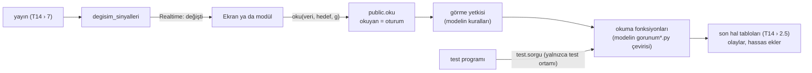

# T16 · Okumalar ve görme yetkileri

*Sürüm 2 · 29 Ekim 2026 · Karar 119, 123 · Kaynak: modelin okumaları (`referans/cevap_anahtari/model/irp/gorunum_v7.py` › `oku`, `gorunum_v10_2.py` › `oku`, `gorunum_v9.py` › `gorebilir_mi`, `proje_gorebilir_mi`, `gorunumler.py`), T6 (ekran başlıkları), T8 › 1 (görünürlük), T9 › 6 (proje ekibi), T12 (sonuç tabloları), T14 (motor), T15 (sürücü sözleşmesi), 19. turun sorgu eşlemesi · Kodu Codex 21. turda yazar*

## 0. Özet

**Okuma, T14'teki gibi modelin çevirisidir (karar 119).** Modelde dış dünyanın tek okuma kapısı `gorunum_v7.oku(d, kim, veri, hedef, **g)`'dir. Görme yetkisini kendisi sınar (`gorebilir_mi`, `proje_gorebilir_mi`). Ürün bunun çevirisini açar:

- **`public.oku(veri, hedef, g)`:** Ekranların ve modüllerin tek okuma kapısı. Okuyanı oturumdan alır, görme yetkisini modelin kurallarıyla sınar. Cevabın yanında hesabın güncel olup olmadığını söyler.
- **İstemci hiçbir tabloyu doğrudan okuyamaz.** Tek istisna anlık iletimin sinyal tablosudur (bölüm 7). Görme yetkisi böylece tek yerde kalır.
- **Ekranların ihtiyacı olup modelin `oku`'sunda olmayanlar** (havuz, onay listesi, kişinin günü…) modelin var olan iç fonksiyonlarının ince sarmalayıcısıdır. Yeni hesap yoktur; görme kuralı modeldeki en yakın kuraldır (bölüm 4.2).
- **Sonuç tabloları (T12)** dört yeni okumadır; doğruluğu tutarlılık denetimleriyle sınanır.
- **Test için `test.sorgu`:** Senaryolardaki 50 iç sorgu, ürünün aynı fonksiyonlarına doğrudan çağrılır. Böylece iç hesaplar birebir karşılaştırılır. Dış kapının görme kuralları da modelin `oku` adımlarıyla ayrıca sınanır. 19. turun "öneri" ve "karşılıksız" eşlemeleri böylece kapanır (T15-2, T15-9).

## 1. Katmanlar



- **Okuma fonksiyonları son hali okur** (T14'ün `'YAYIN'` hali). Motor halini okumaz.
- **Saat:** Okumalar şimdiyi saat arayüzünden alır (T14 › 6.2 kural 5). Açık aralık şimdiye kadar sayılır.

## 2. Kimlik ve oturum

- **Hesap eşlemesi (işletim tablosu):** `kisi_hesaplari(auth_kimligi uuid, kisi text)`. Yalnızca motorun sahibi rol yazar.
- **`kapi.oturum_kisi()`:** `auth.uid()`'den kişiyi bulur. Bulamazsa `IRP|YETKI|Oturum` hatası verir. Ayrılmış ya da istihdamda olmayan kişiyi, modelde olduğu gibi okuma fonksiyonu reddeder (`istihdamda`).
- **Giriş:** Kişi kodu ve şifre (T6 › 1). Supabase Auth e-posta ister; istemci kişi kodunu sabit bir biçimde e-postaya çevirir: `k017@calisan.irp` (T5 › 1). E-posta doğrulaması kapalıdır. Kayıt ve 6 rakamlı şifreyle giriş T17 › 3'te (karar 121).
- **Hesap açma:** MVP'de hesaplar kurulum betiğiyle açılır. Uygulama içinden hesap açma ve şifre sıfırlama MVP'den sonradır. Modelde `hesap_yetkisi` var, senaryoları C katmanında.
- **Modüller:** Model, modülün okumayı kullanıcının kimliğiyle yaptığını varsayar (karar 87; `oku(d, kim, …)`).
  - Modül kullanıcının oturumuyla çağırırsa okuyan oturumdur.
  - Modülün arka ucu servis rolüyle çağırırsa okuyanı `g.kim` ile verir. Bu alan yalnızca servis rolünde kabul edilir.
  - **Karar 125 (T18 › 4.1):** Supabase'in servis anahtarı hiçbir modüle verilmez. Servis rolüyle `g.kim` okuması yalnızca çekirdeğin kendi işleri içindir: test programı ve kurulum betiği. Modülün arka yüzü kullanıcının oturum anahtarını iletir ya da MVP'den sonra kendi rolüyle `public.servis_oku`'yu kullanır.

## 3. `public.oku`

```
public.oku(veri text, hedef text default null, g jsonb default '{}') returns jsonb
  SECURITY DEFINER, sabit search_path, istemci rollerine EXECUTE

  kim ← servis rolüyse g.kim, değilse kapi.oturum_kisi()
  deger ← gorunum_v7.oku(kim, veri, hedef, g)        -- modelin çevirisi; yeni veriler bölüm 4.2–4.3
  cevap: { deger, hesap: GUNCEL | BEKLIYOR, hesap_ani }
```

- **`hesap`:** `motor.durum.bekleyen_sinir` doluysa `BEKLIYOR` olur (T14 › 5). Ekran bunu "hesaplanıyor" diye gösterir; güncel olmayan bilgi güncelmiş gibi gösterilmez (karar 114).
- **`hesap_ani`:** Son yayının anı.
- **`surum`:** Okumanın döndürdüğü her nesne satırında `surum` alanı ürünün sürümüyle doldurulur; istemci yönetim kararında onu geri gönderir (T17 › 4.3).
- **Saat:** `public.simdi()` saat arayüzünün şimdisini verir (istemcinin saat farkı ölçümü için; T17 › 3). Gösteri ortamında `public.gosteri_sifirla()` yalnızca `YETKILI`'ye açıktır (modelin `Depo.demo_sifirla`'sı).
- **Hatalar:**
  - Modelin `ValueError`'u `IRP|BICIM|<neden>` olur: `TANIMSIZ_VERI`, eksik parametre, bilinmeyen kişi.
  - `PermissionError` `IRP|YETKI|<neden>` olur (T15 › 4).
- **Kilit almaz.** Okuma yazmayı beklemez, yazma okumayı beklemez. Okuma fonksiyonları `STABLE` tanımlanır; böylece bir okuma baştan sona aynı anlık görüntüyü görür. Tek istisna geçmiş haldir (bölüm 8).

## 4. Okuma kataloğu

Katman sütunu MVP'deki ihtiyacı gösterir: **A** gösteride kullanılır, **B** MVP'de çalışmalı, **S** MVP'den sonra. Ekran numaraları T6'nındır.

### 4.1 Modelin okumaları (çevrilir)

Kaynak: `gorunum_v7.oku` ve `gorunum_v10_2.oku`. Parametreler `g`'nin alanlarıdır; `hedef` çoğu zaman `g`'deki ilgili alanın yerine geçer.

| Veri | Modeldeki fonksiyon | Parametre | Görme kuralı | Ekran | Katman |
|---|---|---|---|---|---|
| `IS`, `GOREV` | tablo satırı ya da kişinin satırları | hedef: iş, görev ya da kişi | `gorebilir_mi(IS/GOREV)` | 2, 11 | A |
| `LISTE` | listeler + `liste_surumu` | kisi | `gorebilir_mi(IS, kisi)` | 2, 8 | A |
| `KISILER`, `BIRIMLER`, `TEZGAHLAR` | v10_2 | birim | istihdamda olan herkes | 8, 13, 20 | A |
| `ETAPLAR` | v10_2 | proje | `proje_gorebilir_mi` | 13, 15, 16 | A |
| `PROJE`, `ETAP`, `NOT`, `DOSYA` | tablo satırı | hedef | `gorebilir_mi` (proje kapısı) | 16, 6 | A |
| `NOT_ALICILARI` | gerçek not görevleri ve kabul durumu (SQL 154) | not kimliği | not görünürlüğü + her alıcı görevinin görünürlüğü; gizlenen varsa `liste_tam=false` | T28 | A |
| `PROJE_DURUM`, `ETAP_DURUM` | `proje_gostergesi`, `etap_gostergesi` | hedef | herkes + proje kapısı; tutarlar yalnızca `TUTAR` görene | 16, 17 | A |
| `KIM_NEREDE`, `SAAT_NEREYE_GITTI` | `gorunumler` | bas, bit | `UYGUNLUK`. `KIM_NEREDE`'de kişiler `GUN` kuralıyla süzülür. Görülmeyen proje "erişim dışı proje" olur | 10, 17 | A |
| `PERFORMANS` | `adil_performans` | hedef: kişi, bas, bit | kendisi, üstleri, `YETKILI` | 12, 22 | A |
| `BIRIM_PERFORMANS` | `adil_performans` toplamı | hedef: birim, bas, bit | birimi, yöneticileri, üstleri, `YETKILI` | 22 | B |
| `GUN` | `gun_sonu_raporu` | hedef: kişi, gun | kendisi, üstleri, `YETKILI` | 18 | B |
| `MAAS`, `SAAT_MALIYETI` | `aylik_maliyet_ozeti`, `saat_maliyeti` | hedef, ay / gun | `YETKILI` | 21 | A |
| `FAZLA_MESAI` | `fazla_mesai_kayitlari` | hedef: kişi | `GUN` gibi; prim yalnızca `TUTAR` görene | 18 | B |
| `IZIN`, `IZIN_DETAY` | `izinler` | hedef: kişi | kendisi, üstleri, `YETKILI` | — | S |
| `HAM_OLAY` | olaylar | hedef: kişi | kendisi ya da `YETKILI`; sürüm olayı süzgeci | 7, 10c | B |
| `BILDIRIMLER` | `bildirim_kutusu` | hedef: kişi | yalnızca alıcının kendisi | 26 | A |
| `NESNE`, `NESNELER`, `TOP_KIMDE` | v10_2 | nesne, proje, tur, kod | `NESNE` + proje kapısı | Modül 3 | B |
| `SURUMLER`, `GECERLI_SURUM` | `gorunum_v10_1` | hedef: nesne, t | belge kuralları (T10 › 2) | Modül 3 | B |
| `GANTT`, `PLAN_CAKISMALARI` | `gorunum_v10_1` | hedef, bas, bit | proje kapısı | Modül 3 | S |
| `PLAN` | `plan_karsilastir` | hedef: proje | proje kapısı | — | S |
| `UYGUNLUK`, `KAPASITE`, `KAYNAK_YUKU`, `TAKVIM` | v7, v10_2 | kisi/tur/kimlik, bas, bit | İstihdamda olan herkes; fonksiyonların kendi maskeleri (T11 › 7) | 13, 15 | B |
| `TEZGAH_UYGUNLUK`, `TEZGAH_GOSTERGESI` | v7 | tezgah, bas, bit | istihdamda olan herkes | — | S |
| `TEZGAH_UCRETI` | v10_2 | tezgah, gun | `YETKILI` ya da `MALIYET` | — | S |
| `ISCILIK_MALIYETI` | `iscilik_maliyeti` | proje, bas, bit | `TUTAR` + proje kapısı | 16 | A |

Modelin `oku`'sundaki 41 verinin hepsi çevrilir; tablo onları ekranlara göre gruplar. S katmanındakiler de çevrilir, çünkü Modül 3 ve testler kullanır. Ama ekranları MVP'de yoktur.

### 4.2 Ekranlar için yeni okumalar (ince sarmalayıcılar)

Modelin `oku`'sunda olmayan, ekranın ihtiyacı olan okumalardır. Her biri modelin var olan bir iç fonksiyonunu çağırır. **Görme kuralı modeldeki en yakın kuraldır.** Bunlar yeni davranış değil, var olan kuralın bu okumaya uygulanmasıdır.

| Veri | Modeldeki fonksiyon | Parametre | Görme kuralı (benzetme) | Ekran | Katman |
|---|---|---|---|---|---|
| `TELEFON` | `kisi_durumu[k]`, `listeler[k]`, listedeki ve açık işler | — | yalnızca kendisi | 2–5 | A |
| `EKIP` | Birimdeki kişilerin `kisi_durumu`'su ve açık işi; bugünkü çalışma `kisinin_gunu`'dan | birim | `HAVUZ` ile aynı | 8, 10 | A |
| `HAVUZ` | `isler`: birimi b, kişisi yok, durumu `BITTI`/`IPTAL` değil | birim | `kabul.lider(kim, b)`, birimin yöneticileri ve üstleri, `YETKILI` | 8 | A |
| `ONAY_LISTESI` | `gorunumler.onay_listesi` | — | yalnızca kendisi (onaylayan) | 9, 14 | A |
| `KISININ_GUNU` | `gorunumler.kisinin_gunu` | hedef: kişi, tarih | `GUN` | 10b, 18 | A |
| `BIRIM_DOLULUGU` | `gorunumler.birim_dolulugu` | bas, bit | `UYGUNLUK` | 17 | A |
| `MAAS_DAGILIMI` | `gorunumler.maas_dagilimi` | hedef: kişi, ay | `MAAS` (`YETKILI`) | 21 | A |
| `GUN_ISLERI` | `gorunum_v9.gun_isleri` | hedef: kişi, t | `GUN` | 11 | B |
| `GECIKME_RAPORU` | `gorunum_v9.gecikme_raporu` | bas, bit, kirilim | fonksiyonun kendi `cagiran` süzgeci | 22 | B |
| `ELLE_SURELER` | `gorunumler.elle_sureler` | hedef: birim, bas, bit | `BIRIM_PERFORMANS` | 18b | B |
| `ATAMA_UYARILARI` | `cihaz.atama_uyarilari` | satirlar | `GOREV.ATADIM` yetkisi olan roller (`YONETICI`, `EKIP_LIDERI`, `YETKILI`) | 13 | A |
| `YUK` | `gorunumler.yuk` | hedef: kişi, bas, bit | `IS` | 13 | A |
| `PROJELER` | `projeler` | — | `proje_gorebilir_mi` ile süzülür | 16, 23 | A |
| `YONLENDIRME` | `yonlendirme` | birim | birimin yöneticileri, `YETKILI` | 19 | B |
| `SUPHELILER` | `supheliler`, `isleme_hatalari` | — | `YETKILI` | 25 | B |
| `KODLAR` | `kod_listesi` (aktif olanlar) | hedef: liste adı | istihdamda olan herkes | telefon 4, web 8, 24 | A |
| `BUGUNKU_KIMLIKLER` | Kişinin bu harfle bugün buluta ulaşmış olay kimlikleri (modelin `cihaz.sayaci_esitle` girdisi) | hedef: harf | yalnızca kendisi | telefon 1 | A |

### 4.3 Sonuç tabloları (T12; yeni)

| Veri | Tanım | Parametre | Görme kuralı | Katman |
|---|---|---|---|---|
| `PROJE_MALIYETI` | T12 › 2 | hedef: proje, ay | Saat sütunları projeyi görene, tutar sütunları yalnızca `YETKILI`'ye (T12 › 0) | A |
| `PROJE_ISCILIGI` | T12 › 3 | hedef: proje, bas, bit, kirilim | aynı | A |
| `TAHMIN_GERCEK` | T12 › 4 | hedef: proje, bas, bit | projeyi gören; tutar yok | A |
| `PERSONEL_DAGILIMI` | T12 › 5 | bas, bit | `SAAT_NEREYE_GITTI` | A |

Bu dördü modelde yoktur. Hesapları modelin var olan fonksiyonlarından türetilir: `iscilik_maliyeti`, `maas_dagilimi`, `emek`, `saat_nereye_gitti`. Sınamaları bölüm 9'dadır.

## 5. Görme yetkisi

- **Çeviri:** `gorunum_v7.temel_gorebilir_mi`, `gorunum_v9.gorebilir_mi`, `proje_gorebilir_mi`, `pano_projeleri`, `gorunum_v10_1.dosya_gorebilir` ve `surum_olayi_gorebilir` birebir çevrilir. Yeni okumalar modelin takma ad tablosuna (`gorebilir_mi` › `aliases`) eklenerek aynı kurallara bağlanır.
- **Tutar maskesi:** `PROJE_DURUM` ve `ETAP_DURUM`'daki ayıklama (`maliyet`, `iscilik`, `tezgah`, `maas`, `tutar`, `tutarlar`, `prim`) `PROJE_MALIYETI` ve `PROJE_ISCILIGI`'ye de uygulanır.
- **Erişim dışı proje:** Görülmeyen proje panolarda "erişim dışı proje" diye görünür (`pano_projeleri`).
- **Hassas ekler** (ücret) yalnızca `YETKILI`'nin okumalarında kullanılır. Motor ve okuma fonksiyonları onları okur; istemci doğrudan okuyamaz.

## 6. Tablolara doğrudan erişim

- **Bütün tablolarda satır erişim kuralları (RLS) açıktır.** İstemci rollerine (`anon`, `authenticated`) politika verilmez; doğrudan `SELECT`, `INSERT`, `UPDATE`, `DELETE` yoktur.
- **İstemci yalnızca şunları kullanır:**
  - fonksiyonlar: `public.olay_ekle`, `public.oku`, cihaz kapıları
  - tablo: `degisim_sinyalleri` (bölüm 7)
- **Servis rolü** bu fonksiyonları çağırabilir ve modül bildirim kapısını kullanır. `olaylar`'da onun da `UPDATE`, `DELETE` ve `TRUNCATE` hakkı yoktur (T13 › 5).

## 7. Anlık iletim: "değişti" sinyali

T13 › 5: Realtime yalnızca "değişti" der, ekran yeniden okur. Sinyal veri taşımaz.

- **Tablo:** `degisim_sinyalleri(kimlik bigserial, kanal text, an timestamptz)`.
- **Kanallar:**

  | Kanal | Ne değişince | Kim dinleyebilir (RLS) |
  |---|---|---|
  | `kisi:<kod>` | O kişinin satırları: kişi durumu, liste, işleri, görevleri, aralıkları, bildirimleri, gün raporu | Kişinin kendisi, üstleri, `YETKILI` |
  | `birim:<kod>` | Birimin işleri ve havuzu, kişileri | `kabul.lider`, birimin yöneticileri ve üstleri, `YETKILI` |
  | `proje:<kod>` | Projenin işleri, görevleri, etapları, nesneleri | `proje_gorebilir_mi` |
  | `firma` | Ana veri: kişiler, birimler, projeler, ayarlar | İstihdamda olan herkes |

- **Yazan yayın:** Yayın (T14 › 7), değişen son hal satırlarının ek sütunlarından (`kisi`, `birim`, `proje`) kanalları çıkarır. Her kanala tek satır yazar.
- **İstemci:** Kendi kanallarını dinler (postgres_changes, `INSERT`, `kanal=eq.…`). Sinyal gelince açık ekranın okumalarını yeniden çağırır; art arda sinyalleri 300 ms bekleyerek birleştirir.
- **Temizlik:** Saat işi bir günden eski sinyalleri siler.

## 8. Geçmiş hal

Model bazı okumalarda "o anda bilinen hal"i baştan kurar: `gorunum_v7.durum(d, t)`. Süzgeci: `oldugu_an ≤ t` ve `bulut_ulasma_ani ≤ t`. Kullananlar:
- `t` parametresi verildiğinde: `proje_kaydi`, `proje_uyeleri`, `proje_gorebilir_mi`, `gun_isleri`, `gecerli_surum`
- her zaman: `gecmis_gorunumu`

`proje_kaydi(t)` K0'da geçer; bu yüzden geçmiş hal ilk adımda gerekir.

Ürün bunu bir **kayıt noktası (savepoint)** içinde yapar:
1. Firma kilidini al.
2. `SAVEPOINT`.
3. Motoru süzülmüş olaylarla baştan kur: `geri_sar(en baş)`, `ilerle(t)`, `yayınla()`. Olay kaynağı süzgeci motorun parametresidir.
4. Okumayı yap.
5. `ROLLBACK TO SAVEPOINT`.

PL/pgSQL'de `SAVEPOINT` yazılamaz. Aynı iş bir alt blokla yapılır: alt blokta kur, sonucu değişkene al, bilerek hata ver, hatayı yakala. Alt blok geri alınır, değişkenler korunur. Yayının yazdığı sinyaller de geri alındığı için Realtime'a hiçbir şey gitmez.

Pahalıdır ama seyrek kullanılır. Bu okumalar `STABLE` değildir.

## 9. Test

- **`test.sorgu(modul, ad, args, kwargs)`:** Yalnızca test ortamında vardır (T15 › 2.2). Senaryolardaki iç sorguyu ürünün aynı adlı fonksiyonuna, görme denetimi olmadan, modeldeki gibi çağırır.
  - Argümanlar modelin `coz` biçimindedir: `$an`, `$gun`, `$ondalik`, `$kume`.
  - İzin listesi: modelin `yurut.SORGULAR`'ındaki modüllerin, senaryolarda geçen fonksiyonları.
- **Sorgu eşlemesi** (`test/oynatici/sorgu_eslemesi.json`) baştan üretilir:
  - `gorunum_v7.oku` ve `gorunum_v10_2.oku` adımları → `public.oku`. Okuyan, adımdaki `kim` argümanıdır; oturum o kişiyle kurulur (T15 › 2.2). Böylece görme kuralları gerçek kapıdan sınanır.
  - `kisi_gunu.kapi`, `gorev.son_teslim_ani` → istemcinin çekirdeği de sınar (İstemci 1). Üründe de `test.sorgu` ile sınanır; iki taraf aynı vektörü geçmelidir.
  - `hesap_yetkisi.*` → `ATLANDI` (Auth işleri, MVP'den sonra).
  - `surum.liste_surumu` → değerle değil, "değişti mi" diye karşılaştırılır (T15 › 3.1).
  - Geri kalan her şey → `test.sorgu`.
- **`public.oku`'nun cevabı:** Test sürücüsü `deger`'i alır. `hesap` ve `hesap_ani` raporlanır, karşılaştırmaya girmez.
- **Yeni okumaların sınaması (4.2, 4.3):**
  - Sarmaladıkları fonksiyonlar `test.sorgu` ile birebir sınanır.
  - Görme kuralları için birim testleri yazılır: her veri için gören ve göremeyen birer kişi.
  - Sonuç tabloları için T12 › 6'nın altı tutarlılık denetimi ilk ay simülasyonu ve gösteri verisi üstünde koşar.
- **Sinyal testi:** Bir olaydan sonra beklenen kanallara sinyal düşmeli, beklenmeyenlere düşmemeli.

## 10. Süre

- **Hedef:** Ekran açılışı P95 en çok 3 sn, filtreli rapor en çok 10 sn (N:P3276, P3279). Test programı ölçer.
- **Önbellek:** MVP'de yok. Gerekirse T13 › 1.4'e göre etiketli önbellek eklenir: hangi saatte ve hangi hesap sürümüyle hazırlandığı yanında yazar.
- **Dizinler:** Son hal tablolarının ek sütunlarında (`kisi`, `birim`, `proje`, `gun`, `durum`).

## 11. Modül 3'ün gösteride bağlanması (karar 120)

Hamdi'nin 6 sözleşme senaryosu bizim üründe koşar; kayıtları bizim ekranlarımızda görünür (proje › parçalar ve belgeler: `NESNELER`, `TOP_KIMDE`, `GECERLI_SURUM`, `SURUMLER`). Hamdi'nin modülü gösteride canlı bağlanmaz. Okuma kapısı ileride modül için de hazırdır: kullanıcının oturumu ya da servis rolü (bölüm 2).

## 12. Kodlama sırası (22. tur)

| Sıra | Ne | Sınama |
|---|---|---|
| 1 | Kimlik eşlemesi, `public.oku` iskeleti, görme kuralları, `test.sorgu`, sorgu eşlemesinin yeniden üretimi, geçmiş hal (bölüm 8) | K0 ve A'nın sorgu adımları |
| 2 | 4.1'in A ve B katmanındakiler | A, B |
| 3 | 4.2 (A önce) | Birim testleri, `test.sorgu` |
| 4 | 4.3 ve tutarlılık denetimleri | T12 › 6 |
| 5 | Sinyal tablosu ve kanallar | Sinyal testi |
| 6 | 4.1'in S katmanındakiler | C, M3 |
