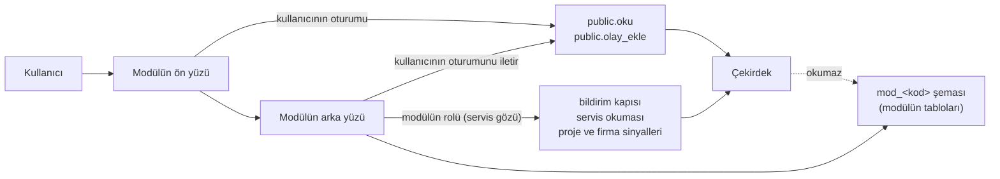

# T18 · Modül sözleşmesi: bağlanma ve modül ekleme kuralları

*Sürüm 1 · 29 Ekim 2026 · Kararlar 124–128 · Kaynak: `onboarding/cekirdek_paketi/02_modul_sozlesmesi.md` (10.2), T11 › 7–8, T13, T16, T17, kararlar 72, 87, 93, 95–99, 101–108, 120, Hamdi'nin uyum raporu (M3-01…17) · Sınama: `test/modul_sozlesmesi/` (81 test, modelin üstünde) · Araçlar: `modul_kiti/`*

## 0. Özet

**31 Ekim güncellemesi · K:157 / T27 / paket 1.1:** S1 kapandı: bütün web/modül ekranları ortak HTML/CSS/JavaScript iş uygulamasına uyarlanır; ayrı React/iframe yolu kullanılmaz. Telefon Flutter kalır. Ortak kurulum/oturum, ayrı NOLOGIN sahip ve dar LOGIN çalışma rolü, servis okuması ve sağlayıcı taşıması ilk M11B pilotuyla gerçek SQL ve mevcut Supabase üzerinde doğrulandı. Çalışan biçim `modul_kiti/paket/sozlesme/` ve T27'dedir. Aşağıdaki 29 Ekim tasarım notları tarihsel bağlamdır; uygulama veya bütün modüllerin kabulü sayılmaz.

**Bu belge neden var?** `02_modul_sozlesmesi.md` bir modülün çekirdeğe hangi beş kapıdan dokunduğunu anlatıyordu ve Modül 3 o kapılarla bağlandı (karar 101). Eksik kalanlar şunlardı:
- kapıların üründe (Supabase'te) nasıl kurulacağı
- modülün kimliği
- ikinci, üçüncü modülün nasıl ekleneceği
- modüllerin birbiriyle nasıl konuşacağı
- modülün nasıl kapatılacağı

T18 bunların kurallarını koyar. **02 değişmez; çelişkide T18 kazanır.**

**Dört cümle:**
1. **Çekirdek modülleri tanımaz; bilgi çekirdekten modüle akar** (karar 87). Çekirdek modül tablosu okumaz.
2. **Modül çekirdeğe yalnızca beş kapıdan dokunur:** okuma, olay, nesne uzantısı, plan, bildirim. Kapıyı iki gözden biriyle kullanır:
   - **kullanıcının gözü:** kullanıcının oturumu
   - **servis gözü:** modülün kendi kimliği; yalnızca bildirim ve kişisel olmayan okumalar
3. **Modül çekirdeğin tablosuna yazmaz, kuralını tekrar etmez, başka modülün tablosunu okumaz.**
4. **Yeni modül eklemek çekirdeğe kod eklemek değildir.** Bir modül üç parçayla eklenir:
   - **künye:** modülün kimlik kartı, `kunye.json`
   - **veritabanı göçleri:** modülün kendi şemasında
   - **kurulum olayları:** künyeden üretilir, yetkili yazar

   Künye denetleyiciden geçmeyen modül kurulmaz.

**Sınandı.** Kurallar Python modelinin üstünde 81 testle sınandı:
- 52 test kapıları sınar.
- 29 test künyeyi, kayıt defterini, göçleri ve künyeden kurulumu sınar.

Altı örnek modülün künyesi yazıldı: M3, kalite, bakım-arıza, İK, VEGA köprüsü, yapay zekâ tahmini. Hepsinin kurulum olaylarını çekirdek kabul etti. On bir modül masa başında yürütüldü (bölüm 12). Altı çekirdeğe istek çıktı, hiçbiri MVP'yi durdurmaz (bölüm 11).

## 1. Sözlük

| Terim | Anlamı |
|---|---|
| **Modül** | Çekirdeğin üstüne kurulan iş alanı: satın alma, kalite, bakım, İK… Kendi verisi, kendi ekranı, kendi kuralları vardır. |
| **Künye** | Modülün kimlik kartı (`kunye.json`). Hangi kapıları, okumaları, olayları, türleri, rolleri kullandığını ve kişisel veri ile para tutup tutmadığını söyler. |
| **Ön yüz** | Modülün kullanıcıya görünen uygulaması. |
| **Arka yüz** | Modülün sunucusu. Kendi kurallarını çalıştırır, bildirim bırakır. Olmayabilir. |
| **Kullanıcının gözü** | Okuma ve yazma, kullanıcının çekirdeğe girdiği oturumla yapılır. Çekirdek o kişinin yetkisini ve görme kurallarını uygular. |
| **Servis gözü** | Modülün kendi kimliği (`SRV-<kod>`, üründe `mod_<kod>` veritabanı rolü). Yalnızca bildirim kapısı ve kişisel olmayan okumalar içindir. |
| **Kurulum olayları** | Künyeden üretilen `MODUL.TANIMLADIM`, rol ve tür tanımları. Yetkili, kurulum betiğiyle yazar. |
| **Çekirdeğe istek** | Modülün çekirdekte bulamadığı şey için açtığı kayıt. Hamdi'nin M3-01…17 bulguları bunun ilk örneğidir. |
| **Kayıt defteri** | Kurulu bütün modüllerin künyeleri, çekirdek deposunda `moduller/<kod>/`. |

## 2. Bir modülün parçaları

- **Ön yüz:**
  - Ayrı bir uygulamadır (soru S1, bölüm 15).
  - Kullanıcı çekirdeğin hesabıyla girer; ayrı şifre yoktur.
  - Çekirdeğe Dart çekirdeğiyle (`irp_cekirdek`, T17) ya da arka yüz üzerinden bağlanır.
- **Arka yüz:**
  - Modülün kurallarını çalıştırır: sipariş gecikti mi, bakım zamanı geldi mi?
  - Kuralın sonucu olay değil bildirimdir (02 › 10: sistem olay yazmaz).
- **Veri:**
  - Aynı Supabase projesinde, modülün kendi şemasında durur (soru S2).
  - Çekirdeğin kayıtlarına kimlikle bağlanır, değer olarak (02 › 1).

## 3. Kurallar ve sınamaları

Her kuralın bir sınaması var. **M**: modelin üstündeki test (`test_kapilar.py`, ör. M A1 = `test_A1_…`). **D**: künye, kayıt ya da göç denetimi ya da künyeden kurulum (`test_kunye.py`; V, R, G denetleyicinin kural kodlarıdır, M1–M6 kurulum testleridir).

### 3.1 Kimlik ve kayıt

| No | Kural | Sınama |
|---|---|---|
| K-1 | Modülü yalnızca `YETKILI` tanımlar (`MODUL.TANIMLADIM`). | M A1 |
| K-2 | Modülün kodu, servis kimliği ve cihaz harfi tekil ve değişmezdir. Harf normal cihaza verilmez. Bir kişinin daha önce kullandığı harf modüle verilmez. | M A2, A3, A7, I3 · D R01–R03 |
| K-3 | Modül harfiyle gelen olayın cihazı `MODUL-<kod>` olur. `MODUL-` önekini başka cihaz kullanamaz. | M A4, A5 · D M2 |
| K-4 | Pasif modül: harfiyle olay yazılamaz, yeni bildirim bırakılamaz. Eski bildirimlerini kaldırabilir. | M A6, B3 · D M5 |
| K-5 | **Modül harfini yalnızca modülün tek arka yüzü kullanır** (yeni). Aynı kişi aynı gün aynı harfle iki yerden yazarsa ikincisi `CAKISMA` alır. Arka yüz kişi ve gün başına sayacını kendi şemasında, tek işlemle artırır. Modülün istemcileri harf almaz; normal cihaz kaydıyla harf alır (T17). | M A8 · D V05 |

### 3.2 Bildirim kapısı

| No | Kural | Sınama |
|---|---|---|
| K-6 | Bildirimi yalnızca modülün kendi servis kimliği, yalnızca kendi koduyla bırakır. | M B1, B2 |
| K-7 | Kayıt türü `PROJE`, `IS`, `GOREV` ya da `NESNE` olur. Kayıt var olmalıdır. An gelecekte olamaz. | M B4 |
| K-8 | Kaydın projesini göremeyen alıcı süzülür. Cevap kimin neden süzüldüğünü söyler. | M B5 |
| K-9 | Tekillik: aynı anahtar yeniden bırakılırsa güncellenir, görülme korunur. Kaldırılan bildirim yeniden bırakılınca geri gelir. **Bu yüzden modül kuralını istediği sıklıkta yeniden çalıştırabilir.** | M B6, B7 |
| K-10 | Alıcı türleri bırakma anında kişilere çevrilir: `KISI`, `BIRIM_YONETICILERI`, `ROL`, `PROJEDE_YETKILILER`, `NESNE_SORUMLUSU`. | M B8 |
| K-11 | Bildirim olay değildir, günlüğe girmez. Çekirdeğin yeniden kurulmasında silinmez. | M B9, B10 |
| K-12 | Bildirim kutusu alıcınındır; başkası okuyamaz. İki modülün bildirimleri aynı kutuda, kaynağıyla görünür. | M B11, G1 |

### 3.3 Olay kapısı

| No | Kural | Sınama |
|---|---|---|
| K-13 | Modül olayı kullanıcının adına ve oturumuyla yazar. `AKTARIM` yazamaz. Servis kimliği olay yazamaz. | M C1, C2, G3 |
| K-14 | Modül kullanıcısının yetkisini genişletmez. | M C3 |
| K-15 | Yönetim kararı okunan sürümü taşır; arada değiştiyse `BAYAT`. | M C4 |
| K-16 | İki modül aynı nesneyi sırayla ilerletebilir. Aşama tek yerdedir, çekirdektedir. | M C5 |
| K-17 | Aynı kimlik ve aynı içerik tekrardır; farklı içerik `CAKISMA`'dır. | M C6 |
| K-24 | Birbirine dayanan olaylar artan anla gönderilir. Aynı ana dayanan karar `BAYAT, SIRA` alır. | M E1, D3 |
| K-31 | **Toplu iş tekrar güvenlidir** (yeni). Örnek: Modül 2'nin 400 parçası. Toplu iş, çok sayıda olay demektir. Yarıda kesilen yükleme aynı kimliklerle yeniden gönderilir; açılmış olanlar "tekrar" döner. | M J5 |

### 3.4 Nesne, tür, rol

| No | Kural | Sınama |
|---|---|---|
| K-18 | Nesne türü veridir; yalnızca `YETKILI` tanımlar. Yeni modülün türü kod yazmadan çalışır; aşamalar türün geçiş tablosuyla yürür. | M D1, D2 · D V13 |
| K-19 | Bir nesnenin birden çok modülde boyutu olur. Örnek: kalite kaydı parçaya bağlanır. Bağ, türün bağlanabilir türlerinden olur. | M D3, D4 |
| K-20 | Nesne kodu bir kez kullanılır. Proje alanı ile proje bağı aynı olmalıdır (karar 107). | M D5, D6 |
| K-25 | İkinci bir modül çekirdekte tek satır kod değişmeden bağlanır: kayıt, tür, kullanıcı olayları, bildirim. | M G1 |
| K-26 | **Modülün rolü veridir** (yeni). Rol, `ROL` kod listesine eklenir, kişiye verilir, türün geçişinde kullanılır. Bir rolün yapabildiğini o rolü taşıyan kişinin üstleri de yapar (karar 60, 62). | M H1, H1b |
| K-29 | **Tür güncellemesi geriye uyumludur** (yeni). Aşama eklenebilir. İçinde nesne duran aşama kaldırılamaz; çekirdek reddeder. Boş aşama kaldırılabilir. Kurulum yeniden koşarsa sonuç değişmez. | M I1, I2 · D M6 |
| K-30 | **Gizli kalması gereken çekirdeğe projesiz nesne olarak açılmaz** (yeni). Projesiz nesneyi mavi yaka dahil herkes görür. Teklif bu yüzden modülde kalır; sipariş gelince proje açılır. | M J3 |
| K-32 | **Her türün ve her rolün tek sahibi vardır:** çekirdek ya da tek bir modül. `PARCA` ve `BELGE` çekirdeğindir. Başka modül sahibin türüne kendi tablosuyla uzanır (`tur_uzantilari`). Türü değiştirmek isterse sahibine istek açar. | D R04, R05, V13 |
| K-33 | **Çekirdeğin kod listeleri sabittir:** `ARIZA`, `DURUS`, `DURUS_NEDENI`, `IZIN`, `MOLA`, `PD`, `ROL`, `YETKINLIK`. Modül bu listelere kod ekleyebilir. Mavi yakanın listelerine (`ARIZA`, `DURUS`, `DURUS_NEDENI`, `MOLA`) eklemek uyarı alır, çünkü seçim uzar. Modülün kendi listesi (ör. yedek parça türleri) kendi şemasındadır. | D katalog testi, V16 |

### 3.5 Görünürlük ve para

| No | Kural | Sınama |
|---|---|---|
| K-21 | Modül kullanıcının gözüyle okur; görünürlüğü çekirdek uygular. Sorumlu olmak tek başına projeyi göstermez (karar 103). | M F1, F2 |
| K-22 | Tanımsız okuma `BICIM`'dir, görünürlük hatası değil. | M F3 |
| K-23 | Para okumalarına kullanıcı ancak kendi yetkisi kadar erişir. | M F4 |
| K-34 | **Kişisel veri ve para beyan edilir** (yeni). Bunları okuyan ya da yazan modül künyesinde beyan eder: `kisisel_veri`'de alan ve neden (KVKK), para için `para: true`. Beyansız modül bunlara dokunamaz. | D V06, V08, V20, V22 |

## 4. Kapıların üründeki karşılığı (Supabase)

### 4.1 İki göz

**Kullanıcının gözü.**
- **Giriş:** Modülün ön yüzü kullanıcıyı çekirdeğin Supabase girişiyle sokar; hesap aynıdır (T16 › 2, T17 › 3).
- **Arka yüzün çağrıları:** Kullanıcı adına çekirdeğe gidecek her çağrıda arka yüz kullanıcının oturum anahtarını (JWT) olduğu gibi iletir. Kendi yetkisiyle "kullanıcı adına" okumaz, yazmaz.
- **Çekirdeğin gördüğü:** Çekirdek okuyanı ve yazanı oturumdan bulur (`kapi.oturum_kisi()`).

**Servis gözü.**
- **Rol:** Modülün veritabanı rolü `mod_<kod>`'dur ve giriş yapabilir. Kendi şemasının sahibidir.
- **Çekirdekteki hakları:**
  - Çekirdeğin hiçbir tablosunda hakkı yoktur.
  - Yalnızca şu fonksiyonları çağırabilir:
    - `public.modul_bildirimi_birak`
    - `public.modul_bildirimi_kaldir`
    - `public.simdi`
    - `public.servis_oku` (MVP'den sonra)
  - `degisim_sinyalleri` tablosunda yalnızca `proje:*` ve `firma` kanallarını görür (RLS).
- **Servis kimliği bağlantıdan gelir:**
  - Bildirim kapısı modülü bağlantının rolünden bulur (`session_user` → `moduller.db_rolu`).
  - Parametredeki `servis_kimligi` onunla aynı olmalıdır; parametre tek başına yetmez.
  - Modelde yalnızca parametre vardır; üründe ikisi birlikte denetlenir.

**Supabase'in servis anahtarı (`service_role`) hiçbir modüle verilmez** (karar 125).
- **Neden:**
  - Bu anahtar satır kurallarını (RLS) atlar ve her tabloya yazabilir.
  - Tek bir sızıntı bütün firmayı açar.
  - Olay günlüğünün "yalnızca eklenir" güvencesi zayıflar (T13 › 5).
- **T16 › 2 değişir:** Servis rolünün `g.kim` ile başkası adına okuması modüllere kapanır. Yalnızca çekirdeğin kendi işlerinde kalır: test programının `test.sorgu`'su, kurulum betiği.

**Doğrulanmalı.** Özel bir Postgres rolünün Supabase'in bağlantı havuzundan girip giremeyeceği Supabase'e geçişte denenecek.
- **Olmazsa yedek yol:** Modül için Supabase girişinde bir servis hesabı açılır. Oturum anahtarında `app_metadata.modul` taşınır; çekirdeğin fonksiyonları buna bakar.

### 4.2 Olay

| Olayı gönderen | Künyede | Kimlik | Cihaz alanı |
|---|---|---|---|
| Modülün arka yüzü | `olay_yolu: ARKA_YUZ` | Kişi + gün + sıra + **modülün harfi**. Sayaç `mod_<kod>.olay_sayaci`'nda, tek işlemle artar (`UPDATE … RETURNING`). `CAKISMA` gelirse sayaç ilerletilip yeniden gönderilir. | `MODUL-<kod>` |
| Modülün istemcisi | `olay_yolu: ISTEMCI` | `irp_cekirdek`'in normal cihaz kaydı ve giden kutusu (T17) | Cihazın kendi adı |

Modülün yazamadığı eylemler katalogda dört sınıfta toplanır (`modul_kiti/cekirdek_katalogu.json`):

| Sınıf | Eylemler | Neden |
|---|---|---|
| Kurulum | `MODUL.TANIMLADIM`, `NESNE_TURU.TANIMLADIM`, `KOD.TANIMLADIM`, `YETKI.TANIMLADIM` | Yalnızca künyeden, kurulumda; gözden geçirilmiş olur |
| Çekirdek ekranı | `AYAR.*`, `GUN_ONAYI.AYARLADIM`, `KAYIT.GECERSIZ_SAYDIM`, `KURULUM.TAMAMLADIM`, `PROJE.ERISIM_*` | Firmanın ayarı, görünürlüğü, denetimi; modül ikinci bir ayar ekranı kurmaz |
| Mavi yaka düğmeleri | `IS.BASLADIM`, `IS.MOLA_VERDIM`, `IS.DEVAM_ETTIM`, `IS.TAMAMLADIM`, `IS.ARIZA_BILDIRDIM`, `MESAI.*`, `DURUS.*` | Mavi yakanın tek yolu çekirdeğin telefonudur (az düğme, tek yol) |
| Hassas (beyanla) | `KISI.*`, `IZIN.*`, `EK_MESAI.*` kişisel veri; `MAAS.*` para | K-34 |

### 4.3 Okuma

- **Kullanıcının gözüyle:** `public.oku` (T16). Künyede `kapilar.okumalar`'da yazılı olanlar.
- **Servis gözüyle:** `public.servis_oku(veri, hedef, g)` (MVP'den sonra, istek İ-1).
  - **İzin verilen okumalar:** katalogdaki `servis_okumalari`. Kişisel veri ve para içermezler:
    - `BIRIMLER`, `ETAP`, `ETAPLAR`, `GECERLI_SURUM`, `KISILER`, `KODLAR`
    - `NESNE`, `NESNELER`, `PROJE`, `PROJELER`
    - `TEZGAHLAR`, `TEZGAH_GOSTERGESI`, `TEZGAH_UYGUNLUK`, `TOP_KIMDE`
  - **Kapsam:** Servis gözü bütün firmayı görür. Projenin parasal alanları ve kişinin izin nedeni gibi maskeler, yetkisiz kişininki gibi uygulanır.
- **Servis gözü kural içindir, ekrana gitmez.**
  - Kullanıcıya gösterilecek her şey kullanıcının gözüyle yeniden okunur.
  - Bildirimin metni yalnızca kendi kaydının bilgisini taşır; başka projeden söz etmez. Alıcı süzgeci kaydın projesine göre çalışır, metnin içeriğini bilmez.
- **Para okuması:** Para okumaları hiçbir zaman servis gözüyle yapılmaz. Yetkilinin oturumuyla, onun bastığı düğmeyle yapılır. Örnek: VEGA köprüsü.

### 4.4 Değişiklik haberi

- **Ön yüz:** Kullanıcının kanallarını dinler (T16 › 7).
- **Arka yüz:** Yalnızca `proje:*` ve `firma` kanallarını dinler. Kişi ve birim kanalları kişiseldir.
- **Sinyalden sonra:** Sinyal veri taşımaz; arka yüz servis gözüyle yeniden okur.

### 4.5 Bildirim, plan, belge

- **Bildirim, plan ve belge sürümü:** 02 › 5–7'deki gibidir.
- **Dakika sınırları:** Künyede bildirim ve okuma için dakikadaki üst sınır yazılır. Ortak geçit/servis SQL kapıları ilk pilotta sayaç uygular; bütün sınır aşımı/yük kabulü ayrıca gerekir (T27, C27). Modül bekleyip yeniden değerlendirir.

## 5. Künye

**Yeri:** `kunye.json`, modülün klasöründe.

**Kurulu modüllerin künyeleri:** çekirdek deposunda `moduller/<kod>/kunye.json`, yanında `veritabani/` göçleriyle. Modülün kodu kendi deposundadır.

**Alanları:**
- **Ayrıntı:** `modul_kiti/kunye_semasi.json`
- **Örnekler:** `modul_kiti/ornekler/` (M3, KAL, BAK, IK, VEGA, YZ)

| Alan | Ne söyler |
|---|---|
| `kod`, `ad`, `surum`, `sahip`, `aciklama` | Kimlik. Kod 2–6 büyük harf ya da rakam; çekirdeğe ayrılmış adlar alınamaz (`MOTOR`, `TEST`, `SRV`…) |
| `cekirdek` | Gereken en eski çekirdek, ör. `>=10.2` |
| `servis_kimligi` | `SRV-<kod>` |
| `arka_yuz`, `olay_yolu`, `cihaz_harfi` | Sunucusu var mı; olayı kim gönderir (`ARKA_YUZ`, `ISTEMCI`, `YOK`); harf yalnızca `ARKA_YUZ`'da |
| `kapilar` | `okumalar`, `servis_okumalari`, `olaylar`, `plan`, `belge_surumu`, `bildirimler` (kural, ad, önem, kayıt ve alıcı türleri), `abonelikler` |
| `nesne_turleri` | Modülün sahip olduğu türler (`NESNE_TURU.TANIMLADIM` girdisinin aynısı) |
| `tur_uzantilari` | Hangi türe hangi tabloyla uzanıyor |
| `roller`, `kod_listeleri`, `yetki_onerileri` | Kurulumda yazılacak rol, kod ve yetki tanımları |
| `veritabani` | Şema (`mod_<kod>`) ve göç klasörü |
| `on_yuz` | Ön yüzün türü (`UYGULAMA_ICI`, `AYRI_UYGULAMA`, `YOK`; S1) ve **derin bağlantılar**: çekirdeğin ekranında görünen "modüldeki ayrıntı" bağlantıları (bağlam, yol, kimler) |
| `saglananlar`, `bagimliliklar` | Modüller arası okuma (bölüm 8) |
| `kisisel_veri`, `para` | Beyan (K-34) |
| `sinirlar` | Dakikadaki bildirim, okuma, servis okuması üst sınırı |
| `istekler` | Çekirdeğe açtığı istekler ve durumları |

**Denetim.** `modul_kiti/kunye_denetle.py` üç düzeyde denetler:
- **Künye (V01–V24):** alanlar, kod, harf, okumanın ve eylemin katalogda olup olmadığı, beyanlar, tür geçişleri, bildirim kuralları, sınırlar.
  - Tür geçişlerinde iki şeye bakılır: her aşamaya ulaşılıyor mu, çıkmaz aşama var mı.
- **Kayıt (R01–R11):** bütün modüller birlikte. Tekil kod, servis kimliği ve harf; türün ve rolün tek sahibi; bağımlılık döngüsü.
- **Göç (G01–G09):** bölüm 7.

**Katalog.** Denetleyicinin dayandığı liste `modul_kiti/cekirdek_katalogu.json`'dur. Elle yazılmaz; `katalog_uret.py` modelden ve T16'dan üretir. Çekirdek değişince yeniden üretilir; test, katalog eskiyse kırılır.

## 6. Ön yüz ve derin bağlantı

**Ölçüt: kullanıcı tek sistem görür** (karar 129; Mustafa: "web tabanlı uygulamada kullanım zorluğu yaşamamak önemli"). Modülün ön yüzü hangi teknik yolla yayımlanırsa yayımlansın şunlar sağlanır:
1. **Tek adres:** modül çekirdeğin alan adının altındadır.
2. **Tek giriş:** modüle geçerken yeniden giriş yapılmaz.
3. **Tek menü:** modülün ekranları çekirdeğin menüsünde, kişinin rolüne göre görünür.
4. **Tek görünüş:** aynı renkler, yazılar, düğmeler ve üst çubuk (ortak tasarım paketi).
5. **Bağlam taşınır:** parçadan modüle gidilince aynı parça açılır; geri dönülünce kalınan yere dönülür.
6. **Bildirimler tek kutuda:** modülün bildirimi çekirdeğin bildirim kutusundadır (K-12).

**Teknik yol (K:157, kesinleşti).** Web ekranı ortak HTML/CSS/JavaScript uygulamasında `ac(host)` sözleşmesiyle açılır. Menü, üst çubuk, beyaz tema, kullanıcı oturumu ve proje bağlamı ortaktır. Ayrı React uygulaması/iframe kurulmaz; gelen ekranlar uyarlanır. Python arka yüz iş mantığını korur ve tek bağlantı katmanını kullanır. Telefon mevcut Flutter istemcisidir; mavi yakanın telefonuna ayrı modül düğmesi girmez. Ayrıntı paket 1.1 `07_on_yuz.md` ve T27.

**Derin bağlantı:**
- **Ne:** Çekirdeğin ekranı bir parçayı ya da projeyi gösterirken künyedeki bağlantıları gösterir, ör. "Satın alma ayrıntısı (M3)". Bağlantıya basan modülün ekranına gider.
- **Bağlamlar:** `PROJE`, `NESNE`, `IS`, `GOREV`, `TEZGAH`, `KISI`.
- **Kim görür:** Bağlantı yalnızca şunlar birlikte doğruysa görünür:
  - modül aktif
  - kişinin rolü bağlantının `kimler`'inde (boşsa herkes)
  - kişi kaydı görüyor
- **Yalnızca geçiştir:** Derin bağlantı veri taşımaz; modülün ekranı kendi okumasını kullanıcının gözüyle yapar.

**Mavi yakanın telefonuna modül düğmesi eklenmez.** Modülün mavi yakadan bir şeye ihtiyacı varsa çekirdeğin yoluyla gelir: lider iş tanımlar, mavi yaka telefonda BAŞLA'ya basar.

## 7. Veritabanı yalıtımı

**Kurulumun açtıkları.** Kurulum betiği künyeden üç şey açar:
- şema `mod_<kod>`
- iki rol: sahip ve giriş yapabilen `mod_<kod>`
- bu rollerin hakları

**Rolün sınırları.** Modülün rolüne ayrıca şunlar konur:
- sorgu süresi sınırı (ör. 5 sn)
- bağlantı sayısı sınırı

**Göçlerin yeri.** Modülün göçleri `veritabani/NNN_ad.sql` dosyalarıdır. Çekirdeğin kurulumundan sonra, sırayla koşar.

**Çekirdeğin yeniden kurulumu `mod_*` şemalarına dokunmaz** (`urun/kur.py`).

**Göç denetimi (G01–G09):**

| No | Kural |
|---|---|
| G01 | Oluşturulan, değiştirilen her nesne `mod_<kod>.` adıyla yazılır |
| G02 | Çekirdeğin şemalarına dokunulmaz. Şu şemalar buna girer: `public`, `motor`, `kapi`, `test`, `auth`, `storage`, `realtime`, `cron`… Başka modülün şemasına da dokunulmaz. Yalnızca izinli fonksiyonlar çağrılır: bildirim kapısı, `public.simdi`, `public.servis_oku`, `auth.uid`, `auth.jwt`, `cron.schedule`. Dinamik SQL uyarı alır |
| G03 | Rol, şema, eklenti açılmaz; `GRANT` ve `REVOKE` yazılmaz (haklar künyeden) |
| G04 | `SECURITY DEFINER` fonksiyonu `search_path`'i sabitler |
| G05 | Başkasının nesnesi silinmez |
| G06 | Çekirdeğin tablosuna tetikleyici konmaz |
| G07 | Zamanlanmış işin adı `mod_<kod>_` ile başlar |
| G08 | Çekirdeğin tablosuna yabancı anahtar konmaz (kimlik değer olarak taşınır, 02 › 1) |
| G09 | `LISTEN`, `NOTIFY` kullanılmaz, rol değiştirilmez, tetikleyiciler susturulmaz |

Örnek göç: `modul_kiti/ornekler/KAL/veritabani/001_kalite.sql`.

## 8. Modüller arası

- **Modül başka modülün şemasını okumaz** (G02). Çekirdek de modülün şemasını okumaz (karar 87).
- **Ortak bilgi iki yoldan biriyle paylaşılır:**
  1. **Çekirdeğe taşınır.** Ölçüt: iki ya da daha çok modül ona ihtiyaç duyuyor ve omurgaya ait. Omurga = top kimde, saat, kişi, proje. Örnek: yetkinlik çekirdeğe alındı (karar 106).
  2. **Sağlayan modül okuma yayımlar.**
     - Okuma künyedeki `saglananlar`'da yazılır: ad `<KOD>.<AD>`, görme kuralı, kişisel ve para işareti.
     - Tüketen modül onu `bagimliliklar`'da ve `kapilar.okumalar`'da anar.
     - Çağrı kullanıcının gözüyledir. Sağlayan, çekirdeğin görünürlüğünü de uygular.
     - Kişisel ya da parasal okuma "kaydı gören herkes"e açılmaz.

     Örnek: kalite modülü kısmi teslimde miktarları M3'ten okur (`M3.SIPARIS_DURUMU`, N:P1398).
- **Bağımlılık her zaman isteğe bağlıdır.**
  - Sağlayan pasifken tüketen çalışmaya devam eder; ekranda "bilgi yok" görünür.
  - Zorunlu bağımlılık iki modülün aslında tek modül olduğunu gösterir.
  - Döngü olmaz (R08).
- **Modüller birbirini çekirdeğin olayları üzerinden etkiler.** A modülünün kullanıcısı parçanın aşamasını geçirir. B modülü `proje:*` sinyalini alır, yeniden okur ve kendi kuralını çalıştırır.
- **Rol paylaşımı:** Başka modülün rolünü kullanan modül ona bağımlı olmalıdır (R09 uyarısı).

## 9. Yaşam döngüsü

### 9.1 Yeni modül eklemek: kontrol listesi

0. **Paketi al** (karar 131): `onboarding/irp_sozlesme.zip`, modülün köküne `irp_sozlesme/` olarak açılır. Modülü yazan ekibin yapay zekâsı `irp_sozlesme/BASLA.md`'den başlar; aşağıdaki adımlar paketin içinde de anlatılır.
1. **Sahibini ve sınırını yaz.** Modül neyi yapar? Çekirdekte zaten ne var? Çekirdeğin kuralını tekrar ediyor mu (02 › 9)?
2. **Künyeyi yaz.** En yakın örnekten başla (`modul_kiti/ornekler/`).
3. **Denetle:** `python3 modul_kiti/kunye_denetle.py <modül klasörü> moduller/*`. Hata kalmayana kadar düzelt; uyarıları oku.
4. **Göçleri yaz:** yalnızca `mod_<kod>` (bölüm 7).
5. **Senaryolarını yaz.** Modülün çekirdekle konuştuğu her yol için cevap anahtarı biçiminde bir sözleşme senaryosu yazılır (Modül 3'ün M3S01–06'sı gibi, karar 101). Senaryolar modelde ve test programıyla üründe koşar (T15).
6. **Çekirdekte bulamadığını istek olarak aç** (bölüm 11). İstek karşılanmadan onu gerektiren özellik yazılmaz.
7. **Gözden geçirme:** Künye ve göçler çekirdek deposuna `moduller/<kod>/` olarak önerilir. Mustafa onaylar (soru S3).
8. **Kurulum:**
   - Kurulum betiği şemayı ve rolleri açar, göçleri koşar.
   - Künyeden üretilen kurulum olaylarını yetkili adına yazar: `kunye_denetle.py --kurulum`.
9. **Rolleri kişilere ver.** Yetkili, çekirdeğin kişi ekranından verir.
10. **Aç:** Derin bağlantılar görünür, arka yüz bildirim bırakmaya başlar.

### 9.2 Güncelleme

- **Sürüm:** Künyenin `surum`'u artar.
- **Serbest olanlar:** Geriye uyumlu değişiklik serbesttir: yeni okuma, yeni bildirim kuralı, türe yeni aşama.
- **Kaldırma:** Bir şey kaldırılacaksa önce kullanımı biter. Örnek: içinde nesne duran aşama; çekirdek zaten reddeder (K-29).
- **Kurulumu yeniden koşmak:** Kurulum olayları yeniden yazılır; aynı tanım yeniden kabul edilir, sonuç değişmez (sınama D M6).

### 9.3 Pasifleştirme

1. **Temizlik:** Modül kendi açık bildirimlerini kaldırır. Pasifleşince kendiliğinden düşmezler (sınama M G2).
2. **Pasif kayıt:** Yetkili modülü pasifleştirir; olay künyeden üretilir.
3. **Sonuçları:**
   - Modülün harfiyle olay ve yeni bildirim reddedilir.
   - Derin bağlantılar gizlenir.
   - Modülün rolü giriş yapamaz (ürün).
4. **Kalanlar:** Olaylar, nesneler ve türler kalır. Kod ve harf bir daha kullanılmaz.

### 9.4 Kaldırma

**Yoktur.** Olay günlüğü silinmez; modül pasif kalır. Şeması yedeklenip boşaltılabilir.

### 9.5 Çekirdek değişince

Yeni çekirdek sürümünde sırayla şunlar yapılır:
1. Katalog yeniden üretilir.
2. Bütün künyeler yeniden denetlenir.
3. Modüllerin senaryoları koşar.
4. Künyenin `cekirdek` alanı yeni sürümü gerektiriyorsa kurulum, çekirdek yükseltilene kadar bekler.

## 10. Hata yalıtımı

- **Çekirdek modüle bağımlı değildir.**
  - Modül düşerse çekirdeğin ekranları çalışır; yalnızca derin bağlantının hedefi açılmaz.
  - Modül ayağa kalkınca kurallarını baştan değerlendirir. Bırakma ve kaldırma tekrar güvenlidir (K-9).
- **Modül çekirdeği yavaşlatamaz:**
  - Çekirdeğin tablosuna tetikleyici koyamaz (G06).
  - Rolünün sorgu süresi ve bağlantı sayısı sınırlıdır.
  - Okuma ve bildirim sınırlarını künyesinde söyler.
- **Hatanın yeri bellidir.** Modülün hatası, modülün şemasında ve modülün bildirimlerinde kalır. Çekirdeğin olay günlüğüne bir şey yazılmaz.

## 11. Çekirdeğe istek

**Ne zaman açılır?** Modülün ihtiyacı çekirdekte yoksa:
- yeni okuma
- görme kuralı
- aşama ya da geçiş kuralı
- bildirim kaydı türü

Modül bunu kendi içinde taklit etmez; istek açar.

**Biçimi.** Hamdi'nin raporundaki gibi: kod, önem, tür, şartname maddesi, senaryo. Tür şunlardan biridir: `EKSIK`, `CELISKI`, `BELIRSIZ`, `DIS_KAPIDA_YOK`.

**Yolu.** Karar 101'deki yol izlenir:
1. modül raporu
2. karar
3. cevap anahtarında senaryo
4. Codex turu
5. yeni çekirdek sürümü
6. yeni katalog

**Çekirdeğe mi, modüle mi?**
- **Kişisel veri ya da para görme kuralı:** her zaman çekirdekte.
- **Aşama, geçiş, rol, bildirim kuralı:** çekirdekte.
- **İki ya da daha çok modülün ihtiyacı olan omurga bilgisi:** çekirdekte.
- **Geri kalan:** modülde.

**Bu çalışmanın açtığı istekler.** Hepsi MVP'den sonra; `plan/mvp_sonrasi.md` 15–20.

| No | İstek | Kim takılır | Sınama | Öneri |
|---|---|---|---|---|
| İ-1 | **Servis gözü:** `public.servis_oku`, modülün veritabanı rolü, bildirim kapısının kimliği bağlantıdan alması | Arka yüzü olan her modül | — (ürün işi) | İlk canlı modülle birlikte yapılır |
| İ-2 | **İK rolü onayladığı izni göremiyor.** Bildirimi alıyor, `IZIN.IK_ONAYLADIM` ile onaylıyor (izin `ONAYLI` oluyor), ama `IZIN` ve `IZIN_DETAY` okumaları ona kapalı. Kimse göremediği kayda karar vermemeli. Bu çekirdeğin kendi bulgusudur | İK, çekirdeğin izin akışı | M J6 | 10.3: izin görme kuralına `IK` rolü eklenir. Şartname izni "yönetici → İK" diye tarif eder (N:P2794, P2809; karar 85). İK onayı MVP'nin C katmanında (Y80, Y95) |
| İ-3 | Bildirim kaydı `TEZGAH` ve `KISI` olamıyor | Bakım ("bakım zamanı geldi"), İK ("izin bakiyesi azaldı") | M J1, J2 | 10.3. `TEZGAH`'ın alıcı süzgeci: istihdamdaki herkes. `KISI`'nınki: kişinin kendisi, üstleri, `IK` |
| İ-4 | **Sorumlu türün her geçişini yapabiliyor.** Bugün nesnenin sorumlusu ve üstleri, geçiş tablosu ne derse desin her geçişi yapar (02 › 4: "yazabilen: geçişin `kimler`'i; nesnenin sorumlusu ve üstleri"). Satın almacı kendi parçasını `KALITE_ONAYLI`'ya alabiliyor | Kalite | M H3 | Şartname kalite kabulünü kalite birimine, montaja hazırı yetkili onayına bırakır (N:P1390, P1403, P1405). 10.3: geçişe isteğe bağlı `yalnizca_kimler` işareti; işaretli geçişi yalnızca `kimler` yapar |
| İ-5 | Bağın yönü ve rolü yok | Modül 2'nin ürün ağacı | M J4 | Ağacın yapısı modülde tutulur; çekirdekte bağ yeter. Gerekirse bağa `rol` eklenir. Düşük öncelik |
| İ-6 | Toplu ve anonim geçmiş okuması | Yapay zekâ (eğitim verisi) | — | Kişi yok, para yok; dönem ve proje özetleri. Sonra |

## 12. Masa başı sınaması: on bir modül

Her modül şu sorularla yürütüldü:
- Hangi kapıdan girer?
- Neyi çekirdekte bulur?
- Neyi kendi tutar?
- Nerede takılır?

Altısının künyesi yazıldı ve denetleyiciden geçti. O altısının kurulum olayları da modelde kabul edildi.

| Modül | Ne yapar | Çekirdekten | Kendinde | Takıldığı | Sonuç |
|---|---|---|---|---|---|
| **M3** satın alma ve tedarik (künye ✓) | Yol seçimi, sipariş, fason, iç imalat planı | Parçanın aşaması, plan tarihleri, okumalar, belge sürümü | Sipariş, fiyat, tedarikçi, fason | Harf verilince bağlayıcının cihaz alanı `MODUL-M3` olmalı (M2) | Uyar. Hamdi'nin istekleri 10.2'de karşılandı |
| **KAL** kalite (künye ✓) | Ölçüm; kabul, şartlı kabul, karantina, ret (N:P1399) | Kendi türü `KALITE_KAYDI`, rolü `KALITECI`, parçaya bağ | Ölçüm değerleri, kabul ve ret miktarları | Sorumlu parçayı kalitesiz "kalite onaylı"ya alabiliyor | İ-4 |
| **BAK** bakım ve arıza (künye ✓) | Planlı bakım, arıza, yedek parça | `TEZGAH.BAKIM_PLANLADIM`, duruş olayları, tezgâh göstergesi | Bakım planı, yedek parça (kendi tablosunda; çekirdeğe yeni liste açılamıyor) | Tezgâh hakkında bildirim bırakamıyor | İ-3 |
| **IK** insan kaynakları (künye ✓) | Özlük, izin bakiyesi, yetkinlik belgesi (karar 87) | `KISI.*`, `IZIN.*`, `MAAS.*` olayları (beyanla) | Özlük, bakiye | İzni onaylıyor ama göremiyor. Kişi hakkında bildirim bırakamıyor | İ-2, İ-3 |
| **VEGA** köprüsü (künye ✓) | İşçilik ve maliyeti muhasebeye aktarır | `ISCILIK_MALIYETI`, `PROJE_MALIYETI`, `MAAS_DAGILIMI` | VEGA eşleşmeleri | Para okuması servis gözüyle yapılamaz | Uyar: yetkili düğmeye basar, aktarım onun oturumuyla |
| **YZ** tahmin ve risk (künye ✓) | Adam/ay tahmini, gecikme riski | Proje ve plan okumaları; öneri bildirimle | Model, öneriler | Toplu geçmiş okuması yok | İ-6. Öneri olay değildir; kararı insan yazar |
| **İletişim ve raporlama** | Yazışma, e-posta, haftalık rapor (karar 87) | Not, bildirim, okumalar | Abonelikler, gönderim kaydı | Kişisel ya da parasal rapor servis gözüyle hazırlanamaz | Uyar: e-postaya kişisel veri ya da para yazılmaz, bağlantı gider; rapor kişi açınca onun gözüyle dolar |
| **Satış ve teklif** (M1.0) | Teklif, pazarlık | Siparişte `PROJE.ACTIM` (kullanıcı) | Teklif, fiyat, müşteri | Projesiz nesne herkese görünür | K-30: teklif modülde kalır |
| **Saha servis** (M7) | Kurulum, servis kaydı | Servis projesi (proje kodu, ek "Servis"), iş ve görev | Servis formu, makine geçmişi | Yok | Uyar. Teknisyen çekirdeğin telefonunu kullanır |
| **Stok ve depo** | Raf, lot, rezervasyon (N:P1400–P1402) | Parçanın aşaması | Miktar, konum, rezervasyon | Aşama nesne başına tek; kısmi teslimde miktar | Uyar: miktar modülde, aşama çekirdekte. Aşama "tamamı" için ilerler; kısmi durumu modül okumasıyla gösterir |
| **Modül 2** tasarım ve ürün ağacı | 400 parçalık liste, revizyon | Toplu `NESNE.ACTIM` (tekrar güvenli), belge sürümü | Ağacın yapısı, satır numaraları | Bağın yönü yok | İ-5 (düşük). Otomasyon listesinin I/O satırları parça değil sinyaldir; modülde kalır |

## 13. Sınama

- **Testler:**
  - `test/modul_sozlesmesi/test_kapilar.py` (52): bölüm 3'ün kuralları, Python modelinin üstünde. Zemin Modül 3'ün M3S04 senaryosunun ilk 51 adımıdır.
  - `test/modul_sozlesmesi/test_kunye.py` (29):
    - katalog güncel mi, modelle aynı mı
    - altı örnek künye ve birlikte kaydı
    - künyeden kurulum modelde kabul ediliyor mu; ardından kalite akışı baştan sona, bakım planı, pasifleştirme
    - 52 bozuk künye çeşidi, her kural için
    - 9 kayıt çakışması
    - 18 bozuk göç
- **Koşmak:** `python3 -I -B -m unittest discover -s test/modul_sozlesmesi -t test/modul_sozlesmesi`
  - Python 3.11 ya da üstü (Mac'te 3.13).
  - Test programıyla (`pytest test/testler`) aynı süreçte koşulmaz.
- **Üründe:** Modülün senaryoları test programıyla ürüne oynatılır (T15). Künye ve göç denetimi Supabase'e kurulumdan önce koşar.

## 14. Başka belgelere etkisi

- **`02_modul_sozlesmesi.md`:** Değişmez. Modül paketinin bir sonraki sürümünde T18 ve `modul_kiti/` pakete eklenir.
- **T16 › 2:** Servis rolünün `g.kim` ile okuması modüllere kapanır (karar 125). 21. turun okuma kapısı bunu çekirdeğin kendi işleri için yazar; MVP'yi değiştirmez.
- **Supabase'e geçiş planı:** Özel Postgres rolünün bağlantı havuzundan girişi denenecek (4.1).
- **MVP:** Etkilemez.
  - Modül 3 gösteride B yoluyla bağlı görünür (karar 120).
  - Senaryolarında M3 harfsiz kayıtlıdır.
  - Hamdi'nin modülü canlı bağlanmaz.

## 15. Mustafa'ya sorular

- **S2 ve S3 cevaplandı** (karar 129): veri aynı Supabase projesinde, kendi şemasında; yeni modülü Mustafa kabul eder.
- **S1 kapandı (31 Ekim, K:157):** Mustafa modül ekranlarının mevcut webe uyarlanmasını seçti. Yeni ekranlı modül `UYGULAMA_ICI` ve ortak HTML/CSS/JavaScript kullanır. Aşağıdaki tablo 29 Ekim seçenek incelemesidir; güncel uygulama önerisi değildir. `AYRI_UYGULAMA` eski künye biçiminde kalır, yeni çalışma kaydı bu yolu devreye almaz.

| No | Soru | Seçenekler | Öneri |
|---|---|---|---|
| S1 | Modülün ön yüzü nerede? | (a) **Uygulamanın içinde** (Odoo, ERPNext gibi): modülün ekranları çekirdeğin web uygulamasında, aynı menüde; modül Flutter'la, `irp_cekirdek` ve ortak tasarım paketiyle yazılır. Kullanıcı için en pürüzsüzü. Bedeli: modül güncellenince web uygulaması yeniden yayımlanır (web'de birkaç dakikalık iş; mavi yakanın telefonuna modül girmez). (b) **Aynı adresin altında ayrı uygulama, ortak kabukla** (Microsoft 365, Google Workspace, SAP Fiori gibi): tek giriş, ortak üst çubuk ve menü; modül başka teknolojiyle de yazılabilir; modüle geçişte sayfa bir kez yüklenir. (c) **Bir sayfada parça parça yüklenen ön yüzler** (mikro ön yüz): en pürüzsüz ama en karmaşık; Flutter'da zahmetli | Bizim yazdığımız modüller **(a)**; başka teknolojiyle gelen bir modül olursa (ör. Hamdi'nin M3'ü olduğu gibi bağlanırsa) **(b)**. İkisinde de bölüm 6'nın altı kuralı geçerli; veri sözleşmesi (künye, kapılar) aynı |
| S2 | Modülün verisi nerede? | (a) **Aynı Supabase projesi, ayrı şema** (`mod_<kod>`): tek giriş, kişiler aynı. (b) **Ayrı Supabase projesi**: tam ayrılık, ama ayrı giriş; çekirdeğe ağ üzerinden bağlanır, her proje ayrıca ücretlendirilir | (a). Ücretsiz planın iki projesi zaten test ve gösteride |
| S3 | Yeni modülü kim kabul eder? | (a) **Mustafa**: künye ve göçler çekirdek deposuna önerilir; denetleyici ve senaryolar geçmeden alınmaz. (b) Modülü yazan ekip kendisi kurar | (a). Sistemin omurgası Mustafa'da (16 Ekim) |
